# CICIoT2023 üzerinde BSO-RF ile DDoS tespiti

**SHUAIB AYAD JASIM JASIM** · Yüksek lisans tezi araştırma deposu

CICIoT2023 örneklemindeki beş trafik sınıfı, Yarasa Sürüsü Optimizasyonu (BSO) ile öznitelik seçimi ve hiperparametre araması yapılan bir Random Forest ile sınıflandırılır.

| Model | Öznitelik | Doğruluk | Makro-F1 | Ağırlıklı F1 | MCC | Ağırlıklı OvR ROC-AUC |
|---|---:|---:|---:|---:|---:|---:|
| BSO-RF | 23 | 87.51% | 82.49% | 87.59% | 0.8382 | 97.70% |
| Tuned RF-All39 | 39 | 87.37% | 81.97% | 87.46% | 0.8363 | 97.67% |

RF-All39, BSO ile seçilen RF hiperparametrelerini 39 girdinin tümüyle kullanır. BSO-RF, girdi sayısını %41,03 azaltır. Karşılaştırma, iki modelin aynı dondurulmuş test bölümündeki çalışma noktalarını gösterir.

## Deney akışı

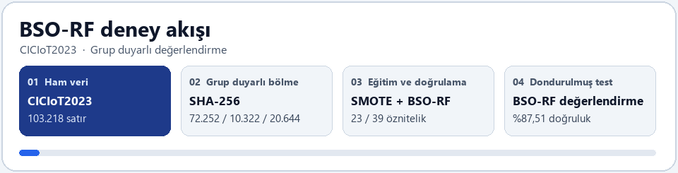

### Eğitimden değerlendirmeye

| Aşama | Veri ve işlem | Kod veya kayıt |
|---|---|---|
| Ham örneklem | CICIoT2023, 103.218 satır, 39 akış özniteliği | [Öznitelik şeması](reproducibility/schema.json) |
| Bölümleme | SHA-256 ile özdeş satırları aynı grupta tutma. Eğitim 72.252, doğrulama 10.322, test 20.644. Bölümler arası tam satır örtüşmesi sıfır | [Bölümleme denetimi](reproducibility/group_split.json) |
| Ön işleme | Medyan atama, sabit sütun taraması ve ölçekleme eğitim verisine uydurulur. SMOTE yalnızca eğitimde uygulanır | [Deney kodu](reproducibility/scripts/run_sealed.py) |
| Model seçimi | 25 aday ve 50 iterasyon. Eğitim ve doğrulama verisiyle öznitelik maskesi ve RF ayarları seçilir | [BSO araması](reproducibility/scripts/corrected_optimizer.py) · [Arama çıktısı](reproducibility/optimizer_result.json) |
| Dondurma | 23 öznitelik, 237 ağaç, azami derinlik 28, minimum bölme 8, max_features 0.50812 | [Model kaydı](reproducibility/model_metadata.json) |
| Değerlendirme | BSO-RF ve aynı ayarları kullanan RF-All39, aynı saklı test bölümünde karşılaştırılır | [Metrikler](reproducibility/predictive_comparison.csv) · [Karışıklık matrisi](reproducibility/confusion_matrix.csv) |

Çevrimiçi çıkarımda akış öznitelikleri, saklanan ön işlemeden ve 23 öznitelikli seçimden geçerek dondurulmuş RF modeline girer. BSO araması çevrimdışı model seçiminin parçasıdır. [Sistem mimarisi](docs/thesis-figures/sekil-12.png)

<strong>Çevrimiçi çıkarım ve dondurulmuş test karşılaştırması</strong>

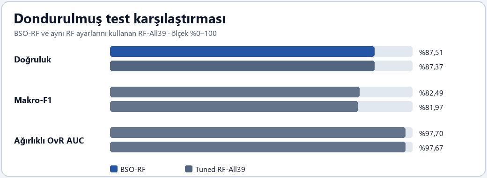

## Tezin bilimsel içeriği

Bölümler, doğrulanmış tez sürümündeki sırayı izler. Aşağıdaki başlıklara tıklayarak metni, tabloları ve şekilleri doğrudan GitHub sayfasında açabilirsiniz.

<strong>ÖZET</strong>

Bu tez, dinamik ağ ortamlarında DDoS ve ilişkili IoT saldırılarının çok sınıflı tespitinde, giriş boyutunu azaltırken güvenilir bir Random Forest çalışma noktası elde etmeyi incelemektedir. Bu amaçla Yarasa Sürüsü Optimizasyonu (BSO), öznitelik maskesi ile RF hiperparametrelerini aynı arama sürecinde optimize edecek biçimde kullanılmıştır. Deney düzeni, performansın veri sızıntısıyla yapay olarak yükselmesini önlemek için bölme-önce (split-first) yaklaşımı, grup-duyarlı veri ayrımı ve yalnızca eğitim verisinde öğrenilen ön işleme adımları üzerine kurulmuştur.

Değerlendirme, CICIoT2023'ten oluşturulan 103.218 örnekli, 39 sayısal öznitelikli ve beş sınıflı kontrollü görev üzerinde gerçekleştirilmiştir. Bölmeden önce özdeş 39-boyutlu sayısal satırlara SHA-256 grup kimliği atanmış ve aynı gruptaki kayıtların farklı bölmelere geçmesine izin verilmemiştir. Eğitim, doğrulama ve test kümeleri sırasıyla 72.252, 10.322 ve 20.644 örnekten oluşmuştur. BSO 39 özniteliğin 23'ünü koruyarak giriş boyutunu %41,03 azaltmış; RF için n_estimators=237, max_depth=28, min_samples_split=8 ve max_features=0,50812 yapılandırmasını seçmiştir.

Dondurulmuş test kümesinde BSO-Hybrid RF; %87,51 doğruluk, %82,49 F1-Makro, %87,59 ağırlıklı F1, 0,8382 MCC ve %97,70 ağırlıklı OvR AUC-ROC elde etmiştir. Aynı RF hiperparametreleriyle tüm 39 özniteliği kullanan modele karşı eşleştirilmiş bootstrap farkı F1-Makro için +0,521 yüzde puandır (%95 GA: +0,137–+0,958). On bağımsız doğrulama kümesi BSO koşusu ayrıca dokuz öznitelikten oluşan yüksek kararlılıklı bir çekirdek ortaya koymuştur. Bulgular, yöntemin her sınıflandırıcıya üstün olduğu iddiasından çok, sızıntı kontrolü yapılmış, daha kompakt ve denetlenebilir bir RF çalışma noktası sunduğunu desteklemektedir. Beş katlı grup-duyarlı sabit-yapılandırma doğrulaması, doğruluk için %87,59 ± %0,17 ve F1-Makro için %82,38 ± %0,29 üretmiştir. Ana model dondurulduktan sonra yürütülen kontrollü öznitelik bozulması ve bırak-bir-saldırı-dışarı stres testleri ise dayanıklılığın saldırı ailesine ve dağılım kaymasına duyarlı olduğunu göstermiştir.

Anahtar Kelimeler: DDoS Saldırı Tespiti; Nesnelerin İnterneti (IoT); Yarasa Sürüsü Optimizasyonu (BSO); Random Forest; Grup-Duyarlı Bölme; Veri Sızıntısı; Öznitelik Seçimi; Makine Öğrenmesi; CICIoT2023; Siber Güvenlik.

<strong>ABSTRACT</strong>

This thesis investigates whether Bat Swarm Optimization (BSO) can produce a compact and defensible Random Forest (RF) operating point for multiclass DDoS and related IoT intrusion detection. BSO jointly searches the feature mask and RF hyperparameters. To limit optimistic bias from information leakage, the evaluation follows a split-first design with group-aware partitioning and preprocessing fitted only on the training data.

Experiments use a controlled five-class CICIoT2023 task with 103,218 samples and 39 numeric traffic features. Identical 39-dimensional numeric rows receive SHA-256 group identifiers before any learned preprocessing, and each group is confined to a single partition. The train, validation, and test sets contain 72,252, 10,322, and 20,644 samples, respectively. BSO retains 23 features (41.03% reduction) and selects an RF configuration with n_estimators=237, max_depth=28, min_samples_split=8, and max_features=0.50812.

On the frozen test set, BSO-Hybrid RF obtains 87.51% accuracy, 82.49% macro-F1, 87.59% weighted F1, MCC=0.8382, and 97.70% weighted one-vs-rest ROC-AUC. Against an identically tuned RF using all 39 features, the paired bootstrap macro-F1 difference is +0.521 percentage points in favor of BSO-RF (95% CI: +0.137 to +0.958). Ten validation-only BSO seeds reveal a nine-feature high-stability core. The result is therefore interpreted as a leakage-controlled, feature-compact, and auditable RF operating point rather than evidence of universal classifier superiority. A post-hoc five-fold group-aware fixed-configuration evaluation yielded 87.59 ± 0.17% accuracy and 82.38 ± 0.29% macro-F1. Controlled feature-corruption and leave-one-attack-out stress tests further showed class- and shift-dependent failure modes.

Keywords: DDoS Attack Detection; Internet of Things (IoT); Bat Swarm Optimization (BSO); Random Forest; Group-Aware Split; Data Leakage; Feature Selection; CICIoT2023; Cybersecurity.

<strong>SİMGELER DİZİNİ</strong>

**Simgeler**

| Simge | Anlam | Açıklama |
| --- | --- | --- |
| fᵢ | Frekans | i. yarasanın ekolokasyon frekansı (f_min=0.0, f_max=2.0) |
| vᵢ(t) | Hız | i. yarasanın t anındaki hız vektörü |
| xᵢ(t) | Pozisyon | i. yarasanın t anındaki pozisyon vektörü (çözüm temsili) |
| x* | En İyi Çözüm | Tüm yarasalar arasındaki en iyi global pozisyon |
| Aᵢ(t) | Gürültü Seviyesi | i. yarasanın t anındaki gürültü seviyesi (A₀=0.95, α=0.9 ile azalır) |
| rᵢ(t) | Darbe Oranı | i. yarasanın t anındaki darbe oranı (r₀=0.5, γ=0.9 ile artar) |
| α | Soğutma Katsayısı | Gürültü azaltma oranı (α=0.9) |
| γ | Darbe Artış Katsayısı | Darbe oranı artış hızı (γ=0.9) |
| β | Rastgele Sayı | [0,1] aralığında düzgün dağılımlı rastgele sayı |
| F(x) | Fitness Fonksiyonu | Çözüm kalitesini ölçen amaç fonksiyonu — minimize edilir |
| S(·) | Sigmoid Fonksiyonu | Sürekli değeri [0,1] aralığına dönüştüren transfer fonksiyonu |
| λ | Ağırlık Katsayısı | Fitness fonksiyonunda öznitelik azaltma ağırlığı (λ=0.01) |
| TP | Doğru Pozitif | Pozitif olarak doğru tahmin edilen örnek sayısı |
| TN | Doğru Negatif | Negatif olarak doğru tahmin edilen örnek sayısı |
| FP | Yanlış Pozitif | Yanlış alarm — negatif örneğin pozitif tahmin edilmesi |
| FN | Yanlış Negatif | Kaçırılmış tespit — pozitif örneğin negatif tahmin edilmesi |
| F1 | F1-Skoru | Precision ve Recall'un harmonik ortalaması |
| F1-Macro | F1-Makro | Her sınıfın F1-skorunun eşit ağırlıklı ortalaması |
| Gini(D) | Gini Safsızlık | Düğümdeki sınıf safsızlığını ölçen metrik — 0=saf, 0.5=tam karışık |
| B | Ağaç Sayısı | Random Forest'taki toplam ağaç sayısı (B=237, BSO ile optimize) |
| m_try | Alt Küme Boyutu | Her bölünmede değerlendirilebilen öznitelik oranı; nihai max_features=0,50812 |
| p-value | p-değeri | Sıfır hipotezi altında gözlenen sonucun olasılığı — p&lt;0.05 = anlamlı |
| H₀ | Sıfır Hipotezi | İki model arasında fark olmadığını varsayan hipotez |
| H₁ | Alternatif Hipotez | İki model arasında anlamlı fark olduğunu öne süren hipotez |
| μ | Ortalama | Aritmetik ortalama — StandardScaler'da öznitelik ortalaması |
| σ | Standart Sapma | Verilerin ortalamadan sapma ölçüsü — StandardScaler'da kullanılır |

<strong>KISALTMALAR DİZİNİ</strong>

**Kısaltmalar**

| Kısaltma | Türkçe Karşılık | İngilizce Karşılık |
| --- | --- | --- |
| DDoS | Dağıtık Hizmet Engelleme | Distributed Denial of Service |
| IoT | Nesnelerin İnterneti | Internet of Things |
| BSO | Yarasa Sürüsü Optimizasyonu | Bat Swarm Optimization |
| RF | Rastgele Orman | Random Forest |
| BSO-RF | BSO-Hibrit Rastgele Orman | BSO-Hybrid Random Forest |
| ML | Makine Öğrenmesi | Machine Learning |
| IDS | Saldırı Tespit Sistemi | Intrusion Detection System |
| SMOTE | Sentetik Azınlık Aşırı Örnekleme | Synthetic Minority Over-sampling Technique |
| SVM | Destek Vektör Makinesi | Support Vector Machine |
| KNN | K-En Yakın Komşu | K-Nearest Neighbors |
| DT | Karar Ağacı | Decision Tree |
| NB | Naif Bayes | Naive Bayes |
| LR | Lojistik Regresyon | Logistic Regression |
| XGBoost | Aşırı Gradyan Artırma | Extreme Gradient Boosting |
| PSO | Parçacık Sürüsü Optimizasyonu | Particle Swarm Optimization |
| GA | Genetik Algoritma | Genetic Algorithm |
| GWO | Gri Kurt Optimizasyonu | Grey Wolf Optimizer |
| AUC-ROC | ROC Eğrisi Altındaki Alan | Area Under ROC Curve |
| MCC | Matthews Korelasyon Katsayısı | Matthews Correlation Coefficient |
| CV | Çapraz Doğrulama | Cross-Validation |
| OOB | Torba Dışı | Out-of-Bag |
| PCA | Temel Bileşen Analizi | Principal Component Analysis |
| CICIoT2023 | CIC IoT 2023 Veri Seti | Canadian Institute for Cybersecurity IoT 2023 |
| TCP | İletim Kontrol Protokolü | Transmission Control Protocol |
| UDP | Kullanıcı Veri Protokolü | User Datagram Protocol |
| SYN | Senkronizasyon | Synchronize |
| ACK | Doğrulama | Acknowledgement |
| SHA-256 | Güvenli Özet Algoritması 256-bit | Secure Hash Algorithm 256-bit |
| SHAP | Shapley Katkı Açıklamaları | SHapley Additive exPlanations |
| ECE | Beklenen Kalibrasyon Hatası | Expected Calibration Error |
| RSS | Yerleşik Bellek Boyutu | Resident Set Size |
| OvR | Bire-Karşı-Diğer | One-vs-Rest |

<strong>1. GİRİŞ</strong>

Dijital dönüşümün hızlanmasıyla birlikte, ağ tabanlı sistemlerin ölçeği ve karmaşıklığı önemli ölçüde artmıştır. Bu dönüşümün merkezinde yer alan nesnelerin interneti (IoT) teknolojileri, çok sayıda heterojen cihazın birbirleriyle sürekli veri alışverişinde bulunduğu dinamik ağ ortamlarının oluşmasına neden olmuştur (Cisco Systems, 2023). IoT tabanlı sistemler; akıllı şehirler, endüstriyel otomasyon, sağlık sistemleri ve kritik altyapılar gibi alanlarda yaygın biçimde kullanılmakta ve bu alanların sürekliliği büyük ölçüde ağ güvenliğine bağlı hâle gelmektedir (Sivanathan vd., 2019). Ancak bu hızlı yaygınlaşma, aynı zamanda saldırı yüzeyinin genişlemesine ve yeni nesil siber tehditlerin ortaya çıkmasına zemin hazırlamaktadır (Kolias vd., 2017).

IoT ağlarının en belirgin özelliklerinden biri, yapısal olarak dinamik olmalarıdır. Ağ trafiği, cihaz davranışları ve veri akışları zaman içinde sürekli değişmekte; bu durum sabit varsayımlara dayalı güvenlik yaklaşımlarının etkinliğini sınırlamaktadır (Yan vd., 2016). Dinamik ağ ortamlarında saldırı örüntüleri de durağan değildir; aksine sürekli evrilmekte ve klasik tespit yöntemlerinin öngöremediği yeni varyasyonlar ortaya çıkmaktadır (Agrawal &amp; Tapaswi, 2019). Bu değişkenlik, modern ağ güvenliği yaklaşımlarının yüksek doğruluğun yanında değişen koşullara uyum sağlayabilmesini de gerektirir.

DDoS saldırıları, IoT ekosisteminde hizmet sürekliliğini doğrudan hedefleyen başlıca tehditlerden biridir. Çok sayıda kaynaktan eş zamanlı trafik üretilmesi, hedef sistemin bant genişliği ve işlem kaynaklarını tüketerek hizmeti kullanılamaz hâle getirebilir (Zargar vd., 2013). IoT cihazlarının botnetlere dâhil edilmesi bu etkinin ölçeğini büyütmüş; Mirai örneği, zayıf yapılandırılmış cihazların geniş hacimli saldırılarda nasıl kullanılabildiğini göstermiştir (Kolias vd., 2017; Meidan vd., 2018). Bu tablo, IoT ortamlarındaki tespit mekanizmalarının değişen trafik örüntülerini öğrenmesini ve yalnızca önceden tanımlı imzalara bağlı kalmamasını gerekli kılmaktadır.

Makine öğrenmesi (ML) tabanlı yöntemler, ağ trafiği içinde yer alan karmaşık ilişkileri öğrenebilme kapasitesi sayesinde saldırı tespitinde güçlü bir alternatif sunmaktadır (Bishop, 2006). Özellikle Random Forest gibi topluluk tabanlı algoritmalar, yüksek doğruluk oranı ve genelleme kabiliyeti nedeniyle yaygın biçimde kullanılmaktadır (Breiman, 2001). Bununla birlikte, ağ trafiği verilerinin yüksek boyutlu olması ve özniteliklerin her birinin modele farklı düzeylerde katkı sağlaması, model performansını doğrudan etkilemektedir (Guyon &amp; Elisseeff, 2003). Gereksiz veya tekrarlı özniteliklerin modele dâhil edilmesi, hem hesaplama maliyetini artırmakta hem de aşırı öğrenmeye neden olabilmektedir (Moustafa &amp; Slay, 2015).

Bu koşullarda öznitelik seçimi yalnızca veri hazırlama adımı olarak değil, modelin karmaşıklığını ve genelleme davranışını doğrudan etkileyen bir tasarım kararı olarak ele alınmalıdır (Chandrashekar &amp; Sahin, 2014). Geniş arama uzaylarında klasik ardışık seçim yöntemleri maliyetli olabildiğinden, meta-sezgisel optimizasyon yöntemleri alternatif bir arama mekanizması sunmaktadır (Xue vd., 2016). Yarasa Sürüsü Optimizasyonu (Bat Swarm Optimization - BSO), frekans, ses yüksekliği ve darbe oranı üzerinden keşif ile yerel arama arasında geçiş kuran bu yöntemlerden biridir (Yang, 2010). Yarasa algoritmasının ikili ve uyarlanmış sürümleri daha önce öznitelik seçimi problemlerinde de kullanılmıştır (Nakamura vd., 2012; Gandomi vd., 2013).

Literatürde öznitelik seçimi ile sınıflandırıcı hiperparametrelerinin çoğu kez ayrı aşamalarda ayarlandığı görülmektedir (Khammassi &amp; Krichen, 2017). Bu ayrım uygulamada yararlı olsa da, seçilen öznitelik alt kümesi ile model ayarları arasındaki etkileşimlerin ortak bir arama uzayında değerlendirilmesini engelleyebilir (Xue vd., 2016). Ayrıca çalışmaların önemli bir bölümü ikili sınıflandırmaya odaklandığı için saldırı türleri arasındaki güçlük farkları tek bir performans değerinin arkasında kalabilmektedir (Aamir vd., 2021). Çok sınıflı değerlendirme bu nedenle yalnızca toplam doğruluğu değil, sınıf bazlı hata yapısını da incelemeyi gerektirir.

Sınıf dağılımındaki dengesizlik de IoT saldırı tespitinde ayrı bir yöntemsel sorundur. Normal trafik veya bazı saldırı türleri veri kümesinde baskın olduğunda, öğrenme algoritması daha az temsil edilen sınıflar için zayıf karar sınırları oluşturabilir (He &amp; Garcia, 2009; Koroniotis vd., 2019). Sentetik örnekleme gibi dengeleme yöntemleri bu sorunu azaltabilir; ancak değerlendirme bilgisinin eğitime sızmaması için yalnızca eğitim bölümü üzerinde uygulanmaları gerekir (Chawla vd., 2002).

Deneysel geçerlilik, kullanılan veri setinin güncelliği ve hedeflenen ağ ortamını ne ölçüde temsil ettiğiyle de ilişkilidir. Klasik IDS veri setleri karşılaştırma için değerli olmakla birlikte güncel IoT trafiğinin cihaz ve protokol çeşitliliğini sınırlı biçimde yansıtır (Sharafaldin vd., 2018). CICIoT2023, gerçek IoT cihazlarından üretilen trafik ve geniş saldırı taksonomisi nedeniyle bu çalışma için uygun bir başlangıç noktası sağlamaktadır (Neto vd., 2023).

Bu çalışma söz konusu sorunları tek bir deneysel akış içinde ele almaktadır. BSO, 39 bitlik öznitelik maskesi ile dört RF hiperparametresini birlikte ararken veri bölme, ön işleme ve model seçimi test bilgisinden ayrı tutulmuştur. Değerlendirmenin amacı en yüksek doğruluk değerini tek başına öne çıkarmak değil; çok sınıflı IoT saldırı tespitinde sınıflandırma başarımı, giriş boyutu ve deneysel güvenilirlik arasındaki dengeyi ölçülebilir biçimde incelemektir.

IoT ağ mimarisinin çok katmanlı yapısı ve saldırı vektörleri Şekil 1’de gösterilmektedir.

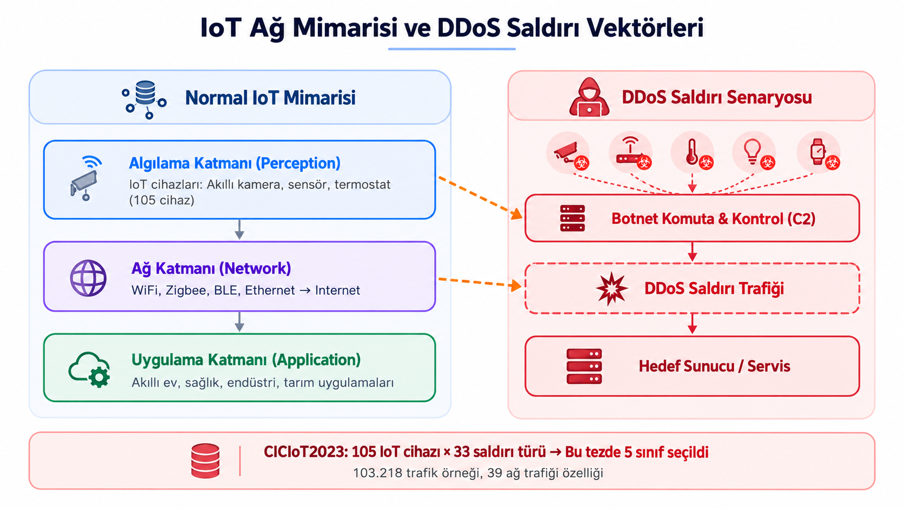

*Şekil 1. IoT ağ mimarisi ve DDoS saldırı vektörleri*

Kaynak: Araştırmacı tarafından oluşturulmuştur.

DDoS saldırılarının temel sınıflandırması ve bu tezde kullanılan seçili CICIoT2023 sınıfları Şekil 2’de özetlenmektedir.

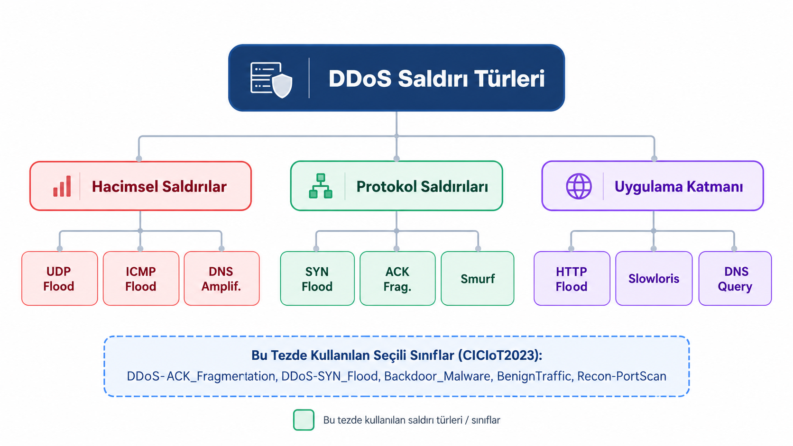

*Şekil 2. DDoS saldırı türlerinin sınıflandırılması ve bu tezde kullanılan seçili sınıflar*

Kaynak: Araştırmacı tarafından oluşturulmuştur.

Literatür birlikte okunduğunda DDoS tespitinde belirgin bir ilerleme olduğu, ancak yöntemsel sorunların tamamen çözülmediği görülmektedir (Zargar vd., 2013; Agrawal &amp; Tapaswi, 2019). Yüksek boyutlu trafik verisi, sınıf dengesizliği, birbirinden bağımsız yürütülen optimizasyon adımları, değişken ağ koşulları ve hesaplama maliyeti en sık karşılaşılan başlıklardır (He &amp; Garcia, 2009; Xue vd., 2016). Bu çalışmanın odaklandığı araştırma problemleri Tablo 1'de toplu olarak verilmiştir.

**Tablo 1. DDoS saldırı tespitinde temel araştırma problemleri**

| No | Araştırma problemi | Literatürde yaygın yaklaşım | Bu tezde benimsenen yaklaşım |
| --- | --- | --- | --- |
| 1 | Yüksek boyutlu ağ verisi | Filtre tabanlı veya ardışık seçim | Meta-sezgisel tabanlı öznitelik seçimi |
| 2 | Ayrı optimizasyon süreçleri | Hiperparametre ve öznitelik seçiminin ayrı yürütülmesi | Eş zamanlı optimizasyon yaklaşımı |
| 3 | Sınıf dengesizliği | Alt örnekleme veya sınırlı yeniden örnekleme | Dengeleyici örnekleme stratejisi |
| 4 | İkili sınıflandırma eğilimi | Normal/saldırı ayrımı | Çok sınıflı değerlendirme |
| 5 | Güncelliğini yitirmiş veri setleri | Eski nesil IDS veri setleri | Güncel IoT veri seti kullanımı |

Bu çerçevede temel araştırma problemi, yüksek boyutlu ve dengesiz IoT trafik verisinde öznitelik seçimi ile sınıflandırıcı ayarlarını birlikte ele alırken değerlendirme sürecini veri sızıntısından koruyabilen bir DDoS tespit düzeni kurmaktır (Guyon &amp; Elisseeff, 2003; He &amp; Garcia, 2009; Yan vd., 2016). Önceki çalışmaların bu bileşenleri çoğu zaman ayrı değerlendirmesi, öznitelik alt kümesi ile model ayarları arasındaki etkileşimin sınırlı incelenmesine yol açabilmektedir (Khammassi &amp; Krichen, 2017; Xue vd., 2016). Bu tezde meta-sezgisel arama, bu ortak tasarım uzayını sistematik biçimde sınamak için kullanılmaktadır (Yang, 2010; Yang, 2013).

Araştırmanın amacı, IoT ortamlarında DDoS ve ilişkili saldırıların çok sınıflı tespiti için BSO ile optimize edilen bir Random Forest çerçevesi geliştirmek ve bu çerçeveyi kontrollü bir değerlendirme protokolü altında incelemektir (Yang, 2010; Breiman, 2001). Çalışmada öznitelik sayısının azaltılması, sınıf dengesizliğinin yalnızca eğitim verisinde ele alınması, RF ayarlarının ortak arama içinde belirlenmesi ve sonuçların sınıf bazlı ölçütlerle desteklenmesi hedeflenmiştir (Chawla vd., 2002; Guyon &amp; Elisseeff, 2003; Neto vd., 2023). İstatistiksel belirsizlik ve arama kararlılığı analizleri de model karşılaştırmasının ayrılmaz bir parçası olarak tasarlanmıştır (Demšar, 2006; Chicco &amp; Jurman, 2020).

Bu kapsamda üç araştırma sorusu incelenmektedir: BSO, öznitelik seçimi ile RF ayarını ortak aramada kullanarak ne ölçüde kompakt ve etkili bir çalışma noktası belirlemektedir? Dondurulmuş test kümesinde sınıf bazlı hatalar özellikle Backdoor_Malware, BenignTraffic ve Recon-PortScan için nasıl dağılmaktadır? Grup-duyarlı değerlendirmede gözlenen farklar, bootstrap belirsizliği, BSO tohum kararlılığı ve eşit bütçeli optimizatör karşılaştırmaları ışığında nasıl yorumlanmalıdır? Bu soruların deneysel karşılıkları Bölüm 3'te AS₁–AS₃ olarak tanımlanmıştır.

Çalışmanın özgün katkısı BSO veya RF'yi yeni algoritmalar olarak sunmak değildir. Katkı; öznitelik maskesi ile RF hiperparametrelerini ortak bir arama uzayında değerlendirirken, grup-duyarlı veri ayrımı, dondurulmuş test kümesi, çok sınıflı hata analizi ve arama kararlılığını aynı deney düzeninde birleştirmesidir (Yang, 2010; Xue vd., 2016). CICIoT2023 üzerinde kurulan bu düzen, yöntemin hangi koşullarda yarar sağladığını ve hangi noktalarda sınırlı kaldığını açık biçimde göstermeyi amaçlamaktadır (Neto vd., 2023; Ferrag vd., 2023).

Tez beş ana bölümden oluşmaktadır. Birinci bölümde araştırmanın arka planı, problem tanımı, amaçları, araştırma soruları ve katkı sınırları açıklanmıştır. İkinci bölüm DDoS saldırıları, IoT güvenliği, makine öğrenmesi tabanlı tespit, öznitelik seçimi ve meta-sezgisel optimizasyon literatürünü karşılaştırmalı olarak ele almaktadır. Üçüncü bölümde veri seti, sızıntı kontrollü bölme stratejisi, ön işleme, BSO-RF yapısı ve değerlendirme ölçütleri tanımlanmıştır. Dördüncü bölüm deneysel sonuçları ve bu sonuçların sınırlarını tartışmakta; beşinci bölüm ise sonuçları, sınırlılıkları ve gelecek çalışma yönlerini bir araya getirmektedir.

<strong>2. LİTERATÜR TARAMASI</strong>

Literatür taraması, IoT ortamlarında DDoS tespitini yalnızca yöntem adları ve raporlanan skorlar üzerinden değil, deney tasarımı ve doğrulama koşulları üzerinden de ele almaktadır. DDoS saldırıları ve IDS yaklaşımlarından başlayarak makine öğrenmesi, meta-sezgisel optimizasyon, öznitelik seçimi, sınıf dengesizliği ve güncel IoT veri setleri birlikte incelenmiş; böylece BSO-Hybrid RF yaklaşımının hangi sınırlılıklara yanıt vermeyi amaçladığı açıklaştırılmıştır.

Bu tez, IoT ağ akışlarının beş sınıflı tespiti için kompakt bir model çalışma noktasını veri seti tabanlı deneylerle değerlendirmektedir. BSO araması model geliştirme aşamasında yürütülür; tahmin aşaması yalnızca dondurulmuş ön işleme, seçilen öznitelikler ve RF modelinden oluşur. Raporlanan host düzeyindeki çıkarım ölçümleri, dondurulmuş modelin hesaplama profilini nicel olarak göstermektedir.

Özgünlük iddiası BSO'nun ya da Random Forest'ın yeni bir algoritma olmasına dayanmamaktadır. Katkı; BSO tabanlı öznitelik seçimi ile RF hiperparametre ayarının tek bir uygunluk fonksiyonunda birleştirilmesi, bu aramanın güncel bir IoT-DDoS görevi üzerinde çok sınıflı olarak sınanması ve sonuçların sızıntı kontrolü, kararlılık ve belirsizlik analizleriyle birlikte raporlanmasıdır.

### 2.1. Dağıtık Hizmet Engelleme saldırıları

Dağıtık Hizmet Engelleme (Distributed Denial of Service - DDoS) saldırıları, hedef sistemlerin işlem, bellek, bağlantı veya bant genişliği kaynaklarını tüketerek hizmet sürekliliğini bozmayı amaçlayan yaygın siber saldırı türlerinden biridir. Bu saldırılarda çok sayıda kaynak veya ele geçirilmiş cihaz, hedefe yoğun trafik yönlendirerek sistemin meşru kullanıcılara hizmet vermesini engellemektedir. Zargar, Joshi ve Tipper (2013), DDoS saldırılarının zaman içinde daha büyük ölçekli, daha dağıtık ve daha karmaşık hale geldiğini belirtmektedir.

DDoS saldırıları çoğunlukla hacimsel saldırılar, protokol tabanlı saldırılar ve uygulama katmanı saldırıları olarak sınıflandırılmaktadır. Hacimsel saldırılar hedefin bant genişliğini tüketmeye odaklanırken, protokol tabanlı saldırılar TCP/IP protokollerinin zayıf yönlerinden yararlanır. Uygulama katmanı saldırıları ise belirli servislerin veya uygulama işlevlerinin yoğun isteklerle tüketilmesini hedefler. IoT ortamlarında bu ayrım daha da önemlidir; çünkü düşük kaynaklı cihazlar, zayıf güvenlik yapılandırmaları ve heterojen trafik yapısı saldırı yüzeyini genişletmektedir.

IoT bağlamında DDoS saldırılarının önemi, özellikle botnet tabanlı saldırılarla artmıştır. Kolias vd. (2017), Mirai botnet örneği üzerinden güvenlik yapılandırması zayıf IoT cihazlarının büyük ölçekli saldırı ağlarına dönüştürülebileceğini göstermiştir. Meidan vd. (2018) ise IoT botnet saldırılarının ağ tabanlı davranış örüntüleri üzerinden tespit edilebileceğini vurgulamıştır. Bu çalışmalar, IoT-DDoS tespitinde yalnızca saldırı varlığının değil, saldırı türleri arasındaki ayrımın da önemli olduğunu göstermektedir.

Mevcut literatür yüksek doğruluk elde etmeye odaklansa da, IoT-DDoS tespitinde üç temel sorun önemini korumaktadır. İlk olarak, ağ trafiği verileri yüksek boyutlu ve artıklı öznitelikler içerebilmektedir. İkinci olarak, azınlık saldırı sınıfları yeterince temsil edilmediğinde model çoğunluk sınıflarına eğilim gösterebilmektedir. Üçüncü olarak, değişen trafik örüntüleri tespit sistemlerinin genellenebilirliğini zorlaştırmaktadır. Bu tez, BSO destekli öznitelik seçimi ve RF sınıflandırmasını kontrollü grup-duyarlı değerlendirme ve giriş bozulması stresleriyle incelemektedir.

**Tablo 2. DDoS saldırı türleri ve IoT ortamlarındaki etkileri**

| Saldırı türü | Temel amaç | IoT bağlamındaki risk | Bu tezle ilişkisi |
| --- | --- | --- | --- |
| Hacimsel saldırılar | Bant genişliğini tüketmek | IoT botnetleri ile çok yüksek trafik üretimi | DDoS-SYN_Flood ve ACK tabanlı sınıflar üzerinden değerlendirilmiştir |
| Protokol tabanlı saldırılar | TCP/IP protokol durumlarını kötüye kullanmak | Sınırlı kaynaklı cihazlarda bağlantı tablolarının tüketilmesi | SYN, ACK ve fragmentasyon özellikleri ile ilişkilidir |
| Uygulama katmanı saldırıları | Uygulama servislerini aşırı istekle tüketmek | Normal istek benzeri davranış nedeniyle ayırt edilmesi zorlaşır | BenignTraffic ve Recon-PortScan ayrımı açısından bağlamsal önem taşır |
| Botnet tabanlı saldırılar | Ele geçirilmiş çok sayıda cihazı koordine etmek | IoT cihazlarının zayıf güvenlik ayarları saldırı ölçeğini artırır | Çok sınıflı IoT-DDoS tespiti motivasyonunu güçlendirir |

Kaynak: Araştırmacı tarafından oluşturulmuştur.

### 2.2. Ağ saldırı tespit sistemleri

Saldırı Tespit Sistemleri (Intrusion Detection Systems - IDS), ağ trafiği veya sistem davranışlarını izleyerek şüpheli etkinlikleri tespit etmeyi amaçlayan güvenlik bileşenleridir. IDS yaklaşımları genel olarak imza tabanlı ve anomali tabanlı yöntemler olarak ele alınmaktadır. İmza tabanlı sistemler bilinen saldırı kalıplarını tanımada etkili olmakla birlikte, sıfırıncı gün saldırılarına ve yeni varyantlara karşı sınırlı kalabilmektedir. Anomali tabanlı sistemler ise normal davranışı modelleyerek sapmaları belirlemeye çalışır; ancak yanlış pozitif oranı bu sistemlerde önemli bir sorun olabilmektedir.

IoT ağlarında IDS tasarımı geleneksel ağlara kıyasla daha karmaşıktır. Cihazların sınırlı hesaplama kapasitesi, heterojen protokoller, değişken trafik hacmi ve botnet tabanlı saldırılar, klasik IDS yaklaşımlarının etkinliğini sınırlamaktadır. Yan vd. (2016), SDN ve dinamik ağ ortamlarında DDoS tespitinin daha esnek ve uyarlanabilir yaklaşımlar gerektirdiğini belirtmiştir. Agrawal ve Tapaswi (2019) ise DDoS savunma mekanizmalarının değişen saldırı örüntülerine karşı güçlendirilmesi gerektiğini vurgulamıştır.

Önerilen yapı, tam kapsamlı bir IDS ürünü değil, IoT ağ akışlarını beş sınıfta ayıran bir makine öğrenmesi bileşenidir. Geliştirme aşamasındaki BSO aramasından sonra tahmin için dondurulmuş dönüşümler ve RF kullanılır. Tezde ölçülen host düzeyindeki çıkarım profili bu bileşenin hesaplama maliyetini gösterir.

**Tablo 3. IDS yaklaşımlarının karşılaştırılması ve bu çalışmadaki kapsam**

| IDS yaklaşımı | Güçlü yön | Sınırlılık | Bu tezdeki konum |
| --- | --- | --- | --- |
| İmza tabanlı IDS | Bilinen saldırılarda düşük yanlış pozitif oranı | Yeni ve bilinmeyen saldırılarda yetersiz kalabilir | Bu tez doğrudan imza tabanlı bir sistem önermemektedir |
| Anomali tabanlı IDS | Yeni davranış sapmalarını yakalayabilir | Yanlış pozitif oranı artabilir | ML tabanlı sınıflandırma mantığı bu yaklaşımla ilişkilidir |
| ML tabanlı trafik sınıflandırma | Karmaşık örüntüleri veriden öğrenebilir | Veri kalitesi, sınıf dengesi ve öznitelik seçimine duyarlıdır | Bu tezin temel deneysel çerçevesini oluşturur |
| Gerçek zamanlı IDS mimarisi | Ağ üzerinde doğrudan çevrimiçi izleme sağlar | Dağıtım, gecikme ve kaynak maliyeti gerektirir | Bu tezde yalnızca dondurulmuş modelin host düzeyindeki çıkarım maliyeti ölçülmüştür |

Kaynak: Araştırmacı tarafından oluşturulmuştur.

### 2.3. Makine öğrenmesi tabanlı DDoS tespiti

Makine öğrenmesi yöntemleri, ağ trafiğinde yer alan doğrusal olmayan ilişkileri ve karmaşık davranış örüntülerini öğrenebilme kapasitesi nedeniyle saldırı tespitinde yaygın olarak kullanılmaktadır. Bu yöntemler, özellikle geleneksel imza tabanlı sistemlerin yetersiz kaldığı yeni veya değişken saldırı biçimlerinde önemli avantajlar sunmaktadır. Ancak makine öğrenmesi tabanlı modellerin başarısı; veri kalitesi, sınıf dağılımı, öznitelik seçimi ve hiperparametre ayarlarına güçlü biçimde bağlıdır.

Random Forest, yüksek boyutlu ve doğrusal olmayan veri kümelerinde güçlü genelleme kabiliyeti sunması nedeniyle IDS çalışmalarında sık kullanılan bir sınıflandırıcıdır (Breiman, 2001). Çok sayıda karar ağacının birleşimine dayalı yapısı, aşırı öğrenmeye karşı görece dayanıklı olmasını sağlamaktadır. Bununla birlikte tüm özniteliklerin doğrudan modele verilmesi, özellikle ağ trafiği gibi artıklı ve ilişkili değişkenler içeren veri setlerinde hesaplama maliyetini artırabilmektedir. Bu nedenle bu tezde Random Forest'ın sınıflandırma kapasitesi, öznitelik uzayını kontrollü biçimde daraltan bir seçim süreciyle birlikte ele alınmıştır.

Support Vector Machine, yüksek boyutlu veri uzaylarında güçlü sınıflandırma sınırları oluşturabilmesine rağmen büyük ölçekli veri setlerinde eğitim süresi ve parametre duyarlılığı açısından sınırlılıklar taşımaktadır. K-Nearest Neighbors basit ve yorumlanabilir bir yöntemdir; ancak tahmin aşamasında mesafe hesaplamasına dayandığı için büyük veri setlerinde maliyetli olabilmektedir. Naive Bayes hızlı çalışmasına rağmen öznitelikler arası bağımsızlık varsayımı nedeniyle karmaşık ağ trafiği örüntülerinde sınırlı kalabilmektedir.

XGBoost ve LightGBM gibi gradyan artırma tabanlı yöntemler, yapılandırılmış veri setlerinde yüksek performans gösterebilen güçlü topluluk öğrenmesi yaklaşımlarıdır (Chen ve Guestrin, 2016; Ke vd., 2017). Ancak bu yöntemlerin yüksek performansı çoğu zaman tüm özniteliklerin kullanımı, dikkatli parametre ayarı ve daha yüksek model karmaşıklığı ile ilişkilidir. Bu tezde XGBoost güçlü bir temel karşılaştırma modeli olarak değerlendirilmekte; önerilen BSO-Hybrid RF modelinin katkısı ise mutlak en yüksek doğruluğu elde etmekten ziyade, daha düşük öznitelik sayısı ile rekabetçi performans ve daha uygun hesaplama maliyeti sunması üzerinden konumlandırılmaktadır.

**Tablo 4. Makine öğrenmesi algoritmalarının IoT-DDoS tespiti açısından değerlendirilmesi**

| Algoritma | IDS bağlamındaki güçlü yön | Temel sınırlılık | Bu tezdeki rol |
| --- | --- | --- | --- |
| Random Forest | Doğrusal olmayan örüntülerde güçlü ve kararlı performans | Tüm öznitelikler kullanıldığında gereksiz karmaşıklık oluşabilir | Önerilen hibrit çerçevenin ana sınıflandırıcısıdır |
| SVM | Yüksek boyutlu uzaylarda ayırıcı sınır oluşturabilir | Büyük veri setlerinde eğitim süresi artabilir | Karşılaştırma modeli olarak kullanılmıştır |
| KNN | Basit ve sezgisel karar mantığı | Tahmin aşamasında mesafe hesaplama maliyeti yüksektir | Temel model karşılaştırmasına dahil edilmiştir |
| Naive Bayes | Hızlı ve düşük maliyetli sınıflandırma | Bağımsızlık varsayımı karmaşık trafikte sınırlayıcıdır | Düşük maliyetli temel modeldir |
| Logistic Regression | Yorumlanabilir doğrusal karar yapısı | Doğrusal olmayan trafik örüntülerinde sınırlı kalabilir | Klasik istatistiksel karşılaştırma modelidir |
| XGBoost | Yüksek performanslı boosting yaklaşımı | Daha yüksek model karmaşıklığı ve tüm öznitelik ihtiyacı | Güçlü performans referansı olarak kullanılmıştır |

Kaynak: Araştırmacı tarafından oluşturulmuştur.

### 2.4. Meta-sezgisel optimizasyon yaklaşımları

Meta-sezgisel optimizasyon algoritmaları, geniş ve karmaşık arama uzaylarında yaklaşık en iyi çözümleri bulmak için kullanılan sezgisel yöntemlerdir. Özellikle öznitelik seçimi ve hiperparametre optimizasyonu gibi NP-zor karakter taşıyan problemlerde, bu yöntemler klasik arama stratejilerine göre esnek çözümler sunabilmektedir. IDS çalışmalarında meta-sezgisel algoritmalar, gereksiz öznitelikleri elemek, model parametrelerini ayarlamak ve sınıflandırma başarımını iyileştirmek amacıyla kullanılmaktadır.

BSO seçiminin temel gerekçesi, arama uzayının tek tip olmamasıdır. Çözüm vektörünün bir bölümü öznitelik seçimini temsil eden ikili maskeden, diğer bölümü ise Random Forest için sürekli ve tamsayı hiperparametrelerden oluşmaktadır. Dolayısıyla arama sürecinin ayrık kararlarla sayısal parametreleri aynı çözüm içinde birlikte ele alması gerekmektedir.

BSO’nun frekans, gürlük ve darbe oranı mekanizmaları, keşif ve sömürü süreçlerini dengeleyerek bu tür karma arama uzaylarında uygun bir optimizasyon çerçevesi sunabilmektedir (Yang, 2010; Gandomi vd., 2013). Bununla birlikte, BSO’nun kendisi bu tezde yeni önerilen bir algoritma değildir. Bu çalışmanın katkısı, BSO’nun IoT-DDoS çok sınıflı tespit probleminde Random Forest sınıflandırıcısı ile birlikte, eş zamanlı öznitelik seçimi ve hiperparametre ayarı amacıyla dikkatli biçimde uygulanması ve kapsamlı deneysel karşılaştırmalarla değerlendirilmesidir.

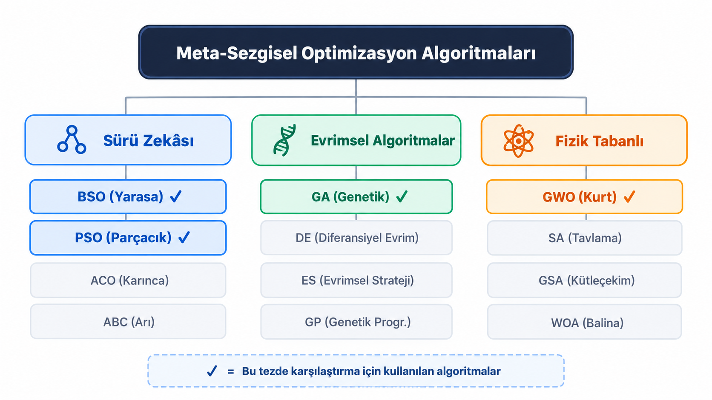

*Şekil 3. Meta-sezgisel optimizasyon algoritmalarının sınıflandırılması*

Kaynak: Araştırmacı tarafından oluşturulmuştur.

**Tablo 5. Meta-sezgisel optimizasyon algoritmalarının karşılaştırılması**

| Algoritma | İlham kaynağı | Keşif mekanizması | Sömürü mekanizması | Bu tez açısından değerlendirme |
| --- | --- | --- | --- | --- |
| BSO | Yarasa ekolokasyonu | Frekans ayarı ve global arama | Gürlük ve darbe oranı ile lokal arama | Karma ikili-sürekli arama uzayı için uygun çerçeve sağlar |
| PSO | Kuş/balık sürü davranışı | Parçacıkların sosyal ve bireysel hareketi | En iyi konuma yakınsama | Hızlı yakınsar; erken yakınsama riski olabilir |
| GA | Doğal seçilim ve evrim | Çaprazlama ve mutasyon | Uygun bireylerin korunması | Çeşitlilik sağlar; parametre ayarına duyarlıdır |
| GWO | Gri kurt sürü hiyerarşisi | Lider kurtların rehberliği | Av kuşatma davranışı | Basit yapı sunar; çözüm çeşitliliği sınırlanabilir |

Kaynak: Araştırmacı tarafından oluşturulmuştur.

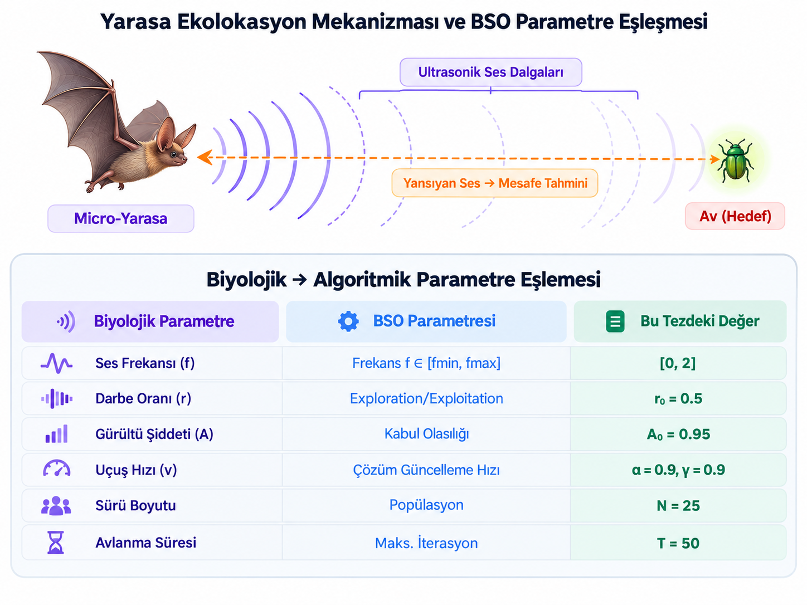

*Şekil 4. Yarasa ekolokasyon mekanizması ve BSO parametre eşlemesi*

Kaynak: Araştırmacı tarafından oluşturulmuştur.

### 2.5. Öznitelik seçimi yaklaşımları

Yüksek boyutlu ağ trafiği verilerinde her öznitelik sınıflandırma başarımına aynı ölçüde katkı sağlamamaktadır. Gereksiz, tekrarlı veya düşük ayırt edici güce sahip öznitelikler modelin hesaplama maliyetini artırabilmekte ve genelleme performansını olumsuz etkileyebilmektedir. Bu özellikler, öznitelik seçimini IDS ve DDoS tespit çalışmalarının temel tasarım adımlarından biri hâline getirmektedir (Guyon ve Elisseeff, 2003; Chandrashekar ve Sahin, 2014).

Öznitelik seçimi yöntemleri genel olarak filtre tabanlı, sarmal tabanlı ve gömülü yöntemler olarak ele alınmaktadır. Filtre tabanlı yöntemler hızlıdır; ancak öznitelikler arası etkileşimleri ve model performansına doğrudan etkileri sınırlı biçimde yansıtabilir. Sarmal yöntemler, seçilen öznitelik alt kümelerini doğrudan bir sınıflandırıcının performansı üzerinden değerlendirir. Gömülü yöntemler ise öznitelik değerlendirmesini model eğitimi sırasında gerçekleştirir.

Random Forest'ın kendi öznitelik önem mekanizması, modelin hangi değişkenlere daha fazla ağırlık verdiğini anlamak için yararlıdır. Ancak bu mekanizma doğrudan en iyi öznitelik alt kümesini garanti etmez. Bir özniteliğin tekil önem değeri yüksek olsa bile başka özniteliklerle birlikte kullanıldığında artıklık oluşturabilir; düşük önem değerine sahip bazı değişkenler ise belirli sınıf ayrımlarında tamamlayıcı bilgi sağlayabilir. Bu sınırlama nedeniyle RF'nin yerleşik önem ölçütü tek başına seçim aracı olarak kullanılmamış; model başarımı ile öznitelik sayısını aynı amaç fonksiyonunda değerlendiren BSO tabanlı sarmal yaklaşım tercih edilmiştir.

**Tablo 6. Öznitelik seçimi yöntemlerinin karşılaştırılması**

| Yöntem türü | Çalışma mantığı | Güçlü yön | Sınırlılık | Bu tezdeki değerlendirme |
| --- | --- | --- | --- | --- |
| Filtre tabanlı | İstatistiksel ölçütlerle öznitelik sıralama | Hızlı ve modelden bağımsızdır | Öznitelik etkileşimlerini sınırlı yakalar | Ön analiz için yararlıdır; nihai seçim için yeterli görülmemiştir |
| Sarmal tabanlı | Alt kümeleri sınıflandırıcı performansına göre değerlendirir | Model başarımına doğrudan odaklanır | Hesaplama maliyeti yüksektir | BSO ile bu yaklaşım benimsenmiştir |
| Gömülü | Seçim model eğitimi içinde yapılır | Modelle bütünleşiktir | Model bağımlıdır ve en iyi alt kümeyi garanti etmez | RF importance yorumlama için değerlidir; tek başına seçim aracı değildir |
| Hibrit | Birden fazla yaklaşımın güçlü yönlerini birleştirir | Daha dengeli çözüm sağlayabilir | Tasarımı ve gerekçelendirmesi dikkat gerektirir | Bu tezin metodolojik temelini oluşturur |

Kaynak: Araştırmacı tarafından oluşturulmuştur.

### 2.6. Sınıf dengesizliği ve SMOTE yaklaşımı

Ağ saldırı tespit veri setlerinde sınıf dengesizliği sık karşılaşılan bir problemdir. Bazı saldırı türleri çok sayıda örnekle temsil edilirken, Backdoor veya nadir botnet davranışları gibi sınıflar daha az örnek içerebilmektedir. Bu durum, sınıflandırıcıların çoğunluk sınıflarına eğilim göstermesine ve azınlık saldırı türlerinde düşük duyarlılık üretmesine neden olabilmektedir (He ve Garcia, 2009).

SMOTE, azınlık sınıfına ait örnekler arasında sentetik örnekler üreterek sınıf dengesizliğini azaltmayı amaçlayan yaygın bir yöntemdir (Chawla vd., 2002). Bu yaklaşım rastgele kopyalama yerine azınlık sınıfı örneklerinin komşuluk ilişkilerinden yararlanarak yeni örnekler üretir. Bu nedenle dengesiz sınıflandırma problemlerinde sıkça kullanılmaktadır.

Bununla birlikte SMOTE kusursuz bir çözüm değildir. Azınlık sınıfının dağılımı karmaşık veya çoğunluk sınıflarıyla örtüşmeli olduğunda sentetik örnekler sınıf sınırlarını bulanıklaştırabilir. Ayrıca azınlık sınıfındaki gerçek çeşitlilik sınırlıysa, SMOTE bu çeşitliliği tam olarak temsil edemeyebilir. Bu riskleri sınırlamak amacıyla SMOTE yalnızca eğitim verisine uygulanmış; doğrulama ve test kümelerinin özgün dağılımı korunmuştur. Böylece dengeleme işleminin değerlendirme verisine sızması önlenmiş ve bağımsız test performansının daha gerçekçi ölçülmesi hedeflenmiştir.

**Tablo 7. SMOTE yaklaşımının katkıları, riskleri ve bu çalışmadaki önlemler**

| Boyut | SMOTE’nin katkısı | Olası risk | Bu tezde alınan önlem |
| --- | --- | --- | --- |
| Azınlık sınıfı temsili | Nadir sınıfların eğitimde daha görünür olmasını sağlar | Sentetik örnekler gerçek çeşitliliği tam yansıtmayabilir | Yalnızca eğitim setinde uygulanmıştır |
| Karar sınırları | Modelin azınlık sınıfına duyarlılığını artırabilir | Sınıf sınırı bulanıklığı oluşabilir | Bağımsız test seti orijinal dağılımda tutulmuştur |
| Veri sızıntısı | Dengeleme sonrası eğitim daha kararlı olabilir | Test setine uygulanırsa iyimser sonuç verir | SMOTE test ve doğrulama verisine uygulanmamıştır |
| Backdoor sınıfı | Düşük örnek sayısına karşı destek sağlar | Sentetik komşuluk hataları oluşabilir | Sınıf bazlı performans ayrıca analiz edilmiştir |

Kaynak: Araştırmacı tarafından oluşturulmuştur.

### 2.7. IoT-DDoS veri setleri ve CICIoT2023

Makine öğrenmesi tabanlı saldırı tespit çalışmalarında kullanılan veri seti, sonuçların geçerliliğini doğrudan etkilemektedir. NSL-KDD ve benzeri eski veri setleri uzun yıllar boyunca karşılaştırma amacıyla kullanılmış olsa da güncel IoT trafiğini ve modern botnet tabanlı saldırı örüntülerini sınırlı biçimde temsil etmektedir. Bu temsil açığı, Bot-IoT, Edge-IIoTset ve CICIoT2023 gibi daha yeni veri setlerinin son yıllarda öne çıkmasının başlıca nedenlerinden biridir.

Bot-IoT veri seti, IoT botnet davranışlarının analizi için önemli bir kaynak sağlarken (Koroniotis vd., 2019), Edge-IIoTset endüstriyel IoT ortamlarında farklı saldırı türlerini içeren kapsamlı bir veri seti sunmaktadır (Ferrag vd., 2023). CICIoT2023 ise gerçek IoT cihazlarından elde edilen büyük ölçekli trafik örnekleri ve güncel saldırı çeşitliliği nedeniyle bu tez için uygun bir referans veri seti olarak değerlendirilmiştir (Neto vd., 2023).

CICIoT2023 veri setinin tamamı yerine DDoS odaklı, beş sınıflı kontrollü bir alt görev kullanılmıştır. Bu sınırlandırma deneysel kapsamı yönetilebilir tutmuş, sınıf dengelemesini kontrollü biçimde uygulamaya ve BSO aramasının hesaplama maliyetini sınırlandırmaya imkân vermiştir. Dolayısıyla çalışma CICIoT2023'ün tüm saldırı taksonomisi için genel amaçlı bir IDS iddiasında bulunmamakta; seçilen DDoS ve ilişkili trafik sınıfları için optimize edilmiş bir sınıflandırma düzenini incelemektedir.

**Tablo 8. Referans veri setlerinin IoT-DDoS çalışmaları açısından karşılaştırılması**

| Veri seti | Yıl | Kapsam | Güçlü yön | Bu tez açısından değerlendirme |
| --- | --- | --- | --- | --- |
| KDD Cup 99 | 1999 | Klasik saldırı tespit verisi | Tarihsel karşılaştırma verisi olarak yaygındır | Güncel IoT trafiğini sınırlı temsil eder |
| NSL-KDD | 2009 | KDD türevi dengelenmiş veri | Tekrar kayıt sorunu azaltılmıştır | Modern IoT saldırılarını yansıtmaz |
| Bot-IoT | 2019 | IoT botnet trafiği | Botnet davranışları için uygundur | Alternatif dış doğrulama veri seti olabilir |
| Edge-IIoTset | 2023 | IoT/IIoT güvenlik verisi | Endüstriyel IoT bağlamı sunar | Gelecek çalışmalarda çapraz doğrulama için uygundur |
| CICIoT2023 | 2023 | Gerçek IoT cihaz trafiği ve güncel saldırılar | Bu tezde kullanılan ana veri setidir | Çok sınıflı DDoS alt kümesi ile değerlendirilmiştir |

Kaynak: Araştırmacı tarafından oluşturulmuştur.

### 2.8. Hibrit yaklaşımlar ve araştırma boşluğu

Literatürde hibrit öznitelik seçimi, meta-sezgisel optimizasyon ve makine öğrenmesi sınıflandırıcılarını birleştiren çok sayıda çalışma bulunmaktadır. Bu tezin katkısı bu nedenle yeni bir optimizasyon algoritması önermekten ziyade, BSO tabanlı öznitelik seçimi ile RF hiperparametre ayarını aynı uygunluk fonksiyonunda birleştirmek ve bu ortak aramayı güncel bir IoT-DDoS veri setinde çok sınıflı, sızıntı kontrollü bir değerlendirme altında sınamaktır.

Mevcut çalışmalar incelendiğinde üç temel araştırma boşluğu öne çıkmaktadır. İlk olarak, birçok çalışmada öznitelik seçimi ve hiperparametre optimizasyonu ayrı süreçler olarak yürütülmektedir. Bu durum, seçilen öznitelik kümesi ile sınıflandırıcı yapılandırması arasındaki etkileşimin yeterince dikkate alınmamasına neden olabilmektedir. İkinci olarak, bazı çalışmalar ikili sınıflandırmaya odaklanmakta ve saldırı alt türleri arasındaki farklılıkları ayrıntılı biçimde değerlendirmemektedir. Üçüncü olarak, model başarımı çoğu zaman yalnızca doğruluk değeri üzerinden raporlanmakta; F1-Makro, MCC, AUC, istatistiksel anlamlılık ve hesaplama verimliliği gibi ölçütler birlikte yeterince analiz edilmemektedir.

Bu tez, belirlenen boşlukları çok sınıflı IoT-DDoS tespiti için BSO-Hybrid RF çerçevesi üzerinden incelemektedir. Değerlendirme yalnızca doğruluğa dayanmamakta; F1-Makro, sınıf bazlı hata yapısı, istatistiksel belirsizlik, öznitelik azaltma ve kaynak profili birlikte raporlanmaktadır. Buradaki katkı yeni bir temel algoritma önermekten çok, bilinen bileşenleri sızıntı kontrollü ve yeniden üretilebilir bir deney düzeni içinde bir araya getirip sınırlarını görünür kılmaktır.

2024–2026 dönemindeki çalışmalar, IoT saldırı tespitinde öznitelik seçimi, sınıf dengesizliği, çoklu veri seti doğrulaması ve kaynak maliyetinin birlikte ele alınmasının giderek daha önemli hâle geldiğini göstermektedir. CICIoT2023 üzerinde yeniden örnekleme ve öznitelik seçimini karşılaştıran güncel çalışmalar ile çoklu veri setlerinde optimize edilmiş özellik seçimi kullanan hibrit IDS çerçeveleri, yüksek skorların görev tanımı, örnekleme, sınıf taksonomisi ve doğrulama protokolünden bağımsız yorumlanamayacağını vurgulamaktadır (Al-Ashmali vd., 2025; Abou Elasaad vd., 2025; Khan vd., 2026; Amrullah vd., 2026). Bu nedenle bu tezde literatür skorları doğrudan bir liderlik sıralamasına dönüştürülmemiş, yöntemsel koşullar bağlamında değerlendirilmiştir.

Dinamik ağ kavramı açısından da statik bir hold-out deney ile gerçek kavram kayması deneyi birbirinden ayrılmalıdır. Zaman içinde değişen IoT akışlarını inceleyen çalışmalar, kavram kaymasının ardışık/zamansal veri, değişim noktaları ve gerektiğinde periyodik yeniden öğrenme veya uyarlama mekanizması gerektirdiğini göstermektedir (Chu vd., 2024; Rehman vd., 2025). Bu tezde dondurulmuş test, grup-duyarlı doğrulama ve kontrollü öznitelik bozulması dağılım duyarlılığını incelemek için kullanılmıştır.

**Tablo 9. Aynı alana yakın çalışmalarla karşılaştırmalı konumlandırma**

| Çalışma | Veri seti | Görev tipi | Yöntemsel odak | Doğrudan karşılaştırma durumu | Bu tez açısından çıkarım |
| --- | --- | --- | --- | --- | --- |
| Neto vd. (2023) | CICIoT2023 | Karşılaştırma verisi / temel sınıflandırma | Veri seti ve temel modeller | Kısmen doğrudan | Aynı veri ailesi nedeniyle ana referanstır |
| Meidan vd. (2018) | N-BaIoT | IoT botnet tespiti | Derin otokodlayıcı | Sınırlı | IoT botnet davranışını anlama açısından önemlidir |
| Koroniotis vd. (2019) | Bot-IoT | IoT botnet tespiti | Veri seti ve ML değerlendirme | Bağlamsal | IoT botnet verisi açısından alternatif karşılaştırma veri seti sağlar |
| Doshi vd. (2018) | Tüketici IoT trafiği | DDoS tespiti | ML tabanlı IoT DDoS | Bağlamsal | IoT cihazlarında ML tabanlı tespit motivasyonunu destekler |
| Bu tez | CICIoT2023 alt kümesi | 5 sınıflı IoT-DDoS tespiti | BSO + RF ortak optimizasyonu | Ana çalışma | Öznitelik azaltma ve performans-verimlilik dengesi odaklıdır |

Kaynak: Araştırmacı tarafından oluşturulmuştur.

**Tablo 10. Araştırma boşlukları ve bu tezin konumlandırılması**

| Karşılaştırma boyutu | Literatürde yaygın durum | Sınırlılık | Bu tezde benimsenen yaklaşım |
| --- | --- | --- | --- |
| Öznitelik seçimi | Filtre/gömülü yöntemler veya ayrı optimizasyon | Seçilen alt küme ile model parametreleri ayrı ele alınabilir | BSO ile 39-bit maske ve dört RF hiperparametresi ortak arama uzayında optimize edilmiştir |
| Veri bölme ve sızıntı kontrolü | Rastgele satır bazlı bölme sık kullanılır | Aynı sayısal kayıtlar farklı bölmelere geçerek iyimser sonuç oluşturabilir | Ham 39-boyutlu satırlara SHA-256 grup kimliği atanmış; train/val/test exact-row overlap 0/0/0 olarak doğrulanmıştır |
| Değerlendirme protokolü | Ön işleme veya model seçimi test bilgisine dolaylı temas edebilir | Genelleme tahmini iyimserleşebilir | İmputasyon, tarama, ölçekleme ve SMOTE yalnız eğitim; BSO yalnız doğrulama verisinde; test kümesi model dondurulana kadar kapalı |
| Değerlendirme metriği | Doğruluk merkezli raporlama | Dengesiz sınıflarda azınlık performansını maskeleyebilir | F1-Makro birincil; MCC, dengeli doğruluk, ağırlıklı OvR AUC ve sınıf bazlı metrikler birlikte raporlanmıştır |
| Belirsizlik ve kararlılık | Tek nokta tahmini veya tek optimizasyon koşusu | Küçük farkların ve arama rastlantısallığının yorumu belirsiz kalabilir | Eşleştirilmiş bootstrap, 10 BSO tohumu, Jaccard benzerliği ve eşit bütçeli optimizatör analizi kullanılmıştır |

Kaynak: Araştırmacı tarafından oluşturulmuştur.

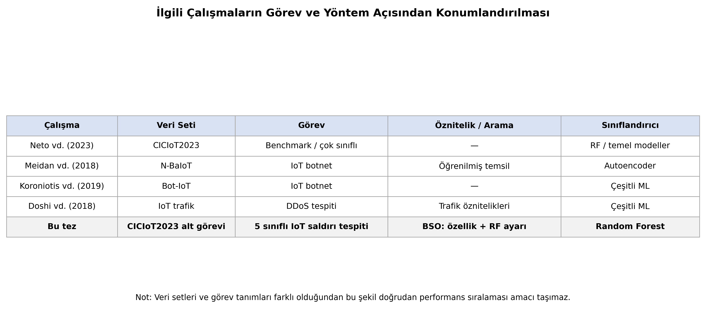

*Şekil 5. İlgili çalışmaların görev tipi açısından karşılaştırılması*

Kaynak: Araştırmacı tarafından oluşturulmuştur.

### 2.9. Literatür değerlendirmesi

Literatür genel olarak değerlendirildiğinde, IoT-DDoS tespitinde makine öğrenmesi ve meta-sezgisel optimizasyon yaklaşımlarının önemli başarılar sağladığı görülmektedir. Bununla birlikte sonuçların genellenebilirliği; veri setinin güncelliği, görevin ikili veya çok sınıflı olması, sınıf dengesizliği, kullanılan öznitelik sayısı ve hesaplama maliyeti gibi değişkenlere bağlıdır. Bu farklılıklar dikkate alınmadan yapılan doğrudan skor karşılaştırmaları yanıltıcı olabileceğinden, çalışmalar yöntem ve deney tasarımıyla birlikte değerlendirilmelidir.

Benimsenen değerlendirme anlayışında amaç, yalnızca en yüksek doğruluğa ulaşmak değildir. Daha dar bir giriş öznitelik kümesi ile rekabetçi çok sınıflı performansın, veri sızıntısını sınırlayan ve denetlenebilir bir protokol altında birlikte değerlendirilmesi esas alınmıştır. Bu bağlamda 'daha az öznitelik' ifadesi 'daha küçük model' ya da 'daha düşük bellek tüketimi' ile eş anlamlı kabul edilmemiş; giriş kompaktlığı ile modelin kaynak maliyeti ayrı göstergeler olarak raporlanmıştır.

Yukarıdaki değerlendirmeler araştırma boşluğunu dört başlıkta belirginleştirmektedir: öznitelik seçimi ile hiperparametre ayarının birlikte yürütülmesi, aynı sayısal satırların bölme öncesinde ortak grup anahtarı altında tutulması, öğrenilen ön işleme adımlarının yalnızca eğitim verisine göre belirlenmesi ve nihai model seçiminin test kümesi açılmadan tamamlanması. Bölüm 3, bu ilkeleri uygulayan BSO-Hybrid RF deney düzenini ayrıntılı olarak tanımlamaktadır.

### 2.10. Bölüm özeti

Literatür taraması; DDoS saldırılarını, IDS yaklaşımlarını, makine öğrenmesi sınıflandırıcılarını, meta-sezgisel optimizasyonu, öznitelik seçimini, sınıf dengesizliğini ve IoT-DDoS veri setlerini ortak bir çerçevede karşılaştırmıştır. Bulgular, BSO ile RF'nin literatürde yerleşik yöntemler olduğunu göstermektedir. Tezin yöntemsel katkısı bu iki bileşeni yeni algoritmalar olarak sunmak değil; çok sınıflı IoT-DDoS görevi için ortak öznitelik seçimi ve RF hiperparametre araması altında birleştirerek değerlendirmeyi veri sızıntısı kontrolleriyle güçlendirmektir.

Bu çerçevede çalışma, ölçülebilir, tekrarlanabilir ve problem alanına açık biçimde bağlanan uygulamalı bir araştırma katkısı olarak konumlandırılmıştır. Böylece Bölüm 3’te sunulan yöntemsel tasarımın gerekçesi literatür üzerinden açıkça temellendirilmiştir.

<strong>3. YÖNTEM</strong>

Yöntem bölümü, BSO tabanlı hibrit RF çerçevesinin hangi veri akışı ve doğrulama kuralları altında değerlendirildiğini tanımlamaktadır. Protokol dört temel ilkeye dayanır: ham veride grup-duyarlı bölme, öğrenilen bütün ön işleme adımlarının yalnızca eğitim verisine göre belirlenmesi, BSO aramasında yalnızca doğrulama kümesinden geri bildirim alınması ve nihai test kümesinin model seçimi tamamlanıncaya kadar kapalı tutulması.

### 3.1. Araştırma Deseni, Problemi ve Hipotezler

Araştırma nicel, deneysel ve karşılaştırmalı bir tasarıma sahiptir. İncelenen risk yalnızca yüksek boyutluluk ve sınıf dengesizliği değildir; aynı sayısal örüntülerin rastgele bölmeler arasında tekrarlanması veya ön işleme parametrelerinin bölme öncesinde öğrenilmesi de performansı olduğundan iyimser gösterebilir. Bu riskleri kontrol etmek için ortak BSO öznitelik/RF hiperparametre araması bölme-önce (split-first) düzeni ve dondurulmuş test protokolü içinde yürütülmüştür.

Bu amaç doğrultusunda aşağıdaki alternatif hipotezler değerlendirilmiştir:

AH₁: 23 öznitelikli BSO-RF, aynı RF hiperparametreleriyle 39 özniteliğin tamamını kullanan modele kıyasla F1-Makro açısından rekabetçi ve ölçülebilir bir performans farkı üretmektedir.

AH₂: BSO, 39 boyutlu giriş uzayını en az %40 azaltırken dondurulmuş test kümesinde güçlü çok sınıflı ayırt etme performansını koruyabilmektedir.

AH₃: Arama rastlantısallığına rağmen BSO tekrarlarında benzer doğrulama performansı ve tekrar eden yüksek kararlılıklı bir öznitelik çekirdeği ortaya çıkmaktadır.

Bu hipotezleri ve yöntemsel katkıyı sınamak amacıyla aşağıdaki araştırma soruları oluşturulmuştur:

AS₁: BSO, 39 öznitelikten kompakt fakat etkili bir alt küme seçerken RF hiperparametrelerini aynı arama sürecinde ne ölçüde optimize edebilmektedir?

AS₂: Önerilen modelin sınıf bazlı hataları özellikle Backdoor_Malware, BenignTraffic ve Recon-PortScan sınıflarında nasıl dağılmaktadır?

AS₃: Grup-duyarlı ve dondurulmuş test protokolünde elde edilen performans farkları bootstrap belirsizliği, çoklu BSO tohumları ve eşit bütçeli optimizatör karşılaştırmalarıyla nasıl yorumlanmaktadır?

### 3.2. Veri Seti: CICIoT2023

Bu çalışmada Canadian Institute for Cybersecurity tarafından geliştirilen CICIoT2023 veri seti kullanılmıştır (Neto vd., 2023). Kontrollü beş sınıflı görev 103.218 ağ akışı ve 39 sayısal trafik özniteliğinden oluşmaktadır. Sınıflar Backdoor_Malware (3.218), BenignTraffic (25.000), DDoS-ACK_Fragmentation (25.000), DDoS-SYN_Flood (25.000) ve Recon-PortScan (25.000) olarak belirlenmiştir. Backdoor sınıfındaki mevcut örneklerin tamamı korunmuş, diğer dört sınıf sabit tohumla 25.000 örnekte sınırlandırılmıştır. Bu dağılım bir deney tasarımıdır ve gerçek dağıtım prevalansı olarak yorumlanmamaktadır.

**Tablo 11. CICIoT2023 kontrollü görevin temel özellikleri ve veri bölmeleri**

| Parametre | Değer | Açıklama |
| --- | --- | --- |
| Toplam örnek sayısı | 103.218 | Kontrollü beş sınıflı görev |
| Toplam öznitelik sayısı | 39 | Ham sayısal ağ trafiği öznitelikleri |
| Sınıf sayısı | 5 | 1 normal trafik + 4 saldırı sınıfı |
| Eğitim seti | 72.252 | SMOTE öncesi grup-duyarlı eğitim bölmesi |
| Doğrulama seti | 10.322 | BSO ve model seçimi için; testten ayrı |
| Test seti | 20.644 | Model dondurulduktan sonra açılan nihai test |
| SMOTE sonrası eğitim | 87.500 | Her sınıfta 17.500; 15.248 sentetik örnek |
| Seçilen öznitelik | 23 / 39 | Ana BSO maskesi |
| Giriş azaltma oranı | %41,03 | 39 öznitelikten 23 özniteliğe |

Kaynak: Neto vd. (2023); araştırmacı tarafından düzenlenmiştir.

Backdoor_Malware sınıfının toplam örnek sayısı diğer sınıflardan belirgin biçimde düşüktür. Bu dengesizlik, yalnızca eğitim bölmesinde uygulanan SMOTE ile ele alınmış; doğrulama ve test kümeleri hiçbir sentetik örnek içermeyecek biçimde korunmuştur.

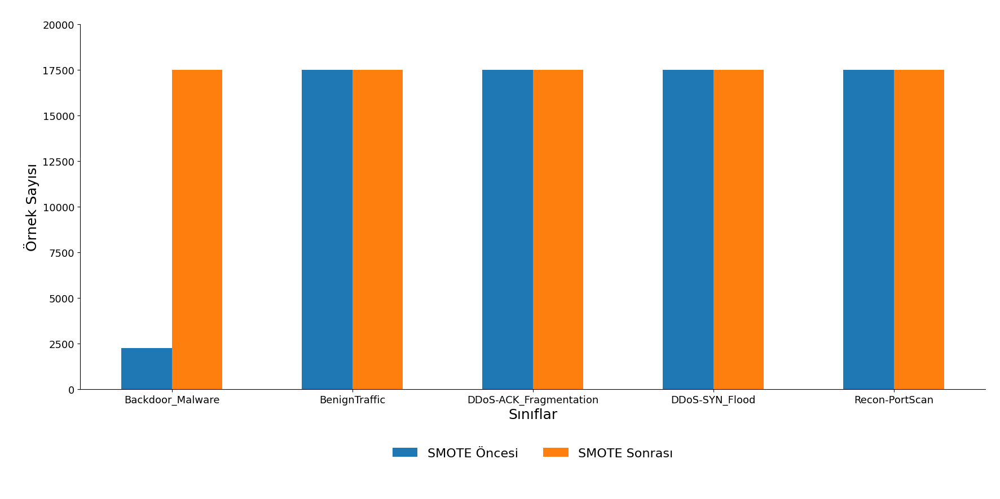

*Şekil 6. SMOTE öncesi ve sonrası eğitim sınıf dağılımı karşılaştırması*

Kaynak: Araştırmacı tarafından oluşturulmuştur.

### 3.2.1 Veri Hazırlama Süreci

Bu çalışmada CICIoT2023 veri kümesinden beş sınıflı kontrollü görev oluşturulmuştur: BenignTraffic, DDoS-SYN_Flood, DDoS-ACK_Fragmentation, Backdoor_Malware ve Recon-PortScan.

Backdoor_Malware sınıfındaki 3.218 kaydın tamamı korunmuş; diğer dört sınıf random_state=42 kullanılarak 25.000'er örnekte sınırlandırılmıştır.

Bu işlem sonunda modelleme öncesi görev tablosu 103.218 satır ve 39 sayısal öznitelikten oluşmuştur.

### 3.3. Grup-Duyarlı Veri Bölme ve Değerlendirme Akışı

Model değerlendirmesinde iyimserliği azaltmak amacıyla veri ayrımı, herhangi bir öğrenilen ön işleme adımından önce gerçekleştirilmiştir. Her tam 39-boyutlu sayısal satır deterministik biçimde kanonikleştirilmiş ve SHA-256 grup kimliği ile eşlenmiştir. Aynı grup kimliğine sahip satırlar tek bir veri bölmesinde tutulmuştur.

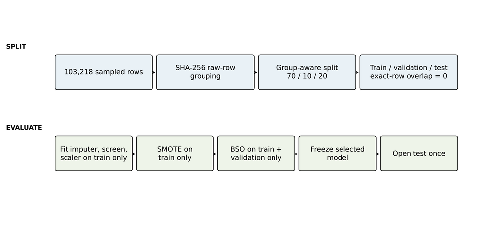

*Şekil 7. Veri sızıntısı kontrollü grup-duyarlı deneysel değerlendirme akışı*

Kaynak: Araştırmacı tarafından oluşturulmuştur.

Şekil 7'de veri gruplama ve bölme işleminin imputasyon, sabit öznitelik taraması, ölçekleme ve SMOTE'dan önce gerçekleştirildiği görülmektedir. Nihai test kümesi, 23 öznitelikli maske ve RF yapılandırması dondurulana kadar model seçimine kapalı tutulmuştur.

### 3.3.1 Veri Bölme Stratejisi ve Bütünlük Denetimi

Grup-duyarlı bölme sonucunda eğitim, doğrulama ve test kümeleri sırasıyla 72.252, 10.322 ve 20.644 örnekten oluşmuştur.

Grup kimliği kümelerinin birbirini kesmemesi zorunlu tutulmuş; eğitim-doğrulama, eğitim-test ve doğrulama-test çiftleri için birebir aynı satır örtüşmesi 0 / 0 / 0 olarak doğrulanmıştır.

Medyan imputasyonu, sabit öznitelik taraması ve ölçekleyici yalnızca eğitim verisinde öğrenilmiş; doğrulama ve test kümelerine değişmeden uygulanmıştır.

SMOTE yalnızca 72.252 örnekli eğitim bölmesine uygulanmış ve eğitim seti 87.500 örneğe (her sınıfta 17.500) dengelenmiştir.

Bu tasarım, birebir aynı sayısal satırların bölmeler arasında yer almasını engeller.

Bu daha katı protokolün amacı mümkün olan en yüksek test skorunu üretmek değil, satır düzeyinde rastgele bölmeye göre daha ihtiyatlı ve savunulabilir bir genelleme tahmini elde etmektir. Bu nedenle daha yüksek fakat sızıntı riski taşıyan bir nokta tahmini yerine, test kümesine seçim sürecinde temas etmeyen sonuçlar esas alınmıştır.

Tüm tekrarlanabilir veri oluşturma ve bölme işlemlerinde sabit rastgelelik tohumu=42 kullanılmıştır.

### 3.4. Veri Ön İşleme Süreci

Ön işleme süreci split-first ilkesine göre tasarlanmıştır. Grup-duyarlı bölme tamamlandıktan sonra eğitim verisinde medyan imputasyonu ve sabit öznitelik kontrolü yapılmış, ölçekleyici yalnızca eğitimde fit edilmiş ve son olarak SMOTE yalnızca eğitim matrisine uygulanmıştır. Doğrulama ve test kümeleri sentetik örnek içermemiştir.

Veri hazırlama ve bütünlük denetimi adımları aşağıdaki özet tabloda birlikte gösterilmiştir.

**Grup duyarlı deney akışı**

| Adım | İşlem | Girdi | Çıktı | Kullanılan araç |
| --- | --- | --- | --- | --- |
| 1 | Görev oluşturma | CICIoT2023 hedef sınıfları | 103.218 × 39 görev tablosu | pandas + seed 42 |
| 2 | SHA-256 grup kimliği | Kanonik 39-boyutlu ham satır | Exact-row grup anahtarı | hashlib / SHA-256 |
| 3 | Grup-duyarlı bölme | 103.218 örnek | 72.252 / 10.322 / 20.644 | Grup-duyarlı bölme |
| 4 | Yalnız eğitimde imputasyon/tarama | Eğitim bölmesi | Fit edilmiş dönüşümler | Medyan + constant screening |
| 5 | Ölçekleme | Train / val / test | Ölçekli matrisler | Train-fitted scaler |
| 6 | SMOTE | 72.252 eğitim örneği | 87.500 eğitim örneği | imblearn.SMOTE |
| 7 | Bütünlük denetimi | Grup kümeleri | Cross-partition overlap = 0 / 0 / 0 | SHA-256 audit |

Standartlaştırma parametreleri yalnızca eğitim bölmesinden hesaplanmış ve aynı dönüşüm doğrulama ile test kümelerine uygulanmıştır. Kullanılan z-skor dönüşümü Denklem 3.1'de verilmiştir.

(Denklem 3.1)

Burada x ham öznitelik değerini, μ ilgili özniteliğin ortalamasını, σ ise standart sapmasını ifade etmektedir.

Sınıf dengesizliğini gidermek için SMOTE yalnızca eğitim verisinde uygulanmıştır. Eğitimde Backdoor_Malware 2.252 örnekten 17.500 örneğe yükseltilmiş, toplam eğitim boyutu 72.252'den 87.500'e çıkmıştır; toplam 15.248 sentetik örnek üretilmiştir.

(Denklem 3.2)

Burada xi azınlık sınıfına ait örneği, xnn bu örneğin en yakın komşusunu, λ ise [0,1] aralığında üretilen katsayıyı göstermektedir. Eğitim kümesindeki dengeleme etkisi Şekil 8'de sunulmuştur.

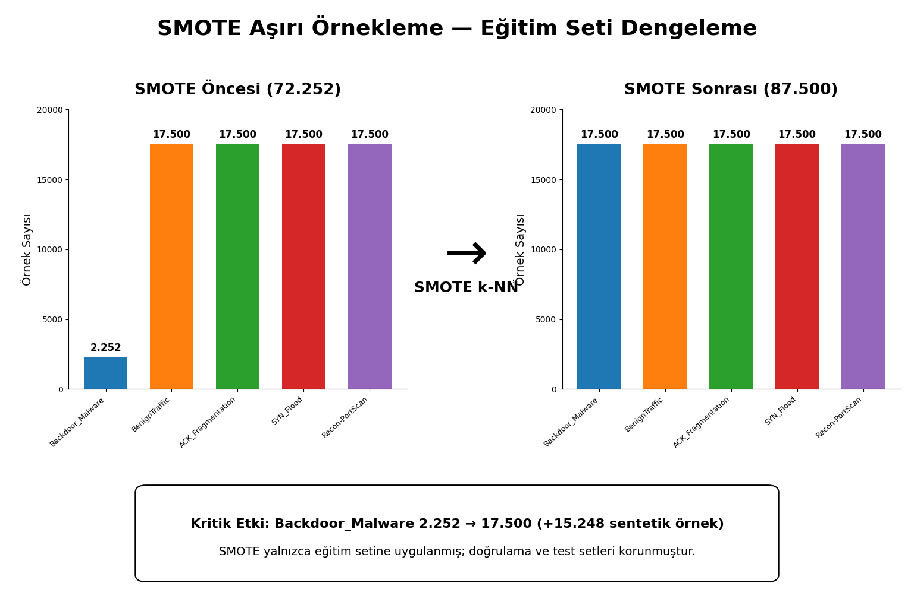

*Şekil 8. SMOTE ile yalnızca eğitim setinin dengelenmesi*

Kaynak: Araştırmacı tarafından oluşturulmuştur.

### 3.5. Yarasa Sürüsü Optimizasyonu (BSO) Algoritması

Yarasa Sürüsü Optimizasyonu, yarasaların ekolokasyon davranışından esinlenen meta-sezgisel bir optimizasyon yöntemidir (Yang, 2010). Bu çalışmada BSO aynı anda iki görevi yürütmektedir: 39-bit öznitelik maskesinin seçimi ve Random Forest'a ait dört sürekli hiperparametrenin optimizasyonu. Böylece ayrık ve sürekli değişkenler aynı arama uzayında değerlendirilmiştir.

BSO’nun bu tezde tercih edilmesinin temel gerekçesi, arama uzayının aynı anda ayrık bir öznitelik maskesi ve sürekli RF hiperparametreleri içermesidir. BSO, bu karma yapıyı tek bir aday çözüm içinde temsil etmeye ve keşif–sömürü dengesini az sayıda kontrol parametresiyle yürütmeye elverişlidir. Bununla birlikte BSO’nun evrensel olarak en iyi meta-sezgisel yöntem olduğu varsayılmamış; PSO, GA ve GWO ile eşit bütçeli karşılaştırmalar yapılarak yöntemin sınırları da raporlanmıştır.

**Tablo 12. BSO algoritma parametreleri**

| Parametre | Sembol | Değer | Açıklama |
| --- | --- | --- | --- |
| Popülasyon boyutu | N | 25 | Çözüm adayı yarasa sayısı |
| Maksimum iterasyon | T | 50 | Ana arama iterasyon sayısı |
| Frekans aralığı | f_min, f_max | [0, 2) | Keşif için kullanılan frekans aralığı |
| Başlangıç gürlüğü | A0 | 0,95 | Yerel arama kabul dinamiği |
| Başlangıç nabız oranı | r0 | 0,50 | Yerel arama kontrolü |
| Gürlük azalma katsayısı | α | 0,90 | Kabul dinamiğinin azalması |
| Nabız artış katsayısı | γ | 0,90 | Nabız oranı güncellemesi |
| Arama uzayı | D | 43 | 39 ikili özellik + 4 sürekli RF koordinatı |

BSO algoritmasının temel güncelleme denklemleri aşağıda sunulmuştur. Frekans güncellemesi Denklem 3.3 ile yapılır:

(Denklem 3.3)

Hız güncellemesi, mevcut en iyi çözüme olan uzaklığa göre Denklem 3.4 ile hesaplanır:

(Denklem 3.4)

Konum güncellemesi Denklem 3.5 ile gerçekleştirilir:

(Denklem 3.5)

Gürlük ve nabız oranı güncellemeleri sırasıyla Denklem 3.6 ve 3.7'dir:

(Denklem 3.6)

(Denklem 3.7)

Burada xbest mevcut en iyi çözümü, β ise [0,1] aralığında üretilen rastgele sayıyı göstermektedir. Ortak arama süreci Şekil 9'da özetlenmiştir.

Her aday çözüm 39 ikili öznitelik kararı ve dört sürekli RF koordinatından oluşmaktadır. Sürekli koordinatlar sigmoid tabanlı dönüşüm ile tanımlı RF aralıklarına çözülmektedir.

Aday kalite ölçütü doğrulama kümesindeki F1-Makro değerine ve seçilen öznitelik oranına dayanmaktadır: J = 1 − F1_Macro(val) + 0,01 × (|S|/39). Daha düşük değer daha iyidir.

Arama 25 yarasa ve 50 iterasyon ile yürütülmüştür. Hesaplama maliyetini sınırlamak amacıyla her aday RF, eğitim bölmesinden sabit seçilmiş 12.000 satırlık alt kümede fit edilmiş; skor her zaman tam doğrulama kümesinde hesaplanmıştır.

Aday değerlendirmeler önbelleğe alınmış ve ana koşuda 1.160 benzersiz RF yapılandırması değerlendirilmiştir. Nihai çözüm iterasyon 35'te elde edilmiş ve iterasyon 50'ye kadar değişmeden kalmıştır.

Test etiketlerine optimizasyon, öznitelik seçimi ve hiperparametre ayarı boyunca erişilmemiştir.

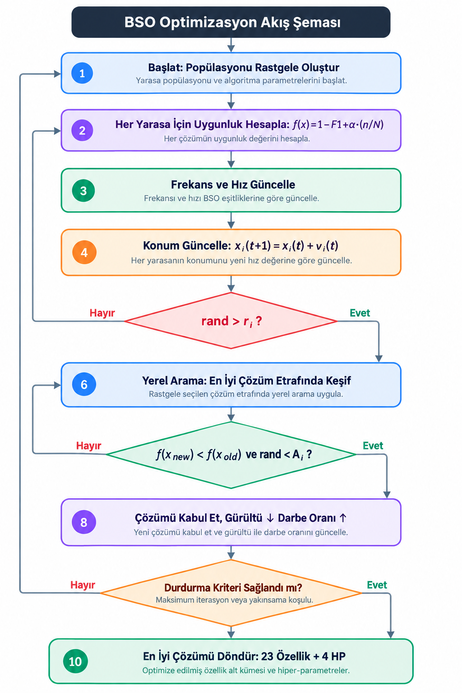

*Şekil 9. BSO ortak öznitelik seçimi ve RF hiperparametre optimizasyon akış şeması*

Kaynak: Araştırmacı tarafından oluşturulmuştur.

BSO'nun keşif–sömürü davranışı, gürlük ve nabız oranı parametrelerinin değişimi ile birlikte izlenmiştir (Şekil 10). Ana koşudaki en iyi doğrulama fitness değerinin iterasyonlara göre değişimi ise Şekil 11'de gösterilmiştir.

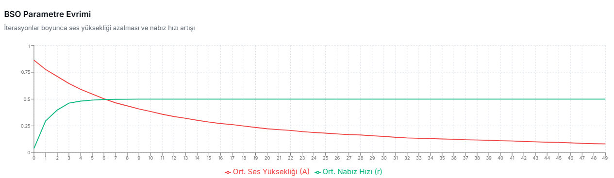

*Şekil 10. BSO parametrelerinin iterasyonlar boyunca değişimi*

Kaynak: Araştırmacı tarafından oluşturulmuştur.

Şekil 10 incelendiğinde, ses yüksekliğinin iterasyonlarla birlikte azaldığı, buna karşılık nabız oranının giderek arttığı görülmektedir. Bu eğilim, algoritmanın başlangıçta keşif, ilerleyen aşamalarda ise sömürü odaklı çalıştığını göstermektedir. BSO algoritmasının yakınsama performansı Şekil 11'de gösterilmiştir.

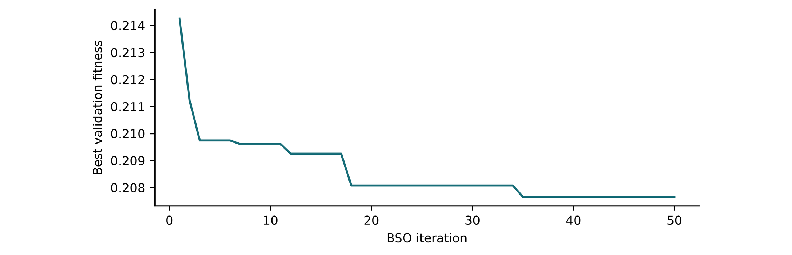

*Şekil 11. Ana BSO koşusunda en iyi doğrulama fitness değerinin yakınsaması*

Kaynak: Araştırmacı tarafından oluşturulmuştur.

### 3.6. Önerilen BSO-Hybrid Random Forest Çerçevesi

Bu çalışmada 'hibrit' terimi, birden fazla sınıflandırıcının oylanmasını değil; meta-sezgisel öznitelik/hiperparametre araması ile RF sınıflandırıcısının aynı geliştirme çerçevesinde birleştirilmesini ifade etmektedir. BSO yalnızca doğrulama verisinden geri bildirim almakta; seçilen maske ve RF parametreleri daha sonra SMOTE ile dengelenmiş tam eğitim matrisi üzerinde yeniden fit edilmektedir.

Random Forest ana sınıflandırıcı olarak; doğrusal olmayan öznitelik etkileşimlerini modelleyebilmesi, çok sınıflı ağ trafiğinde kararlı bir topluluk yapısı sunması, öznitelik önemlerinin incelenmesine izin vermesi ve BSO’nun sarmalayıcı uygunluk değerlendirmesi içinde tekrarlı biçimde eğitilebilmesi nedeniyle seçilmiştir. Bu seçim, RF’nin tüm alternatif sınıflandırıcılardan daha yüksek ham skor üreteceği iddiasına dayanmamaktadır.

Çözüm vektörü, 39 ikili öznitelik seçimi değişkeni ile 4 sürekli hiperparametreden oluşmaktadır. Çözüm vektörü gösterimi Denklem 3.8'de verilmiştir.

(Denklem 3.8)

Burada bj ilgili özniteliğin seçilip seçilmediğini, θ ise Random Forest hiperparametre vektörünü göstermektedir. Kullanılan arama aralıkları Denklem 3.9'da verilmiştir.

(Denklem 3.9)

Optimizasyon sürecinde kullanılan amaç fonksiyonu, sınıflandırma başarımı ile öznitelik sayısını birlikte değerlendirmektedir (Denklem 3.10).

(Denklem 3.10)

Bu denklemde F1-Makro doğrulama kümesindeki makro F1 skorunu, |S| seçilen öznitelik sayısını, |T| toplam öznitelik sayısını ve λ öznitelik azaltma ceza katsayısını ifade etmektedir. Bu çalışmada λ=0,01 olarak kullanılmıştır. Önerilen sistem mimarisi Şekil 12'de verilmiştir.

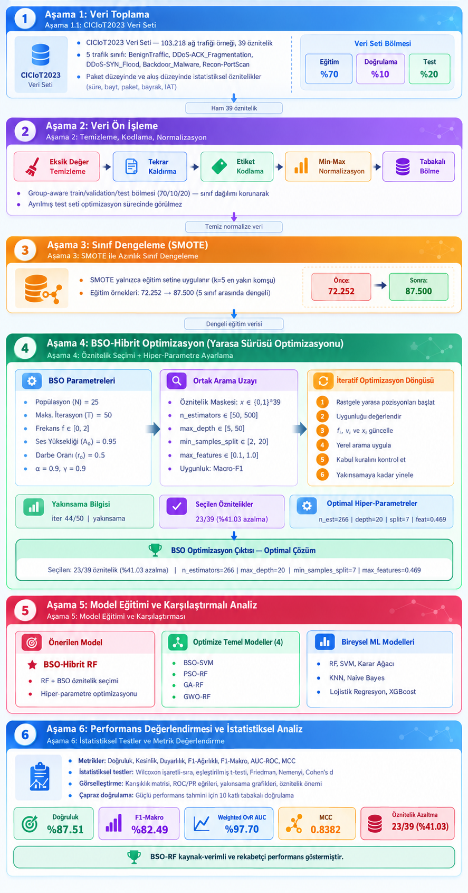

*Şekil 12. Önerilen BSO-Hybrid Random Forest sistem mimarisi*

Kaynak: Araştırmacı tarafından oluşturulmuştur.

Şekil 12, çevrimdışı geliştirme ile çevrimiçi tahmin katmanlarını birbirinden ayırmaktadır. Çevrimdışı aşamada grup-duyarlı bölme, yalnızca eğitim verisinde öğrenilen ön işleme adımları ve BSO araması yürütülür. Çevrimiçi aşamada ise dondurulmuş dönüşümler, seçilen 23 öznitelik ve nihai RF kullanılarak beş sınıflı tahmin üretilir.

### 3.7. Nihai Öznitelik Kümesi ve RF Yapılandırması

Ana BSO optimizasyonu sonucunda 39 öznitelikten 23'ü seçilmiştir. Bu, giriş boyutunda %41,03 azalmaya karşılık gelmektedir. Seçilen özniteliklerin RF safsızlık önemi, on BSO tekrarındaki seçim sıklığı ile birlikte Tablo 13'te sunulmuştur.

Seçilen 23 öznitelik sayısı önceden sabitlenmiş bir hedef değildir. Nihai maske, doğrulama F1-Makro başarımı ile öznitelik oranını birlikte cezalandıran amaç fonksiyonunun arama sonucunda ortaya çıkmıştır. Bu nedenle 23 sayısı, belirli bir boyut azaltma yüzdesini zorlamaktan çok, λ=0,01 altında elde edilen performans–giriş kompaktlığı çalışma noktasını temsil etmektedir.

**Tablo 13. BSO ile seçilen 23 öznitelik, RF önemi ve arama kararlılığı**

| # | Öznitelik | RF Önem | Seçim Sıklığı |
| --- | --- | --- | --- |
| 1 | Number | 0,187153 | 5/10 (50%) |
| 2 | syn_count | 0,177338 | 8/10 (80%) |
| 3 | Tot_sum | 0,112325 | 3/10 (30%) |
| 4 | syn_flag_number | 0,088236 | 7/10 (70%) |
| 5 | Rate | 0,083359 | 8/10 (80%) |
| 6 | AVG | 0,054872 | 3/10 (30%) |
| 7 | Max | 0,053569 | 9/10 (90%) |
| 8 | Header_Length | 0,041015 | 4/10 (40%) |
| 9 | Time_To_Live | 0,040053 | 10/10 (100%) |
| 10 | Std | 0,037587 | 6/10 (60%) |
| 11 | HTTPS | 0,035205 | 10/10 (100%) |
| 12 | HTTP | 0,017817 | 10/10 (100%) |
| 13 | psh_flag_number | 0,017495 | 8/10 (80%) |
| 14 | fin_flag_number | 0,011563 | 4/10 (40%) |
| 15 | DNS | 0,010500 | 10/10 (100%) |
| 16 | Min | 0,007850 | 5/10 (50%) |
| 17 | rst_flag_number | 0,006291 | 3/10 (30%) |
| 18 | rst_count | 0,005427 | 7/10 (70%) |
| 19 | LLC | 0,003801 | 5/10 (50%) |
| 20 | ICMP | 0,003119 | 7/10 (70%) |
| 21 | SSH | 0,002660 | 8/10 (80%) |
| 22 | Protocol Type | 0,001772 | 5/10 (50%) |
| 23 | DHCP | 0,000993 | 5/10 (50%) |

Tablo 13'e göre en yüksek RF önemleri Number, syn_count, Tot_sum, syn_flag_number ve Rate özniteliklerinde yoğunlaşmaktadır; ilk beş öznitelik toplam önemin yaklaşık %64,8'ini oluşturmaktadır. Bununla birlikte öznitelik önemi ile farklı BSO tohumlarında seçilme kararlılığı aynı kavram değildir; bu nedenle her iki bilgi ayrı raporlanmıştır.

**Tablo 14. Nihai Random Forest hiperparametreleri ve BSO arama çıktısı**

| Hiperparametre | Arama aralığı | Optimize edilen değer | Açıklama |
| --- | --- | --- | --- |
| n_estimators | [50, 400] | 237 | Karar ağacı sayısı |
| max_depth | [5, 35] | 28 | Maksimum ağaç derinliği |
| min_samples_split | [2, 15] | 8 | Bölünme için minimum örnek |
| max_features | [0,30, 1,00] | 0,50812 | Her bölünmede özellik oranı |
| Seçilen öznitelik | 39 bit | 23 / 39 | BSO ana maskesi |
| Benzersiz aday / arama süresi | — | 1.160 / 811,10 s | Önbellekli ana BSO araması |

Nihai RF yapılandırması 237 ağaç, maksimum derinlik 28, minimum bölünme örneği 8 ve max_features=0,50812 olarak belirlenmiştir. Ana BSO koşusu 1.160 benzersiz aday değerlendirmiş ve çevrimdışı arama süresi 811,10 saniye olarak kaydedilmiştir. Bu arama süresi çevrimiçi tahmin maliyetinden ayrı değerlendirilmiştir.

### 3.8. Deneysel Tasarım

Önerilen çerçevenin bileşen katkısını ve seçilen çalışma noktasının bağlamını değerlendirmek amacıyla geliştirme kümesi ablasyonları, dondurulmuş test karşılaştırmaları, on-tohum BSO kararlılık analizi ve eşit bütçeli optimizatör deneyleri yürütülmüştür.

**Tablo 15. Deney senaryoları**

| Senaryo | Açıklama | İçerik |
| --- | --- | --- |
| S1 | Temel RF | 39 özellik, varsayılan RF, SMOTE yok |
| S2 | RF + SMOTE | 39 özellik, varsayılan RF, yalnız eğitim SMOTE |
| S3 | BSO-FS + RF | 23 özellik, varsayılan RF, yalnız eğitim SMOTE |
| S4 | RF tuning | 39 özellik, ayarlanmış RF, yalnız eğitim SMOTE |
| S5 | Tam BSO-RF | 23 özellik + ayarlanmış RF + yalnız eğitim SMOTE |

Birincil karşılaştırmada 23 öznitelikli BSO-RF, aynı nihai RF hiperparametrelerini kullanan 39 öznitelikli RF-All39 ile karşılaştırılmıştır. Buna ek olarak, yedi standart sınıflandırıcı ailesi yalnızca doğrulama verisine dayalı model seçimiyle değerlendirilmiş; ana çalışma dondurulduktan sonra LightGBM-23, bağımsız ayarlanmış RF-All39 ve kayıtlı GA-RF maskesi post-hoc stres testleri olarak raporlanmıştır. Tablo 16 deneysel işlem hattını özetlemektedir.

**Tablo 16. BSO-Hybrid RF çerçevesinin işlem hattı**

| Aşama | Bileşen | Giriş | Çıkış | Yöntem |
| --- | --- | --- | --- | --- |
| 1 | Görev oluşturma | CICIoT2023 | 103.218 × 39 | Sabit seed ile sınıf örnekleme |
| 2 | Grup anahtarı | Ham 39-boyutlu satır | SHA-256 grup ID | Kanonik satır hash |
| 3 | Bölme | 103.218 örnek | 72.252 / 10.322 / 20.644 | Grup-duyarlı bölme |
| 4 | Yalnız eğitimde ön işleme | Train / val / test | Fit edilmiş dönüşümler | Medyan + tarama + scaler |
| 5 | SMOTE | 72.252 train | 87.500 train | Yalnızca training |
| 6 | BSO araması | 39 bit + 4 RF koord. | 23 özellik + RF ayarı | 25 × 50; val Macro-F1 |
| 7 | Nihai fit | 87.500 × 23 | Dondurulmuş RF | 237 ağaç; depth 28 |
| 8 | Nihai test | 20.644 × 23 | Metrikler + CI | Frozen-test + bootstrap |

(Not: Deney senaryolarının sonuçları ve karşılaştırmalı performans tabloları Bölüm 4'te raporlanmaktadır.)

### 3.9. Değerlendirme Metrikleri

Nihai test değerlendirmesinde doğruluk, F1-Makro, ağırlıklı kesinlik/duyarlılık/F1, dengeli doğruluk, çok sınıflı MCC ve ağırlıklı one-vs-rest ROC-AUC kullanılmıştır. Dengesiz beş sınıflı yapı nedeniyle birincil ayırt etme metriği F1-Makro olarak ele alınmıştır. Olasılık kalitesi Brier skoru ve 15-bin top-label ECE ile ayrıca incelenmiştir.

(Denklem 3.11)

(Denklem 3.12)

(Denklem 3.13)

(Denklem 3.14)

(Denklem 3.15)

Burada K, toplam sınıf sayısını göstermektedir.

(Denklem 3.16)

### 3.10. İstatistiksel Doğrulama

Birincil BSO-RF ile aynı hiperparametreli RF-All39 arasındaki farkların belirsizliği eşleştirilmiş test-satırı bootstrap güven aralıkları ile değerlendirilmiştir. Arama rastlantısallığı için on BSO tohumu (42–51) aynı veri bölmesi ve aynı aday değerlendirme protokolü üzerinde çalıştırılmış; öznitelik kümeleri arasındaki benzerlik Jaccard katsayısı ile ölçülmüştür. BSO, PSO, GA ve GWO için beş eşleşmiş tohum ve koşu başına 1.275 objektif değerlendirme kullanılmış; Friedman testi ve Kendall W değeri keşifsel olarak raporlanmıştır. Ana model ve test protokolü dondurulduktan sonra ayrıca beş katlı grup-duyarlı sabit-yapılandırma doğrulaması, bağımsız bootstrap/McNemar tekrarı, kalibrasyon tekrarı, kontrollü öznitelik-bozulma stresleri ve bırak-bir-saldırı-dışarı ikili bilinmeyen-saldırı analizi yürütülmüştür. Bu post-hoc analizler model seçimine geri beslenmemiş ve bağımsız dış veri seti ya da gerçek zamansal concept-drift doğrulamasının yerine geçirilmemiştir.

Açıklanabilirlik analizi TreeSHAP ile sabit 200 satırlık doğrulama örneğinde gerçekleştirilmiş; SHAP çıktıları optimizasyon hedefine geri beslenmemiştir (Lundberg &amp; Lee, 2017).

### 3.11. Hesaplama Karmaşıklığı

Önerilen yöntemin zaman karmaşıklığı, BSO algoritmasının popülasyon boyutu, iterasyon sayısı ve her iterasyonda gerçekleştirilen model değerlendirme işlemlerine bağlıdır. Genel zaman karmaşıklığı Denklem 3.17'de ifade edilmiştir.

(Denklem 3.17)

BSO aramasının çevrimdışı maliyeti popülasyon boyutu, iterasyon sayısı ve aday RF fitlerinin maliyetine bağlıdır. Çevrimiçi kullanımda ise dondurulmuş ön işleme ve RF tahmini değerlendirilmiştir. Giriş özniteliği sayısının azalması, model dosyası veya RSS belleğinin mutlaka azalacağı varsayımıyla eş tutulmamıştır.

Bu çalışma kapsamında Python tabanlı tek bir deney ortamı kullanılmış, yöntemsel ayrıntılar ve makine-okunabilir sonuç özetleri tekrarlanabilirlik amacıyla arşivlenmiştir. Deneysel uygulama ortamı Tablo 17'de verilmiştir.

**Tablo 17. Deneysel uygulama ortamı**

| Bileşen | Sürüm / Özellik |
| --- | --- |
| Python | 3.13.15 |
| scikit-learn | 1.9.0 |
| xgboost | 2.0.2 |
| imbalanced-learn | 0.14.2 |
| Temel araçlar | pandas, NumPy, SciPy |
| Grup bütünlüğü | SHA-256 exact-row grouping |
| Dengeleme | SMOTE – training only |
| Belirsizlik / açıklama | Paired bootstrap + TreeSHAP |

### 3.12. Uygulama Ortamı ve Tekrarlanabilirlik

Çalışmanın tekrar üretilebilirliğini desteklemek amacıyla veri görevi, grup anahtarı, train/validation/test indeksleri, BSO arama uzayı, nihai RF hiperparametreleri, dondurulmuş modeller, test tahmin/olasılık dizileri, bootstrap sonuçları, on-tohum kararlılık çıktıları ve post-hoc doğrulama tabloları makine-okunabilir biçimde arşivlenmiştir. Birincil yeniden üretilebilirlik paketi ile 28 Eylül 2026 tarihli genişletilmiş doğrulama eki için SHA-256 bütünlük özetleri de saklanmıştır.

Birincil paket içindeki kaydedilmiş split indeksleri, grup hash'leri, frozen preprocessing/model nesneleri ve test girdileri kullanılarak ana BSO-RF sonucu bağımsız olarak yeniden yürütülmüş; %87,512 doğruluk, %82,486 F1-Makro, MCC=0,83819 ve %97,699 ağırlıklı OvR AUC yeniden elde edilmiştir. Genişletilmiş doğrulama paketi; beş katlı grup-duyarlı sabit-yapılandırma sonuçlarını, sentetik kayma/bozulma deneylerini, leave-one-attack-out stresini, kalibrasyon tekrarını, eşleştirilmiş istatistikleri ve güncel host gecikme ölçümlerini ayrı dosyalarda saklamaktadır.

### 3.13. Bölüm Özeti

Yöntemsel akış; grup-duyarlı veri ayrımını, yalnızca eğitim verisine göre öğrenilen ön işleme adımlarını, BSO tabanlı ortak öznitelik/RF aramasını, dondurulmuş test protokolünü, bootstrap belirsizliğini, kararlılık incelemelerini ve açıklanabilirlik analizini kapsamaktadır. Bölüm 4, bu protokolden elde edilen birincil sonuçlarla yardımcı ve post-hoc analizleri birlikte sunmaktadır.

<strong>4. BULGULAR VE TARTIŞMA</strong>

Bulgular tek bir performans ölçütüne indirgenmemiştir. Dondurulmuş test sonuçlarına ek olarak sınıf bazlı hata yapısı, ROC/PR davranışı, BSO arama kararlılığı, geliştirme ablasyonu, öznitelik atıfları, eşit bütçeli optimizatör karşılaştırmaları, kaynak profili ve bootstrap belirsizliği birlikte değerlendirilmiştir. Model seçimi test kümesine erişilmeden tamamlanmış; nihai test ölçümleri daha sonra sabitlenen model üzerinde hesaplanmıştır.

### 4.1. Karşılaştırmalı performans analizi

Birincil model BSO-RF'tir. Bağlamsal karşılaştırmada yedi standart sınıflandırıcı ailesi aynı grup-duyarlı veri bölümü ve yalnızca eğitim verisinde öğrenilen ön işleme üzerinde, yapılandırma seçimi yalnızca doğrulama kümesine dayandırılarak eğitilmiştir. Öznitelik seçiminin etkisini ayrı görmek için aynı RF hiperparametrelerini kullanan RF-All39 birincil kontrol modeli olarak eklenmiştir. LightGBM-23, bağımsız ayarlı RF-All39 ve kayıtlı GA-RF ise ana model dondurulduktan sonra gerçekleştirilen stres testleri olarak ayrıca raporlanmıştır.

**Tablo 18. Dondurulmuş test kümesinde ana, bağlamsal ve post-hoc model sonuçları**

| Model | Özn. | Doğr. (%) | F1-Makro (%) | F1-Ağır. (%) | MCC | AUC (%) | Model MB | Rol |
| --- | --- | --- | --- | --- | --- | --- | --- | --- |
| BSO-RF | 23 | 87,51 | 82,49 | 87,59 | 0,8382 | 97,70 | 37,89 | Ana model |
| RF-All39 (aynı HP) | 39 | 87,37 | 81,97 | — | 0,8363 | 97,67 | 36,19 | Birincil kontrol |
| LightGBM | 39 | 88,31 | 83,37 | 88,27 | 0,8478 | 97,87 | 4,44 | Doğrulama-seçimli temel model |
| XGBoost | 39 | 87,58 | 82,15 | 87,62 | 0,8392 | 97,72 | 1,09 | Doğrulama-seçimli temel model |
| Random Forest | 39 | 87,22 | 82,03 | 87,29 | 0,8342 | 97,59 | 51,86 | Doğrulama-seçimli temel model |
| Decision Tree | 39 | 85,27 | 78,54 | 85,38 | 0,8097 | 94,51 | 0,10 | Doğrulama-seçimli temel model |
| KNN | 39 | 83,28 | 75,54 | 83,90 | 0,7847 | 94,76 | 6,21 | Doğrulama-seçimli temel model |
| SVM | 39 | 80,79 | 72,99 | 82,71 | 0,7613 | 96,41 | &lt;0,01 | Doğrulama-seçimli temel model |
| Logistic Regression | 39 | 80,57 | 72,80 | 82,51 | 0,7589 | 96,43 | &lt;0,01 | Doğrulama-seçimli temel model |
| LightGBM-23 | 23 | 88,12 | 83,10 | — | 0,8453 | 97,88 | — | Sonradan eklenen |
| RF-All39 bağımsız ayarlı | 39 | 87,21 | 81,91 | — | 0,8345 | 97,65 | — | Sonradan eklenen |
| GA-RF kayıtlı maske | 13 | 87,27 | 81,89 | — | 0,8350 | 97,63 | — | Sonradan eklenen |

Kaynak: Araştırmacı tarafından oluşturulmuştur.

BSO-Hybrid RF, 23 öznitelikle %87,51 doğruluk, %82,49 F1-Makro, 0,8382 MCC ve %97,70 ağırlıklı OvR AUC elde etmiştir. Aynı RF hiperparametreleriyle tüm 39 özniteliği kullanan RF-All39 modelinin F1-Makro değeri %81,97'dir. Eşleştirilmiş bootstrap analizinde iki model arasındaki F1-Makro farkı BSO-RF lehine +0,521 yüzde puan olup %95 güven aralığı +0,137 ile +0,958 arasındadır.

Bağlamsal karşılaştırmada 39 öznitelikli LightGBM %83,37 F1-Makro ile en yüksek ham skoru üretmiştir; aynı 23 BSO özniteliğini kullanan LightGBM-23 ise %83,10'a ulaşmıştır. Bu bulgu ana sonucun yorumunu sınırlar: çalışmanın katkısı RF'nin her sınıflandırıcıdan daha yüksek skor üretmesi değil, sızıntı kontrollü ve daha dar bir RF çalışma noktası elde edilmesi ve seçilen öznitelik temsilinin farklı bir güçlü sınıflandırıcıda da kullanılabilmesidir.

LightGBM’nin daha yüksek ham F1-Makro üretmesi, test sonuçları görüldükten sonra birincil modeli LightGBM olarak yeniden tanımlamak için kullanılmamıştır. Böyle bir değişiklik, test kümesini model seçiminin parçası hâline getirerek çalışma protokolünü zayıflatırdı. Bu nedenle birincil BSO-RF modeli araştırma sorusu ve geliştirme sürecinde önceden tanımlandığı biçimde korunmuş; LightGBM sonucu ise yöntemin mutlak sınıflandırıcı üstünlüğü iddiasını sınırlayan şeffaf bir karşı-bulgu olarak raporlanmıştır.

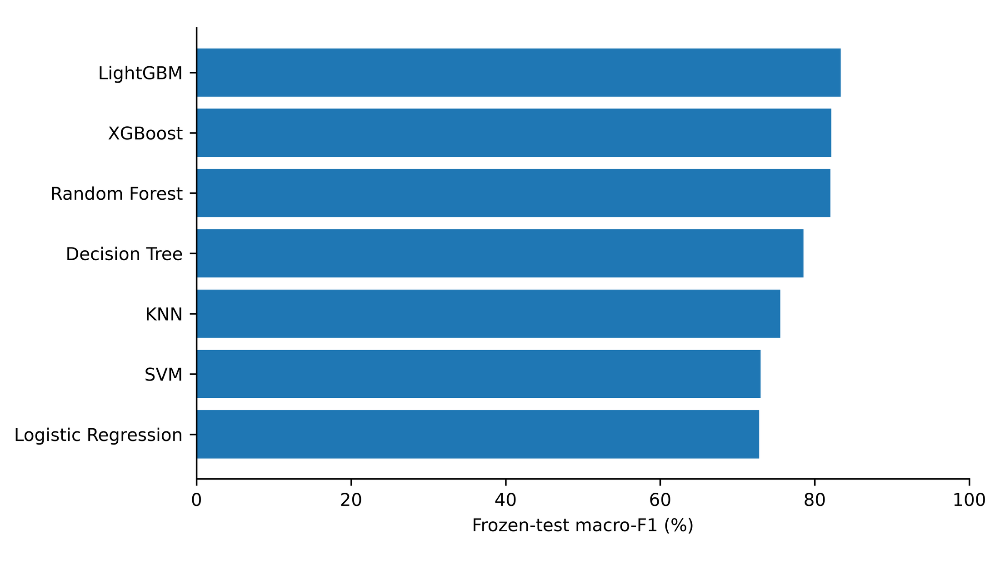

*Şekil 13. Tüm 39 özniteliği kullanan standart sınıflandırıcıların dondurulmuş test F1-Makro karşılaştırması*

Kaynak: Araştırmacı tarafından oluşturulmuştur.

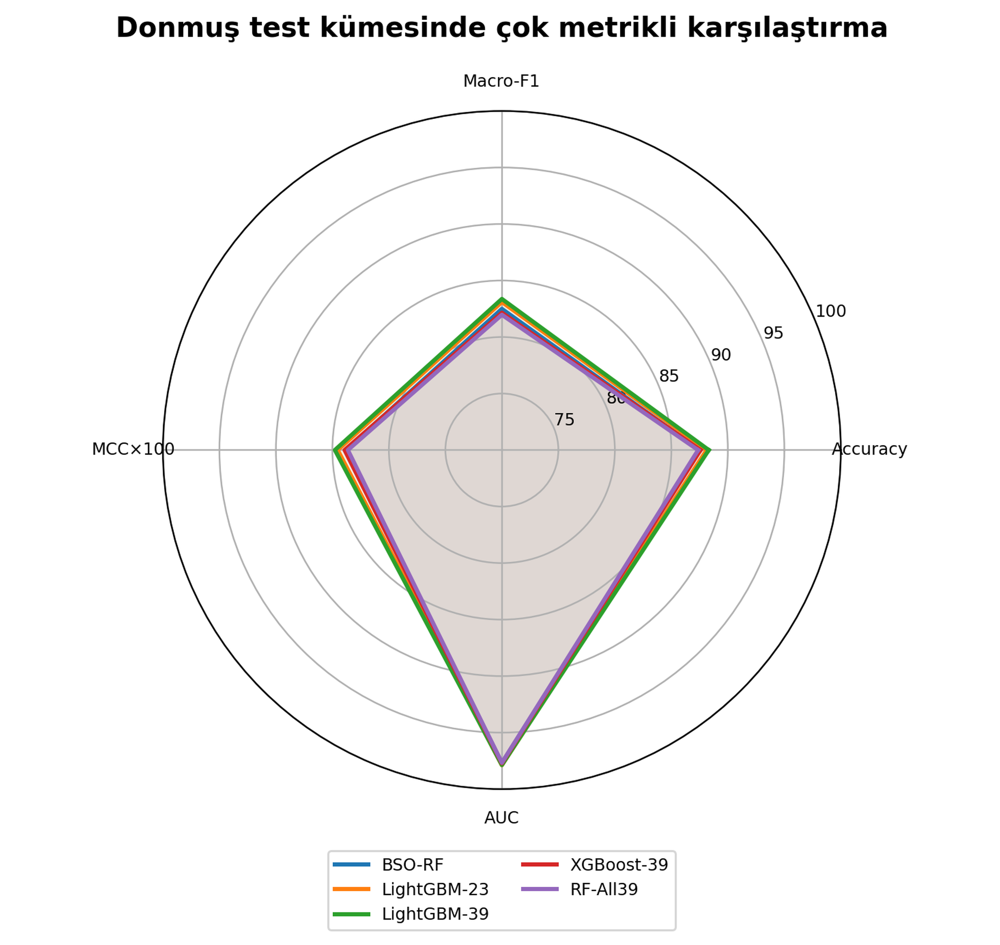

*Şekil 14. BSO-RF ve başlıca karşılaştırıcıların çok metrikli radar karşılaştırması*

Kaynak: Araştırmacı tarafından oluşturulmuştur.

### 4.2. Sınıf bazlı performans ve hata analizi

Genel skorların azınlık sınıfındaki davranışı maskelememesi için her sınıf için kesinlik, duyarlılık ve F1 değerleri ayrı hesaplanmıştır. Bu analiz, yüksek hacimli DDoS sınıfları ile daha örtüşen düşük hacimli saldırı sınıfları arasındaki farkı açık biçimde göstermektedir.

**Tablo 19. Dondurulmuş 23 öznitelikli BSO-RF modelinin sınıf bazlı performansı**

| Sınıf | Kesinlik (%) | Duyarlılık (%) | F1-Skor (%) | Destek |
| --- | --- | --- | --- | --- |
| Backdoor_Malware | 50,11 | 69,72 | 58,31 | 644 |
| BenignTraffic | 75,21 | 82,20 | 78,55 | 5.000 |
| DDoS-ACK_Fragmentation | 99,94 | 99,92 | 99,93 | 5.000 |
| DDoS-SYN_Flood | 99,96 | 99,94 | 99,95 | 5.000 |
| Recon-PortScan | 82,01 | 70,28 | 75,69 | 5.000 |
| Makro Ortalama | 81,44 | 84,41 | 82,49 | 20.644 |
| Ağırlıklı Ortalama | 88,06 | 87,51 | 87,59 | 20.644 |

Kaynak: Araştırmacı tarafından oluşturulmuştur.

DDoS-ACK_Fragmentation ve DDoS-SYN_Flood sınıfları sırasıyla yaklaşık %99,93 ve %99,95 F1 ile neredeyse kusursuz biçimde ayrılmıştır. En zor sınıf Backdoor_Malware'dir: kesinlik %50,11, duyarlılık %69,72 ve F1 %58,31'dir. BenignTraffic F1 değeri %78,55, Recon-PortScan F1 değeri ise %75,69 olarak gerçekleşmiştir.

644 gerçek Backdoor örneğinin 110'u BenignTraffic, 85'i Recon-PortScan olarak tahmin edilmiştir. 5.000 Recon-PortScan örneğinin 1.245'i BenignTraffic ve 241'i Backdoor olarak sınıflandırılmıştır. Bu hata yapısı, F1-Makro değerinin ağırlıklı F1'den neden daha düşük olduğunu açıklamaktadır.

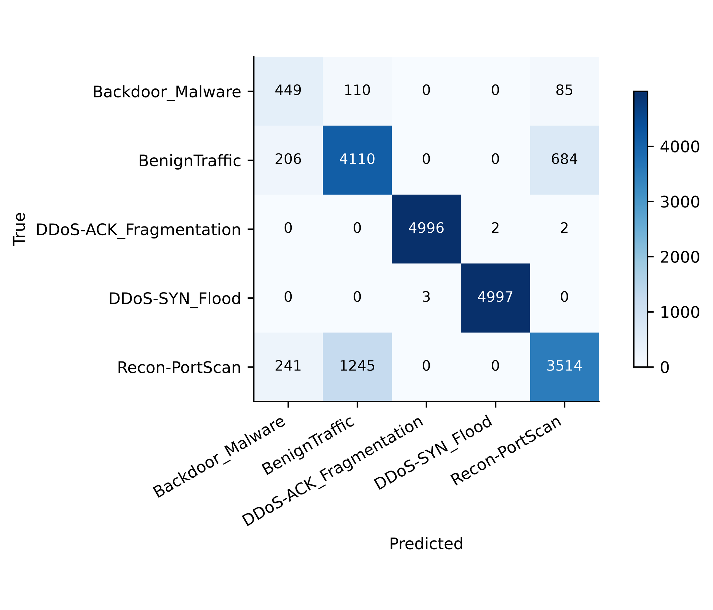

*Şekil 15. Dondurulmuş 23 öznitelikli BSO-Hybrid RF modelinin karışıklık matrisi*

Kaynak: Araştırmacı tarafından oluşturulmuştur.

**Tablo 20. BSO-RF için sınıf bazlı hata ayrıştırması**

| Gerçek sınıf | Başlıca yanlış tahmin | Adet | Sınıf içi (%) | İkinci yanlış tahmin | Yorum |
| --- | --- | --- | --- | --- | --- |
| Backdoor | Benign | 110 | 17,08 | Recon: 85 (%13,20) | Ana düşük-hacimli karışıklık |
| Benign | Recon | 684 | 13,68 | Backdoor: 206 (%4,12) | Benign–Recon örtüşmesi |
| ACK_Frag | SYN | 2 | 0,04 | Recon: 2 (%0,04) | İhmal edilebilir hata |
| SYN_Flood | ACK_Frag | 3 | 0,06 | — | İhmal edilebilir hata |
| Recon | Benign | 1.245 | 24,90 | Backdoor: 241 (%4,82) | En büyük hata kanalı |

Kaynak: Araştırmacı tarafından oluşturulmuştur.

Tablo 20'deki hata dağılımı, temel karışıklığın Backdoor_Malware, BenignTraffic ve Recon-PortScan üçlüsünde toplandığını göstermektedir. Buna karşılık iki DDoS sınıfındaki hata oranları binde birin altında kalmıştır. Bu örüntü, modelin kontrollü görevde flooding saldırılarını oldukça iyi ayırdığını; düşük hacimli saldırı türlerinde ise daha temkinli yorumlanması gerektiğini ortaya koymaktadır.

### 4.3. ROC ve precision–recall eğrileri

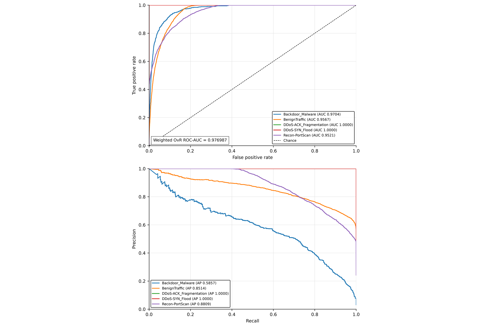

*Şekil 16. BSO-Hybrid RF modelinin ROC ve precision–recall eğrileri*

Kaynak: Araştırmacı tarafından oluşturulmuştur.

ROC ve precision–recall eğrileri iki DDoS sınıfında çok yüksek ayrıştırma gücü gösterirken, Backdoor_Malware için daha düşük kesinlik-duyarlılık dengesi ortaya koymaktadır. Ana modelin ağırlıklı one-vs-rest ROC-AUC değeri %97,70'tir. Bu eğriler, tek bir accuracy değerinin sınıflar arasındaki farklı zorluk düzeylerini tam olarak temsil etmediğini göstermektedir.

### 4.4. BSO arama kararlılığı ve tohum duyarlılığı

BSO aramasının rastlantısallığa duyarlılığını değerlendirmek için aynı grup-duyarlı bölme, yalnızca eğitim verisinde öğrenilen dönüşümler, 12.000 satırlık aday eğitim alt kümesi ve aynı arama bütçesiyle on rastgelelik tohumu (42–51) kullanılmıştır. Bu sonuçlar geliştirme kümesi aday skorlarıdır; on bağımsız test değerlendirmesi değildir.

**Tablo 21. On BSO tohumunda doğrulama kümesi arama kararlılığı**

| Tohum | Fitness | Val. F1-Makro (%) | Val. Doğruluk (%) | Seçilen Özn. |
| --- | --- | --- | --- | --- |
| 42 | 0,2076 | 79,82 | 85,95 | 23 |
| 43 | 0,2076 | 79,80 | 85,80 | 22 |
| 44 | 0,2106 | 79,53 | 85,67 | 23 |
| 45 | 0,2115 | 79,34 | 85,73 | 19 |
| 46 | 0,2061 | 79,93 | 86,06 | 21 |
| 47 | 0,2070 | 79,76 | 85,82 | 18 |
| 48 | 0,2084 | 79,67 | 85,93 | 20 |
| 49 | 0,2058 | 79,91 | 85,92 | 19 |
| 50 | 0,2122 | 79,37 | 85,60 | 23 |
| 51 | 0,2047 | 80,00 | 86,06 | 18 |
| Ort.±SS | 0,2082±0,0025 | 79,71±0,23 | 85,85±0,16 | 20,6±2,1 |

Kaynak: Araştırmacı tarafından oluşturulmuştur.

On koşuda aday RF'lerin doğrulama F1-Makro ortalaması %79,71 ± 0,23, en iyi fitness ortalaması 0,2081 ± 0,0025 ve seçilen öznitelik sayısı 20,6 ± 2,1 olmuştur. 45 ikili maske karşılaştırmasındaki ortalama Jaccard benzerliği 0,440'tır; bu durum skorun görece kararlı, tam 23 öznitelikli maskenin ise tekil ve değişmez olmadığını göstermektedir.

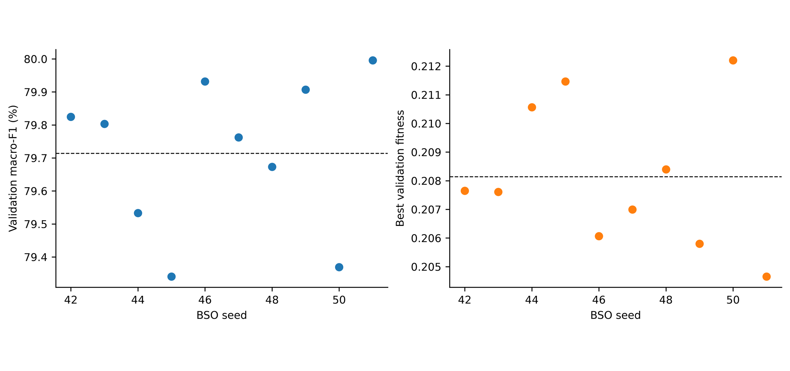

*Şekil 17. On BSO tohumunda doğrulama F1-Makro dağılımı*

Kaynak: Araştırmacı tarafından oluşturulmuştur.

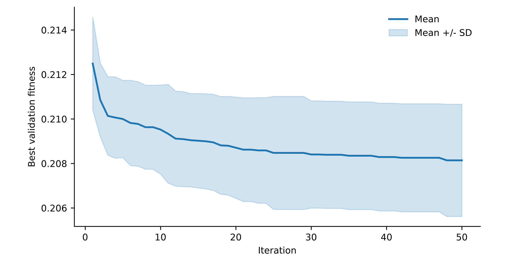

*Şekil 18. On BSO tohumunda ortalama en iyi fitness yakınsaması*

Kaynak: Araştırmacı tarafından oluşturulmuştur.

### 4.5. Bileşen katkısı: ablasyon çalışması

Bileşen katkısı yalnızca geliştirme verisi üzerinde değerlendirilmiştir. Böylece nihai test kümesi, işlem hattı tasarımı veya bileşen seçimi için tekrar tekrar kullanılmamıştır.

**Tablo 22. Geliştirme-kümesi ablasyon analizi**

| Senaryo | Model / Varyant | Özn. | SMOTE | RF Ayarı | Doğruluk (%) | F1-Makro (%) | MCC |
| --- | --- | --- | --- | --- | --- | --- | --- |
| S1 | Temel RF | 39 | Yok | Varsayılan | 86,99 | 80,78 | 0,8326 |
| S2 | RF + SMOTE | 39 | Var | Varsayılan | 86,89 | 80,59 | 0,8311 |
| S3 | BSO-FS + RF | 23 | Var | Varsayılan | 87,30 | 81,49 | 0,8362 |
| S4 | RF tuning | 39 | Var | Ayarlı | 87,38 | 81,43 | 0,8366 |
| S5 | Tam BSO-RF | 23 | Var | Ayarlı | 87,65 | 82,06 | 0,8400 |

Kaynak: Araştırmacı tarafından oluşturulmuştur.

Varsayılan 39 öznitelikli RF %80,78 doğrulama F1-Makro üretirken, yalnızca SMOTE bu değeri artırmamıştır (%80,59). BSO öznitelik seçimi varsayılan RF ile %81,49'a, yalnızca RF ayarı %81,43'e ve tam BSO-RF yapılandırması %82,06'ya ulaşmıştır. Sonuçlar, nihai geliştirme çalışma noktasının tek bir bileşenden değil, öznitelik seçimi ile RF ayarının birlikte etkisinden oluştuğunu göstermektedir.

### 4.6. Öznitelik önemi, SHAP atıfları ve seçim davranışı

Ana model 23 öznitelik kullanmaktadır. RF safsızlık önemleri ile yalnızca doğrulama verisine dayalı TreeSHAP atıfları, modelin karar davranışını farklı açılardan incelemek için birlikte değerlendirilmiştir. SHAP yalnızca sabit 200 doğrulama satırında hesaplanmış ve öznitelik seçimine geri beslenmemiştir.

**Tablo 23. Seçilen 23 özniteliğin RF önemleri ve seçim kararlılığı**

| Sıra | Öznitelik | RF Önem | Kümülatif (%) | Kararlılık |
| --- | --- | --- | --- | --- |
| 1 | Number | 0,187153 | 18,7 | 5/10 – Orta |
| 2 | syn_count | 0,177338 | 36,4 | 8/10 – Yüksek |
| 3 | Tot_sum | 0,112325 | 47,7 | 3/10 – Düşük |
| 4 | syn_flag_number | 0,088236 | 56,5 | 7/10 – Orta |
| 5 | Rate | 0,083359 | 64,8 | 8/10 – Yüksek |
| 6 | AVG | 0,054872 | 70,3 | 3/10 – Düşük |
| 7 | Max | 0,053569 | 75,7 | 9/10 – Yüksek |
| 8 | Header_Length | 0,041015 | 79,8 | 4/10 – Düşük |
| 9 | Time_To_Live | 0,040053 | 83,8 | 10/10 – Yüksek |
| 10 | Std | 0,037587 | 87,6 | 6/10 – Orta |
| 11 | HTTPS | 0,035205 | 91,1 | 10/10 – Yüksek |
| 12 | HTTP | 0,017817 | 92,9 | 10/10 – Yüksek |
| 13 | psh_flag_number | 0,017495 | 94,6 | 8/10 – Yüksek |
| 14 | fin_flag_number | 0,011563 | 95,8 | 4/10 – Düşük |
| 15 | DNS | 0,010500 | 96,8 | 10/10 – Yüksek |
| 16 | Min | 0,007850 | 97,6 | 5/10 – Orta |
| 17 | rst_flag_number | 0,006291 | 98,2 | 3/10 – Düşük |
| 18 | rst_count | 0,005427 | 98,8 | 7/10 – Orta |
| 19 | LLC | 0,003801 | 99,1 | 5/10 – Orta |
| 20 | ICMP | 0,003119 | 99,5 | 7/10 – Orta |
| 21 | SSH | 0,002660 | 99,7 | 8/10 – Yüksek |
| 22 | Protocol Type | 0,001772 | 99,9 | 5/10 – Orta |
| 23 | DHCP | 0,000993 | 100,0 | 5/10 – Orta |

Kaynak: Araştırmacı tarafından oluşturulmuştur.

Number, syn_count, Tot_sum, syn_flag_number ve Rate en yüksek RF önemine sahip özniteliklerdir. On BSO koşusunda DNS, HTTP, HTTPS ve Time_To_Live her koşuda; Max dokuz koşuda; Rate, SSH, psh_flag_number ve syn_count sekiz koşuda seçilmiştir. Bu dokuz değişken yüksek kararlılıklı çekirdeği oluşturmaktadır. Önem ile seçim sıklığı arasındaki ilişki düşük olduğundan iki ölçüt birbirinin yerine kullanılmamalıdır.

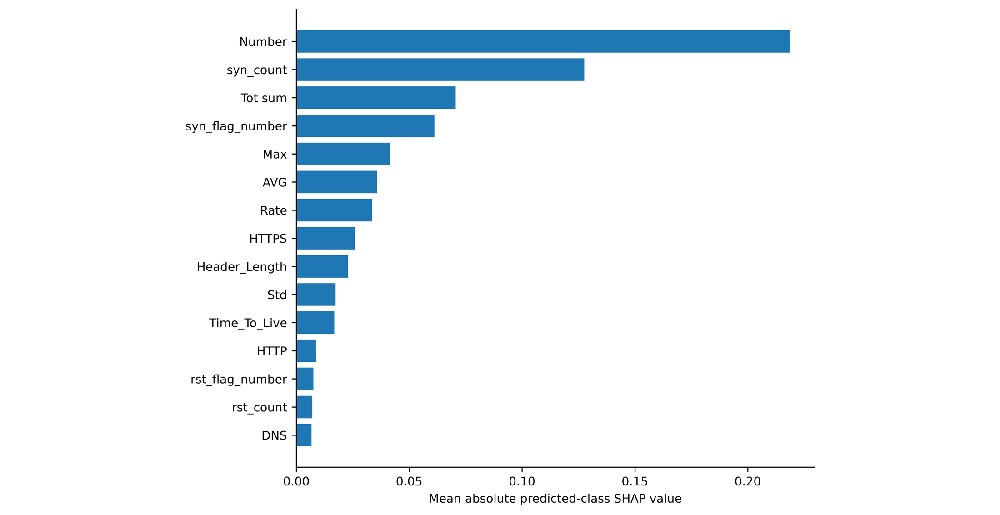

*Şekil 19. Yalnızca doğrulama kümesinde SHAP ile seçilmiş BSO-RF özniteliklerinin ortalama mutlak atıfları*

Kaynak: Araştırmacı tarafından oluşturulmuştur.

### 4.7. Öznitelik seçimi kararlılığı

Öznitelik maskesinin tek bir rastgele başlangıca aşırı bağlı olup olmadığını görmek için 39 girişin on BSO koşusundaki seçilme sıklıkları hesaplanmıştır. Dokuz öznitelik en az sekiz koşuda seçilmiş; 18 ana-model özniteliği en az beş koşuda yeniden elde edilmiştir.

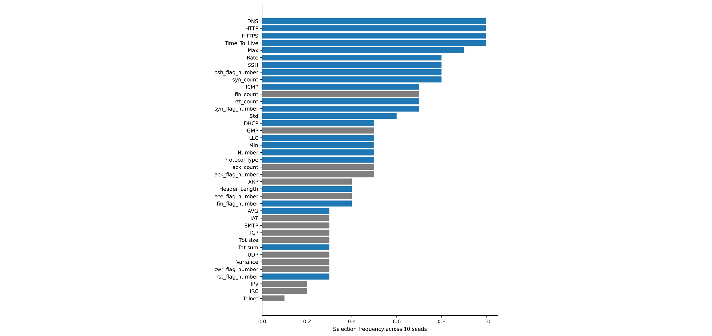

*Şekil 20. Tüm 39 özniteliğin on BSO koşusundaki seçim sıklığı*

Kaynak: Araştırmacı tarafından oluşturulmuştur.

Şekil 20, ana modeldeki 23 özniteliğin tamamının aynı kararlılık düzeyine sahip olmadığını göstermektedir. Seçim sıklıklarındaki bu dağılım, 23 öznitelikli maskenin yalnızca bu görev ve arama koşulları altında belirlenmiş bir çalışma noktası olarak ele alınmasını gerektirir; maske evrensel veya tek olası öznitelik kümesi olarak yorumlanmamalıdır.

### 4.8. Eşit bütçeli meta-sezgisel optimizatör karşılaştırması

BSO, PSO, GA ve GWO beş eşleşmiş rastgelelik tohumu altında aynı başlangıç aday popülasyonu, aynı aday değerlendirme fonksiyonu ve koşu başına 1.275 objektif çağrısı ile karşılaştırılmıştır. Bu deney yalnızca doğrulama kümesi arama davranışını karşılaştırır; optimizatörlerin hiçbiri bu karşılaştırma kapsamında test etiketlerine erişmemiştir.

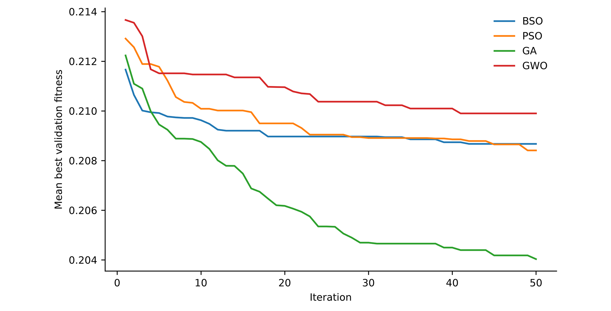

*Şekil 21. Eşit bütçeli BSO, PSO, GA ve GWO yakınsama karşılaştırması*

Kaynak: Araştırmacı tarafından oluşturulmuştur.

Beş eşleşmiş tohumda GA ortalama 0,2040 ile en düşük fitness değerini üretirken BSO 0,2087, PSO 0,2084 ve GWO 0,2099 düzeyinde kalmıştır. Friedman testi χ²=10,680 ve p=0,0136, Kendall W≈0,712 vermiştir. Yalnızca beş blok bulunduğundan bu sıralama keşifsel kabul edilmeli ve evrensel optimizatör üstünlüğü olarak yorumlanmamalıdır.

### 4.9. Kaynak profili, kalibrasyon ve çıkarım performansı

Öznitelik sayısının azalmasının model dosyası, yüklü bellek veya tahmin gecikmesine doğrudan yansıyıp yansımadığı aynı bilgisayar üzerinde ölçülmüştür. Bu analiz, giriş kompaktlığı ile RF model kaynak maliyetinin birbirinden ayrılmasını sağlar.

**Tablo 24. Aynı host üzerinde kaynak ve kalibrasyon profili**

| Model | Özn. | Model MB / RSS MB | Medyan ms/akış | Kalibrasyon |
| --- | --- | --- | --- | --- |
| BSO-RF | 23 | 37,89 / 269,66 | 0,04471 | Brier 0,1671; ECE 0,00717 |
| RF-All39 (aynı HP) | 39 | 36,19 / 257,23 | 0,04482 | Brier 0,1682; ECE 0,00523 |
| Throughput – BSO-RF | 23 | — | ≈22.366,9 akış/s | Aynı bilgisayar ölçümü |
| Throughput – RF-All39 | 39 | — | ≈22.313,2 akış/s | Aynı bilgisayar ölçümü |

Kaynak: Araştırmacı tarafından oluşturulmuştur.

BSO-RF'nin model dosyası 37,89 MB ve yüklü RSS değeri 269,66 MB iken RF-All39 için değerler sırasıyla 36,19 MB ve 257,23 MB'dir. Medyan batch-normalized gecikme neredeyse aynıdır: 0,04471 ve 0,04482 ms/akış. Dolayısıyla 23 özniteliğe düşmek giriş toplama şemasını sadeleştirir; fakat bu deneyde model dosyası veya RAM tüketimini azaltmamıştır.

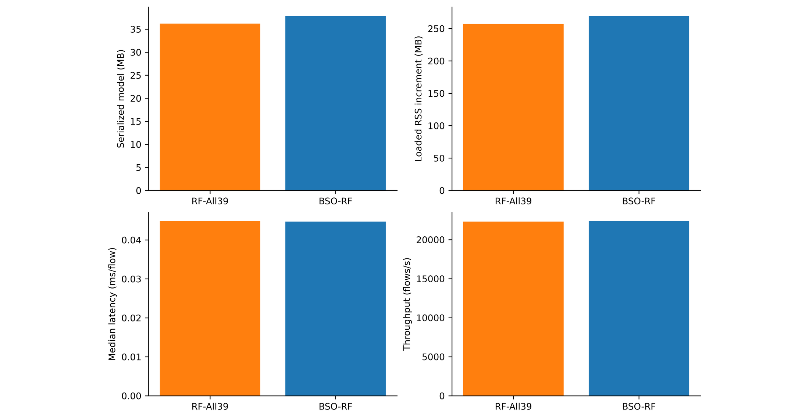

*Şekil 22. BSO-RF ile RF-All39 için kaynak ve kalibrasyon karşılaştırması*

Kaynak: Araştırmacı tarafından oluşturulmuştur.

### 4.10. Eşleştirilmiş bootstrap ve ileri düzey sağlamlık doğrulaması

Küçük nokta farklarını aşırı yorumlamamak için birincil BSO-RF ile aynı hiperparametreli RF-All39 aynı dondurulmuş test satırlarında eşleştirilmiş bootstrap ile karşılaştırılmıştır. Bu birincil analize ek olarak, model seçimi tamamlandıktan sonra sabit 23 öznitelik ve sabit RF hiperparametreleri beş farklı grup-duyarlı fold üzerinde yeniden değerlendirilmiş; kalibrasyon, bağımsız eşleştirilmiş istatistik, kontrollü giriş bozulması, bırak-bir-saldırı-dışarı ve güncel host gecikme analizleri yürütülmüştür. Tüm ek deneyler post-hoc olarak etiketlenmiş ve test sonucuna göre ana model yeniden seçilmemiştir.

Birincil arşivde BSO-RF – RF-All39 farkı F1-Makro için +0,521 yüzde puan (%95 GA: +0,137–+0,958) olup güven aralığı sıfırın üzerinde kalmaktadır. 1.000 tekrar içeren bağımsız bootstrap tekrarı aynı farkı +0,521 yüzde puan olarak yeniden üretmiş ve %95 aralığı yaklaşık +0,090–+0,919 yüzde puan vermiştir. Buna karşılık doğruluk farkı yalnızca +0,145 yüzde puan düzeyinde kalmış, güven aralığı sıfırı kesmiş ve exact McNemar testi p=0,227 üretmiştir. Dolayısıyla ana karşılaştırmanın savunulabilir sonucu küçük bir F1-Makro avantajıdır; genel doğruluk üstünlüğü iddia edilmemektedir.

**Tablo 25. Birincil ve ileri düzey post-hoc doğrulama sonuçları**

| Analiz | Protokol | Temel sonuç | İstatistik / kapsam | Bilimsel yorum |
| --- | --- | --- | --- | --- |
| Birincil paired bootstrap | BSO-RF vs aynı-HP RF-All39; dondurulmuş 20.644 test satırı | F1-Makro farkı +0,521 pp | Arşiv %95 GA +0,137–+0,958 pp; bağımsız tekrar +0,090–+0,919 pp | Küçük fakat yönü tekrarlanan avantaj |
| Doğruluk / hata çifti | Aynı iki model ve aynı test satırları | Accuracy +0,145 pp | Bağımsız %95 GA sıfırı kesiyor; McNemar p=0,227 | Genel accuracy üstünlüğü desteklenmiyor |
| 5-fold grup-duyarlı sabit yapılandırma | 23 öznitelik + aynı RF HP; her fold içinde train-only preprocessing/SMOTE | Accuracy %87,59 ± %0,17; F1-Makro %82,38 ± %0,29 | MCC 0,8390 ± 0,0024; AUC %97,77 ± %0,04 | Tek split bağımlılığına karşı güçlü tutarlılık; nested BSO-CV değildir |
| Kalibrasyon tekrarı | Frozen test probabilities | Brier 0,1671; ECE 0,00717 | 15-bin top-label ECE | Olasılık kalibrasyonu arşiv sonucu ile yeniden üretildi |
| Leave-one-attack-out stres | Hedef saldırı eğitimden çıkarıldı; benign-vs-malicious ikili test | Unseen recall: Backdoor %55,43; ACK %99,64; SYN %100; Recon %4,54 | Harici zero-day benchmark değildir | Bilinmeyen saldırı genellemesi saldırı ailesine güçlü biçimde bağlı |
| Kontrollü giriş bozulması | Frozen test temsilinde Gaussian noise / feature dropout | σ=0,05: F1-Makro %54,36; %5 dropout: %77,27 | Sentetik covariate/feature corruption | Gerçek concept drift kanıtı değil; dağılım bozulmasına duyarlılık gösterir |
| Güncel host gecikme tekrarı | Frozen preprocessing + predict; batch=1024 | 0,04336 ms/akış; ≈23.064 akış/s | Host- ve batch-spesifik | Gerçek ağ geçidi/enerji gecikmesi olarak yorumlanmamalı |

Kaynak: Birincil yeniden üretilebilirlik paketi ve 28 Eylül 2026 tarihli genişletilmiş doğrulama/stres deneyleri.

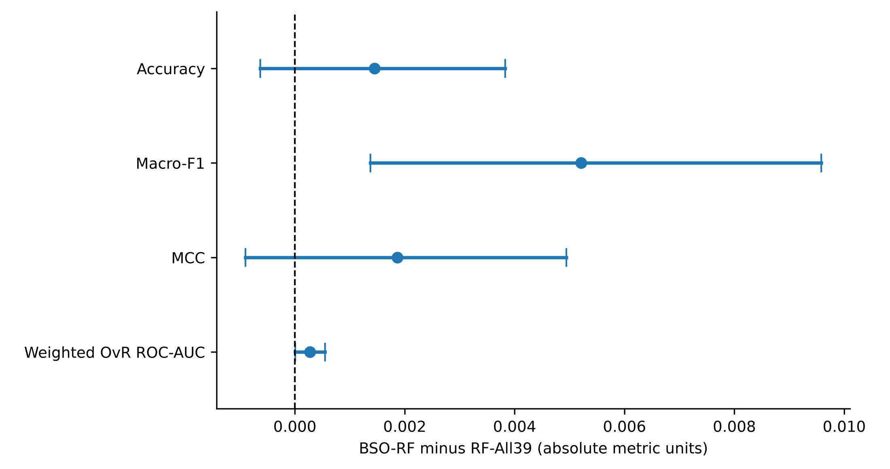

*Şekil 23. BSO-RF ile aynı hiperparametreli RF-All39 arasındaki eşleştirilmiş bootstrap farkları*

Kaynak: Araştırmacı tarafından oluşturulmuştur.

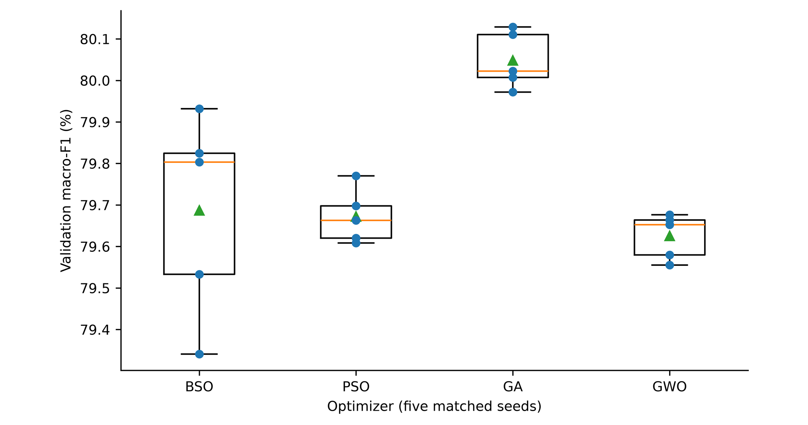

*Şekil 24. Dört optimizatörün beş eşleşmiş tohumdaki doğrulama F1-Makro dağılımı*

Kaynak: Araştırmacı tarafından oluşturulmuştur.

Sabit-yapılandırma beş katlı grup-duyarlı doğrulamada ortalama F1-Makro %82,38 (SS=0,29 yüzde puan), doğruluk %87,59 (SS=0,17 yüzde puan) ve ağırlıklı OvR AUC %97,77 (SS=0,04 yüzde puan) olarak ölçülmüştür. Bu sonuç ana dondurulmuş test tahminiyle yakındır ve seçilen çalışma noktasının tek bir split'e aşırı bağımlı olmadığını destekler. Bununla birlikte bu analizde BSO her fold içinde yeniden optimize edilmemiştir; dolayısıyla tam nested model-selection belirsizliği ölçülmüş sayılmaz. Kontrollü giriş-bozulma ve leave-one-attack-out deneyleri ise önemli negatif kanıt üretmiştir: küçük sentetik öznitelik bozulmaları performansı düşürebilmekte ve görülmemiş Recon-PortScan için ikili saldırı duyarlılığı %4,54'e kadar inmektedir.

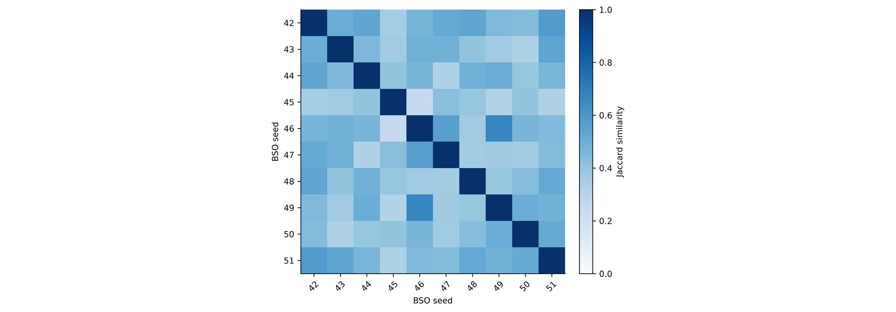

*Şekil 25. On BSO koşusunda seçilen öznitelik kümelerinin Jaccard benzerlik matrisi*

Kaynak: Araştırmacı tarafından oluşturulmuştur.

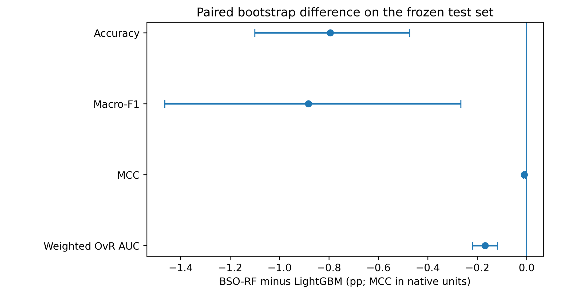

*Şekil 26. BSO-RF ile tüm-39 LightGBM arasındaki eşleştirilmiş bootstrap farkları*

Kaynak: Araştırmacı tarafından oluşturulmuştur.

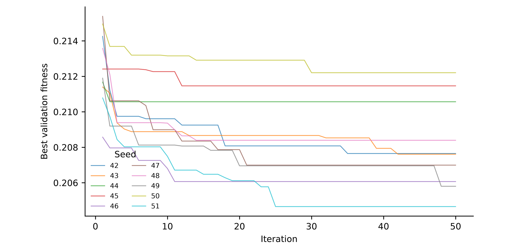

*Şekil 27. On BSO tohumu için bireysel yakınsama eğrileri*

Kaynak: Araştırmacı tarafından oluşturulmuştur.

### 4.11. Öznitelik azaltma ve çalışma noktası verimliliği

BSO-RF'nin pratik katkısı model belleğini otomatik olarak küçültmek değil, izlenmesi gereken orijinal trafik özniteliklerini 39'dan 23'e indirmektir. Bu ayrım, veri toplama/özellik deposu maliyeti ile tahmin modelinin kendi depolama maliyetinin farklı kaynaklar olduğunu göstermektedir.

**Tablo 26. Öznitelik sayısı ile dondurulmuş test F1-Makro çalışma noktalarının karşılaştırması**

| Model | Test F1-Makro (%) | Kullanılan öznitelik | Durum |
| --- | --- | --- | --- |
| BSO-RF | 82,49 | 23 | Ana dondurulmuş model |
| LightGBM-23 | 83,10 | 23 | Sonradan eklenen; aynı BSO maskesi |
| LightGBM-39 | 83,37 | 39 | Doğrulama-seçimli temel model |
| RF-All39 bağımsız ayarlı | 81,91 | 39 | Sonradan eklenen; 1.275 val çağrısı |
| GA-RF kayıtlı maske | 81,89 | 13 | Sonradan eklenen |

Kaynak: Deneysel model karşılaştırma çıktıları temel alınarak araştırmacı tarafından düzenlenmiştir.

Ana BSO-RF %41,03 giriş azaltımı ile %82,49 F1-Makro üretmiştir. Aynı 23 özniteliği kullanan LightGBM-23 %83,10'a ulaşırken, bağımsız ayarlı RF-All39 %81,91 ve 13 öznitelikli GA-RF %81,89 değerinde kalmıştır. Bu sonuçlar seçilmiş temsilin RF'ye özgü olmadığını, ancak daha az öznitelik ile daha yüksek ham skor arasında tekdüze bir ilişki bulunmadığını göstermektedir.

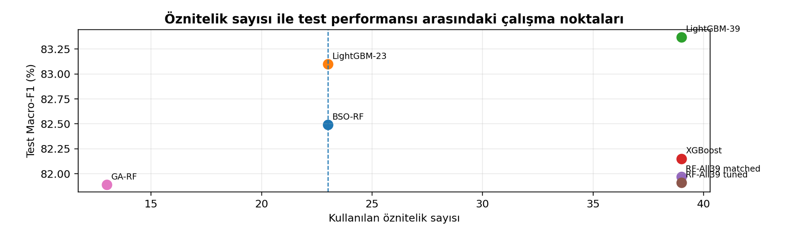

*Şekil 28. Öznitelik sayısı ile dondurulmuş test F1-Makro arasındaki çalışma noktaları*

Kaynak: Araştırmacı tarafından oluşturulmuştur.

### 4.12. Gerçek dünya uygulanabilirliği ve hata analizi

### 4.12.1. Gerçek dünya uygulama etkileri

Önerilen yaklaşım çevrimdışı model geliştirme ile çevrimiçi tahmini açık biçimde ayırır. Çevrimiçi kullanımda dondurulmuş dönüşümler ve 23 öznitelikli RF uygulanabilir; ancak aynı bilgisayarda yapılan ölçümler model dosyası ve RSS belleğinin 39 öznitelikli RF'ye göre azalmadığını göstermiştir. Bu ölçümler ışığında yöntem, 'hafif model' olarak değil, daha dar bir izleme girdisi kullanan ve karar süreci denetlenebilir bir RF çalışma noktası olarak tanımlanmalıdır.

### 4.12.2. Hata analizi

Karışıklık matrisi, DDoS-ACK_Fragmentation ve DDoS-SYN_Flood sınıflarının neredeyse kusursuz ayrıldığını; hataların Backdoor_Malware, BenignTraffic ve Recon-PortScan arasında yoğunlaştığını göstermektedir. Backdoor gerçeklerinin %17,08'i BenignTraffic ve %13,20'si Recon-PortScan olarak; Recon-PortScan gerçeklerinin %24,90'ı BenignTraffic ve %4,82'si Backdoor olarak tahmin edilmiştir. Bu sınıflar operasyonel kullanımda ek bağlamsal sinyallerle desteklenmelidir.

### 4.13. Geçerliliğe yönelik tehditler

Bulgular, hem olumlu hem de olumsuz doğrulama kanıtları birlikte dikkate alınarak yorumlanmalıdır. Grup-duyarlı veri ayrımı birebir aynı satır örtüşmesini kaldırmış, yalnızca eğitim verisinde öğrenilen dönüşümler sızıntı riskini sınırlamış ve dondurulmuş çalışma noktası beş ayrı group-aware fold üzerinde benzer performans üretmiştir. Sentetik bozulma ve bilinmeyen-saldırı stresleri de dağılım değişiminde belirgin zayıflıklar ortaya koymuştur.

**Tablo 27. Geçerliliğe yönelik tehditler, kontroller ve kalan sınırlar**

| Geçerlilik boyutu | Kontrol / yürütülen doğrulama | Kalan sınır |
| --- | --- | --- |
| İç geçerlilik | SHA-256 exact-row grouping; 0/0/0 cross-partition overlap; tüm fitted preprocessing training-only; frozen pipeline replay | Yakın-benzer fakat aynı olmayan satırlar ve gizli ilişkili oturumlar tam kontrol edilemeyebilir |
| Bölme/genelleme kararlılığı | 5-fold group-aware sabit-yapılandırma: F1-Makro %82,38 ± %0,29 | BSO/hiperparametre araması her dış fold içinde yeniden çalıştırılmadı; tam nested model-selection CV değildir |
| Dağılım / bilinmeyen saldırı dayanıklılığı | Gaussian/dropout stresleri ve leave-one-attack-out yürütüldü | Sentetik bozulmaya duyarlılık ve unseen Recon recall %4,54; gerçek concept drift/zero-day genellemesi kanıtlanmış değildir |
| Dış geçerlilik | CICIoT2023 kontrollü beş sınıf; source/identifier feasibility audit yapıldı | Tek veri seti; device/session/time/capture-disjoint veya bağımsız dış dataset performansı yok |
| Sonuç geçerliliği | Frozen test, paired bootstrap, McNemar, 10 BSO tohumu, paired optimizer seeds, 5-fold fixed-config audit | Ek analizler post-hoc; dış veri belirsizliğini temsil etmez |
| Yapı / operasyonel geçerlilik | F1-Makro, MCC, AUC, kalibrasyon, hata yapısı, batch-latency ve kaynak profili birlikte raporlandı | Host ölçümü fiziksel enerji, uç donanım veya gerçek packet-to-decision saha gecikmesi değildir |

Kaynak: Araştırmacı tarafından oluşturulmuştur.

### 4.14. Nihai araştırma katkıları

Araştırma katkıları yalnızca doğruluk skoruyla tanımlanmamıştır. Veri sızıntısı kontrolü, giriş kompaktlığı, dondurulmuş test kullanımı, belirsizlik analizi, arama kararlılığı, açıklanabilirlik ve beklenenin tersine çıkan sonuçların şeffaf biçimde raporlanması birlikte değerlendirilmiştir.

**Tablo 28. Araştırmanın nihai katkıları ve doğrulama kanıtları**

| Katkı | Durum | Kanıt / çıktı |
| --- | --- | --- |
| Grup-duyarlı split-first protokol | ✓ | SHA-256 exact-row gruplama; train-val/test overlap 0 / 0 / 0 |
| BSO ortak öznitelik + RF araması | ✓ | 39 bit + 4 RF koordinatı; 25×50 geliştirme araması |
| Giriş kompaktlığı | %41,03 | 39 → 23 öznitelik |
| Dondurulmuş-test değerlendirmesi | ✓ | %87,51 doğruluk; %82,49 F1-Makro; MCC 0,8382; AUC %97,70 |
| Bölme-kararlılığı doğrulaması | ✓ | 5-fold group-aware fixed-config: F1-Makro %82,38 ± %0,29; Accuracy %87,59 ± %0,17 |
| Belirsizlik ve arama kararlılığı | ✓ | Paired bootstrap/McNemar; 10 BSO tohumu; Jaccard=0,440; 9 özelliklik kararlı çekirdek |
| Negatif sonuç / stres şeffaflığı | ✓ | LightGBM ham skoru daha yüksek; model belleği küçülmedi; synthetic shift ve unseen Recon zayıflığı açık raporlandı |

Kaynak: Araştırmacı tarafından oluşturulmuştur.

### 4.15. Bulguların tartışılması

Bulgular birlikte değerlendirildiğinde BSO-Hybrid RF'nin katkısı ham skor liderliğiyle açıklanmamaktadır. Sızıntı kontrollü protokol altında 23 öznitelikli RF, aynı hiperparametrelerle tüm 39 özniteliği kullanan RF'ye karşı küçük fakat bootstrap aralığı sıfırın üzerinde kalan bir F1-Makro avantajı sağlamıştır. Buna karşılık LightGBM sonuçları, öznitelik temsilinin yanı sıra sınıflandırıcı seçiminin de performansı belirlemeye devam ettiğini göstermektedir.

AS₁ kapsamında BSO, 39 girişten 23'ünü seçmiş ve dört RF hiperparametresini aynı arama sürecinde ayarlamıştır. AS₂ için hata analizi Backdoor-Benign-Recon üçlüsünün temel güçlük alanı olduğunu, iki DDoS sınıfının ise çok yüksek duyarlılıkla ayrıldığını göstermiştir. AS₃ kapsamında bootstrap, on tohumlu BSO kararlılık analizi ve eşit bütçeli optimizatör deneyleri; hangi sonuçların kararlı, hangilerinin arama koşullarına daha duyarlı olduğunu nicel olarak ortaya koymuştur.

Hipotezler açısından AH₁ desteklenmiştir: aynı RF hiperparametreleriyle yapılan birincil karşılaştırmada F1-Makro için güven aralığı BSO-RF lehine sıfırın üzerinde kalmıştır. AH₂ de desteklenmiştir; giriş uzayı %41,03 azaltılırken güçlü test performansı korunmuştur. AH₃ ise kısmen desteklenmiştir. Doğrulama skoru düşük varyans göstermiş ve dokuz öznitelikli kararlı bir çekirdek belirlenmiş olsa da ortalama Jaccard=0,440 değeri tam maskenin tekil bir çözüm olmadığını göstermektedir. Eşit bütçeli karşılaştırmada GA daha düşük ortalama doğrulama fitness değeri üretmiş; bu nedenle BSO için genel bir optimizatör üstünlüğü iddia edilmemiştir.

### 4.16. Bölüm özeti

Dondurulmuş test performansı, sınıf bazlı hatalar, ROC/PR eğrileri, geliştirme ablasyonu, BSO kararlılığı, SHAP atıfları, eşit bütçeli optimizatör deneyleri, kaynak/kalibrasyon profili ve bootstrap belirsizliği aynı çerçevede ele alındığında sonuçlar tek bir 'en iyi model' anlatısına indirgenememektedir. BSO-RF daha dar ve sızıntı kontrollü bir RF çalışma noktası sağlarken, LightGBM hem tüm özniteliklerle hem de seçilen özniteliklerle daha yüksek ham F1-Makro değerleri üretmiştir.

<strong>5. SONUÇ VE ÖNERİLER</strong>

Sonuçlar, araştırma soruları ve hipotezlerle birlikte ele alınmış; doğrudan deneysel kanıtla desteklenen bulgular ile veri ve deney tasarımının sınırları içinde yorumlanması gereken çıkarımlar açık biçimde ayrılmıştır. Bu ayrımın ardından çalışmanın uygulamadaki karşılığı, temel sınırlılıkları ve izleyen araştırmalar için öncelikli adımlar özetlenmektedir.

### 5.1. Sonuçlar

IoT ortamlarında DDoS ve ilişkili saldırıların çok sınıflı tespiti için geliştirilen BSO-Hybrid RF çerçevesi, CICIoT2023'ten oluşturulan kontrollü beş sınıflı görev üzerinde sınanmıştır. Çalışmanın temel yöntemsel özelliği, ortak öznitelik/RF optimizasyonunu grup-duyarlı bölme, dondurulmuş test kümesi, belirsizlik analizi ve arama kararlılığıyla aynı değerlendirme düzeninde birleştirmesidir. Araştırma hedeflerinin gerçekleşme durumu Tablo 29'da özetlenmiştir.

**Tablo 29. Araştırma hedeflerinin gerçekleşme durumu ve güncellenmiş kanıtlar**

| Hedef | Açıklama | Elde edilen sonuç ve kanıt | Durum |
| --- | --- | --- | --- |
| H1 | Sızıntı kontrollü veri ayrımı | SHA-256 gruplama; 72.252 / 10.322 / 20.644; exact overlap 0/0/0 | ✓ Başarıldı |
| H2 | BSO ile kompakt RF çalışma noktası | 23/39 öznitelik (%41,03 azaltma); RF: 237 ağaç, depth 28 | ✓ Başarıldı |
| H3 | Dondurulmuş testte güvenilir değerlendirme | %87,51 accuracy; %82,49 Macro-F1; MCC 0,8382; AUC %97,70; frozen replay eşleşti | ✓ Başarıldı |
| H4 | Belirsizlik ve bölme/arama kararlılığı | Paired bootstrap + McNemar; 10 BSO tohumu; 5-fold group-aware fixed-config F1-Makro %82,38 ± %0,29 | ✓ Başarıldı |
| H5 | Sınırlı ve denetlenebilir iddia | LightGBM ve kaynak karşı-sonuçları; shift/LOAO zayıflıkları; external-ID feasibility audit açık raporlandı | ✓ Başarıldı |

Kaynak: Araştırmacının deneysel sonuçları.

BSO, 39 öznitelikten 23'ünü seçerek giriş boyutunu %41,03 azaltmıştır. Ana maskede Number, syn_count, Tot_sum, syn_flag_number ve Rate yüksek RF önemine sahipken DNS, HTTP, HTTPS ve Time_To_Live on bağımsız arama koşusunun tamamında seçilmiştir. Bu iki gözlem, bir özniteliğin RF içindeki öneminin arama boyunca seçilme kararlılığıyla aynı şeyi ölçmediğini göstermektedir.

Nihai BSO-Hybrid RF modeli 20.644 satırlık dondurulmuş test kümesinde %87,51 doğruluk, %82,49 F1-Makro, %87,59 ağırlıklı F1, %84,41 dengeli doğruluk, 0,8382 MCC ve %97,70 ağırlıklı OvR AUC elde etmiştir. Aynı RF ayarlarıyla tüm 39 özniteliği kullanan karşılaştırıcıya göre F1-Makro farkı +0,521 yüzde puandır; %95 eşleştirilmiş bootstrap güven aralığı +0,137 ile +0,958 arasındadır.

Sınıf bazlı sonuçlarda iki DDoS sınıfı yaklaşık %99,93-%99,95 F1 aralığında ayrılmıştır. Backdoor_Malware %58,31 F1 ile en zor sınıf olurken BenignTraffic %78,55 ve Recon-PortScan %75,69 F1 elde etmiştir. Karışıklık matrisi, düşük hacimli Backdoor ve keşif trafiğinin normal trafikle örtüşmesinin kalan başlıca hata kaynağı olduğunu göstermektedir.

On BSO tohumu arasında doğrulama F1-Makro değişkenliği düşük kalmasına rağmen seçilen öznitelik maskelerinin ortalama Jaccard benzerliği 0,440'tır. Dokuz öznitelikli yüksek kararlılıklı çekirdek ve ana maskenin 23 özniteliğinden 18'inin en az beş koşuda yeniden seçilmesi, çözümün kararlı bir çekirdeğe sahip olduğunu; ancak tek bir eşdeğer maske ile sınırlı olmadığını düşündürmektedir.

Sınıflandırıcı bağlamı sonuçların yorumunda belirleyicidir. Tüm 39 özniteliği kullanan LightGBM %83,37 F1-Makro, aynı 23 BSO özniteliğini kullanan LightGBM-23 ise %83,10 F1-Makro elde ederek BSO-RF'nin %82,49 değerini aşmıştır. Bu sonuç, seçilen öznitelik temsilinin başka bir güçlü sınıflandırıcıya aktarılabildiğini; buna karşın RF'nin ham skor açısından genel lider olmadığını göstermektedir.

Eşit bütçeli optimizatör deneylerinde GA en düşük ortalama doğrulama fitness değerini üretmiş, BSO genel lider olmamıştır. Ana model dondurulduktan sonra kayıtlı 13 öznitelikli GA maskesi RF ile yeniden eğitildiğinde test F1-Makro değeri %81,89 olarak ölçülmüş ve BSO-RF'nin altında kalmıştır. Dolayısıyla optimizasyon sırasında elde edilen fitness sıralaması ile dondurulmuş test kümesindeki nihai RF performansı aynı sıralamayı vermemektedir.

Geliştirme kümesindeki ablasyon sonuçlarında tam BSO-RF yapılandırması %82,06 doğrulama F1-Makro ile varsayılan RF, yalnızca SMOTE, yalnızca öznitelik seçimi ve yalnızca RF ayarı varyantlarının üzerinde kalmıştır. Bu sonuç, seçilen çalışma noktasının tek bir bileşenden değil, ortak optimizasyon düzeninin birleşik etkisinden oluştuğunu desteklemektedir.

Kaynak profili beklenenin aksine bir sonuç vermiştir. BSO-RF daha az giriş kullanmasına rağmen model dosyası (37,89 MB) ve yüklü RSS belleği (269,66 MB) 39 öznitelikli eşdeğer RF'den daha küçük değildir; medyan tahmin gecikmeleri de neredeyse aynıdır. Buna göre verimlilik iddiası model belleği veya gecikmeye değil, izlenmesi gereken giriş şemasının daha kompakt olmasına dayandırılmalıdır.

İstatistiksel yorum tek bir çapraz doğrulama sıralamasına dayandırılmamıştır. Dondurulmuş test kümesinde eşleştirilmiş bootstrap belirsizliği, on tohumlu BSO arama kararlılığı ve beş eşleşmiş tohumla yürütülen optimizatör deneyleri birlikte kullanılmıştır. Böylece küçük nokta farklarının olduğundan fazla önemsenmesi azaltılmış ve ana bulguların hangi sınırlar içinde savunulabileceği daha açık hâle getirilmiştir.

Genel olarak çalışma, CICIoT2023'ten oluşturulan kontrollü beş sınıflı görevde birebir aynı satırların farklı bölmelere dağılmasını engelleyen, ön işleme adımlarını yalnızca eğitim verisinde öğrenen ve 23 öznitelik kullanan açıklanabilir bir BSO-RF çalışma noktası sunmaktadır. Sonuçlar, raporlanan kontrollü beş sınıflı görev için geçerli bir çalışma noktası ortaya koymaktadır.

### 5.2. Kısıtlamalar

Uygulanan sızıntı ve veri bütünlüğü kontrolleri iç geçerliliği güçlendirmiştir; yine de bulguların kapsamını belirleyen sınırlılıklar vardır. Sonuçların hangi koşullara genellenebileceğini açık tutmak için bu sınırlılıklar Tablo 30'da özetlenmiştir.

**Tablo 30. Araştırma sınırlılıkları, bilimsel bağlamı ve alınan önlemler**

| # | Sınırlılık | Bilimsel bağlam ve etki analizi | Alınan önlem / yorum |
| --- | --- | --- | --- |
| 1 | Tek veri seti / kontrollü görev | Dört sınıf 25.000 ile sınırlandı; saha prevalansı ve başka IoT alanları temsil edilmiyor | İddialar raporlanan CICIoT2023 göreviyle sınırlandı; harici doğrulama geleceğe bırakıldı |
| 2 | Device/session/time/capture-disjoint veri yok | Arşivlenen 39 öznitelikte gerekli kimlikler yok; bazı sınıflar tek kaynak dosyadan geliyor | Feasibility audit fail-closed çalıştı; geçersiz bir grup skoru üretilmedi |
| 3 | Tam nested BSO değerlendirmesi yok | Yeni 5-fold group-aware analiz sabit maskeyi/HP’yi sınar, aramayı her outer fold’da tekrarlamaz | Fixed-config CV açıkça robustness audit olarak etiketlendi; nested search gelecek çalışma |
| 4 | Sentetik dağılım bozulmasına duyarlılık | Gaussian σ=0,05 stresinde F1-Makro %54,36; %5 feature dropout ile %77,27 | Bu negatif bulgu raporlandı; gerçek concept drift dayanıklılığı iddia edilmedi |
| 5 | Görülmemiş saldırı genellemesi sınıfa bağlı | LOAO unseen recall: Backdoor %55,43; Recon %4,54; ACK/SYN çok yüksek | Zero-day genellemesi iddiası yapılmadı; Recon/Backdoor için yeni veri ve zamansal bağlam gerekli |
| 6 | Backdoor çok-sınıflı F1 düşük | Ana testte Backdoor F1=%58,31; Benign/Recon ile örtüşme | Sınıf bazlı hata ve güven analizi açık raporlandı |
| 7 | Kaynak ölçümü host-spesifik | 0,04336 ms/akış batch=1024 ölçümü enerji veya gerçek uç gecikmesi değildir | Fiziksel edge/enerji ölçümü ayrı gelecek çalışma olarak tutuldu |

İlk sınırlılık, ana kanıtın tek bir veri setinden ve araştırma amacıyla oluşturulmuş beş sınıflı kontrollü görevden gelmesidir. Beş katlı grup-duyarlı sabit-yapılandırma doğrulaması split duyarlılığını azaltmış olsa da farklı bir ağ, cihaz popülasyonu veya veri setine dış geçerlilik sağlamaz.

İkinci sınırlılık, SHA-256 grup anahtarının yalnızca birebir aynı sayısal satırları birlikte tutmasıdır. Makine-okunabilir şema ve source manifest üzerinde yapılan feasibility audit, dondurulmuş 39 öznitelikte device/session/timestamp/capture/IP kimliklerinin bulunmadığını ve Backdoor, Benign, ACK ve Recon için frozen örnekte yalnız birer kaynak dosya kaldığını göstermiştir. Bu nedenle geçerli bir beş sınıflı device/session/time/capture-disjoint skor üretmek mevcut arşivden mümkün değildir; eksik kimlik yerine yapay grup oluşturulmamıştır.

Üçüncü olarak, on BSO tohumu arama rastlantısallığını, yeni beş katlı group-aware sabit-yapılandırma doğrulaması ise seçilen çalışma noktasının farklı grup bölmelerindeki kararlılığını ölçmektedir. Ancak BSO ve hiperparametre seçimi her outer fold içinde sıfırdan tekrarlanmadığından bu sonuç tam nested model-selection belirsizliğinin yerine geçmez.

Dördüncü sınırlılık, az görülen ve sınırları daha karmaşık saldırılardaki performanstır. Ana çok-sınıflı testte Backdoor_Malware F1=%58,31’dir. Ayrıca leave-one-attack-out stresinde görülmemiş Backdoor için saldırı duyarlılığı %55,43 iken görülmemiş Recon-PortScan için yalnızca %4,54 olmuştur. Bu sonuç, ACK/SYN üzerindeki çok yüksek görünmeyen-saldırı duyarlılığının diğer ailelere genellenemeyeceğini göstermektedir.

Beşinci olarak, kontrollü Gaussian bozulması ve feature-dropout deneyleri giriş dağılımındaki yapay değişikliklere belirgin duyarlılık göstermiştir. En düşük Gaussian seviyesi σ=0,05 altında F1-Makro %54,36’ya, rastgele %5 feature dropout altında %77,27’ye düşmüştür. Bu stresler gerçek zamansal concept drift değildir; tersine, gerçek concept-drift dayanıklılığı iddiasında bulunulmaması gerektiğini nicel olarak desteklemektedir.

Altıncı olarak LightGBM-23, bağımsız ayarlı RF-All39, kayıtlı GA-RF, sabit-yapılandırma CV, synthetic shift ve LOAO deneyleri ana model dondurulduktan sonra eklenen şeffaf denetimlerdir. Hiçbiri test sonuçlarına bakılarak ana modeli yeniden seçmek veya daha yüksek bir iddia üretmek için kullanılmamıştır.

Son olarak kaynak ölçümleri yazılım/host düzeyindedir. Güncel tekrarda batch=1024 için frozen preprocessing+RF medyanı 0,04336 ms/akış ve yaklaşık 23.064 akış/s olarak ölçülmüş, ancak tek-akış çağrılarında batch overhead nedeniyle gecikme çok daha yüksektir. Fiziksel enerji, gerçek IoT ağ geçidi gecikmesi ve uç donanım performansı ölçülmediğinden bu sonuçlar saha gecikmesi veya edge-energy kanıtı değildir.

### 5.3. Gelecek çalışmalar

Bu çalışmanın doğal devamı dört yöndedir; her biri mevcut model ve değerlendirme protokolünden ayrı bir araştırma kapsamı oluşturur. Öncelikler Tablo 31'de özetlenmiştir.

**Tablo 31. Gelecek çalışma önerileri, gerekçeleri ve beklenen etkileri**

| # | Öneri | Bilimsel gerekçe | Beklenen etki | Öncelik |
| --- | --- | --- | --- | --- |
| 1 | Dış veri transferi | Tek veri setiyle sınırlı kanıt | Kaynaklar arası genelleme | Yüksek |
| 2 | Zaman sıralı test | Sentetik bozulma zamansal kayma değildir | Gerçek trafik değişimine duyarlılık | Yüksek |
| 3 | Uç platform testi | Host profili saha maliyetini temsil etmez | Gecikme, bellek ve enerji | Yüksek |
| 4 | Uyarlamalı eğitim | Sabit modelin uzun dönem davranışı ayrı incelenmelidir | Yeniden eğitim maliyeti ve performans sürekliliği | Orta |

Bağımsız bir IoT veri setinde, önceden sabitlenmiş özellik haritası ve modelle frozen-transfer değerlendirmesi, veri kaynakları arasındaki genellemeyi doğrudan ölçebilir.

Zaman damgalı akışlarda sıralı değerlendirme, trafik değişimlerinin ve kavram kaymasının etkisini inceleyebilir.

Fiziksel uç ağ geçidinde uçtan uca gecikme, bellek ve enerji ölçümü, host düzeyindeki profilin operasyonel karşılığını ortaya koyabilir.

Zamansal akış deneyleriyle birlikte önceden tanımlanmış uyarlanabilir yeniden eğitim kuralları, uzun dönem performansın korunup korunmadığını sınayabilir.

<strong>KAYNAKLAR</strong>

Aamir, M., Rizvi, S. S., Hashmani, M. A., Zulfiqar, M., &amp; Ahmad, H. (2021). Machine learning classification of port scanning and DDoS attacks: A comprehensive survey. International Journal of Advanced Computer Science and Applications, 12(4), 1–10.

Abou Elasaad, M. M., Sayed, S. G., &amp; El-Dakroury, M. M. (2025). AegisGuard: A multi-stage hybrid intrusion detection system with optimized feature selection for industrial IoT security. Sensors, 25(22), 6958. https://doi.org/10.3390/s25226958

Agrawal, N., &amp; Tapaswi, S. (2019). Defense mechanisms against DDoS attacks in a cloud computing environment: State-of-the-art and research challenges. IEEE Communications Surveys &amp; Tutorials, 21(4), 3769–3795. https://doi.org/10.1109/COMST.2019.2914817

Ahmad, I., Basheri, M., Iqbal, M. J., &amp; Rahim, A. (2018). Performance comparison of support vector machine, random forest, and extreme learning machine for intrusion detection. IEEE Access, 6, 33789–33795. https://doi.org/10.1109/ACCESS.2018.2841987

Al-Ashmali, A. Y., Manjaiah, D. H., Gad, I. M., &amp; Aljunid, M. F. (2025). A comprehensive benchmark of resampling and feature selection for imbalanced IoT intrusion detection on the CICIoT2023 dataset. 2025 2nd International Conference on Intelligent Systems for Cybersecurity (ISCS), 1–6. https://doi.org/10.1109/ISCS69371.2025.11386384

Amrullah, M. H., Dewanta, F., &amp; Aminanto, M. E. (2026). Performance evaluation of boosting algorithms on intrusion detection system based on real-time CICIoT2023 dataset. IIUM Engineering Journal, 27(3), 250–265. https://doi.org/10.31436/iiumej.v27i3.4534

Bishop, C. M. (2006). Pattern recognition and machine learning. Springer.

Breiman, L. (2001). Random forests. Machine Learning, 45(1), 5–32. https://doi.org/10.1023/A:1010933404324

Chandrashekar, G., &amp; Sahin, F. (2014). A survey on feature selection methods. Computers &amp; Electrical Engineering, 40(1), 16–28. https://doi.org/10.1016/j.compeleceng.2013.11.024

Chawla, N. V., Bowyer, K. W., Hall, L. O., &amp; Kegelmeyer, W. P. (2002). SMOTE: Synthetic minority over-sampling technique. Journal of Artificial Intelligence Research, 16, 321–357.

Chen, T., &amp; Guestrin, C. (2016). XGBoost: A scalable tree boosting system. Proceedings of the 22nd ACM SIGKDD International Conference on Knowledge Discovery and Data Mining, 785–794. https://doi.org/10.1145/2939672.2939785

Chicco, D., &amp; Jurman, G. (2020). The advantages of the Matthews correlation coefficient (MCC) over F1 score and accuracy in binary classification evaluation. BMC Genomics, 21(1), 6. https://doi.org/10.1186/s12864-019-6413-7

Chu, R., Jin, P., Qiao, H., &amp; Feng, Q. (2024). Intrusion detection in the IoT data streams using concept drift localization. AIMS Mathematics, 9(1), 1535–1561. https://doi.org/10.3934/math.2024076

Cisco Systems. (2023). Cisco annual internet report (2018–2023). Cisco White Paper.

Demšar, J. (2006). Statistical comparisons of classifiers over multiple data sets. Journal of Machine Learning Research, 7, 1–30.

Ferrag, M. A., Friha, O., Hamouda, D., Maglaras, L., &amp; Janicke, H. (2023). Edge-IIoTset: A new comprehensive realistic cyber security dataset of IoT and IIoT applications. IEEE Access, 10, 25863–25878. https://doi.org/10.1109/ACCESS.2022.3165809

Gandomi, A. H., Yang, X. S., Alavi, A. H., &amp; Talatahari, S. (2013). Bat algorithm for constrained optimization tasks. Neural Computing and Applications, 22(6), 1239–1255. https://doi.org/10.1007/s00521-012-1028-9

Guyon, I., &amp; Elisseeff, A. (2003). An introduction to variable and feature selection. Journal of Machine Learning Research, 3, 1157–1182.

He, H., &amp; Garcia, E. A. (2009). Learning from imbalanced data. IEEE Transactions on Knowledge and Data Engineering, 21(9), 1263–1284. https://doi.org/10.1109/TKDE.2008.239

Ke, G., Meng, Q., Finley, T., Wang, T., Chen, W., Ma, W., Ye, Q., &amp; Liu, T.-Y. (2017). LightGBM: A highly efficient gradient boosting decision tree. Advances in Neural Information Processing Systems, 30, 3146–3154.

Khan, M. Z., Alam, M., Alam, I., Bokhari, M. U., Ashraf, Z., Khan, M. Z., &amp; Masoodi, F. S. (2026). A resource efficient IoT intrusion detection model using hybrid feature selection for edge computing. Scientific Reports, 16, 24187. https://doi.org/10.1038/s41598-026-59156-9

Khammassi, C., &amp; Krichen, S. (2017). A GA-LR wrapper approach for feature selection in network intrusion detection. Computers &amp; Security, 70, 255–277. https://doi.org/10.1016/j.cose.2017.06.005

Kolias, C., Kambourakis, G., Stavrou, A., &amp; Voas, J. (2017). DDoS in the IoT: Mirai and other botnets. Computer, 50(7), 80–84. https://doi.org/10.1109/MC.2017.201

Koroniotis, N., Moustafa, N., Sitnikova, E., &amp; Turnbull, B. (2019). Towards the development of realistic botnet dataset in the Internet of Things for network forensic analytics: Bot-IoT dataset. Future Generation Computer Systems, 100, 779–796. https://doi.org/10.1016/j.future.2019.05.041

Lundberg, S. M., &amp; Lee, S.-I. (2017). A unified approach to interpreting model predictions. Advances in Neural Information Processing Systems, 30, 4765–4774.

Meidan, Y., Bohadana, M., Mathov, Y., Mirsky, Y., Shabtai, A., Breitenbacher, D., &amp; Elovici, Y. (2018). N-BaIoT: Network-based detection of IoT botnet attacks using deep autoencoders. IEEE Pervasive Computing, 17(3), 12–22. https://doi.org/10.1109/MPRV.2018.03367731

Moustafa, N., &amp; Slay, J. (2015). UNSW-NB15: A comprehensive data set for network intrusion detection systems. Military Communications and Information Systems Conference (MilCIS), 1–6. https://doi.org/10.1109/MilCIS.2015.7348942

Nakamura, R. Y. M., Pereira, L. A. M., Costa, K. A., Rodrigues, D., Papa, J. P., &amp; Yang, X. S. (2012). BBA: A binary bat algorithm for feature selection. SIBGRAPI Conference on Graphics, Patterns and Images, 291–297.

Neto, E. C. P., Dadkhah, S., Ferreira, R., Zohourian, A., Lu, R., &amp; Ghorbani, A. A. (2023). CICIoT2023: A real-time dataset and benchmark for large-scale attacks in IoT environment. Sensors, 23(13), 5941. https://doi.org/10.3390/s23135941

Rehman, M. U., Bahşi, H., &amp; Kalakoti, R. (2025). Exploring the impact of feature selection on non-stationary intrusion detection models in IoT networks. 2025 22nd Annual International Conference on Privacy, Security, and Trust (PST). https://doi.org/10.1109/PST65910.2025.11268886

Sharafaldin, I., Lashkari, A. H., &amp; Ghorbani, A. A. (2018). Toward generating a new intrusion detection dataset and intrusion traffic characterization. Proceedings of the 4th International Conference on Information Systems Security and Privacy, 108–116.

Sivanathan, A., Gharakheili, H. H., Loi, F., Radford, A., Wijenayake, C., Vishwanath, A., &amp; Sivaraman, V. (2019). Classifying IoT devices in smart environments using network traffic characteristics. IEEE Transactions on Mobile Computing, 18(8), 1745–1759.

Xue, B., Zhang, M., Browne, W. N., &amp; Yao, X. (2016). A survey on evolutionary computation approaches to feature selection. IEEE Transactions on Evolutionary Computation, 20(4), 606–626. https://doi.org/10.1109/TEVC.2015.2504420

Yan, Q., Yu, F. R., Gong, Q., &amp; Li, J. (2016). Software-defined networking and distributed denial of service attacks in cloud computing environments. IEEE Communications Surveys &amp; Tutorials, 18(1), 602–622.

Yang, X. S. (2010). A new metaheuristic bat-inspired algorithm. In Nature Inspired Cooperative Strategies for Optimization (NICSO) (pp. 65–74). Springer.

Yang, X. S. (2013). Bat algorithm: Literature review and applications. International Journal of Bio-Inspired Computation, 5(3), 141–149.

Zargar, S. T., Joshi, J., &amp; Tipper, D. (2013). A survey of defense mechanisms against distributed denial of service attacks. IEEE Communications Surveys &amp; Tutorials, 15(4), 2046–2069.

<strong>EKLER</strong>

Ekler, ana metnin akışını yoğunlaştırmadan tekrarlanabilirlik ve denetim için gerekli ayrıntıları bir araya getirmektedir. Tam öznitelik durumu, optimizatör özeti, BSO tohum kararlılığı, yazılım akışı ve ana modelin sayısal karışıklık matrisi bu bölümde sunulmuştur.

EK A: Veri seti ve öznitelik analizi

**Tablo A.1. CICIoT2023 veri seti: Tam öznitelik listesi (39 öznitelik) ve BSO seçim durumu**

| # | Öznitelik adı | Açıklama | BSO seçimi | Önem sırası |
| --- | --- | --- | --- | --- |
| 1 | Header_Length | Paket başlık uzunluğu | ✓ Seçildi | #8 |
| 2 | Protocol Type | Protokol türü tanımlayıcı | ✓ Seçildi | #22 |
| 3 | Time_To_Live | Paket time-to-live değeri | ✓ Seçildi | #9 |
| 4 | Rate | Paket hızı | ✓ Seçildi | #5 |
| 5 | fin_flag_number | FIN bayrak sayısı | ✓ Seçildi | #14 |
| 6 | syn_flag_number | SYN bayrak sayısı | ✓ Seçildi | #4 |
| 7 | rst_flag_number | RST bayrak sayısı | ✓ Seçildi | #17 |
| 8 | psh_flag_number | PSH bayrak sayısı | ✓ Seçildi | #13 |
| 9 | ack_flag_number | ACK bayrak sayısı | — | — |
| 10 | ece_flag_number | ECE bayrak sayısı | — | — |
| 11 | cwr_flag_number | CWR bayrak sayısı | — | — |
| 12 | ack_count | ACK paket sayısı | — | — |
| 13 | syn_count | SYN paket sayısı | ✓ Seçildi | #2 |
| 14 | fin_count | FIN paket sayısı | — | — |
| 15 | rst_count | RST paket sayısı | ✓ Seçildi | #18 |
| 16 | HTTP | HTTP protokol göstergesi | ✓ Seçildi | #12 |
| 17 | HTTPS | HTTPS protokol göstergesi | ✓ Seçildi | #11 |
| 18 | DNS | DNS protokol göstergesi | ✓ Seçildi | #15 |
| 19 | Telnet | Telnet protokol göstergesi | — | — |
| 20 | SMTP | SMTP protokol göstergesi | — | — |
| 21 | SSH | SSH protokol göstergesi | ✓ Seçildi | #21 |
| 22 | IRC | IRC protokol göstergesi | — | — |
| 23 | TCP | TCP protokol göstergesi | — | — |
| 24 | UDP | UDP protokol göstergesi | — | — |
| 25 | DHCP | DHCP protokol göstergesi | ✓ Seçildi | #23 |
| 26 | ARP | ARP protokol göstergesi | — | — |
| 27 | ICMP | ICMP protokol göstergesi | ✓ Seçildi | #20 |
| 28 | IGMP | IGMP protokol göstergesi | — | — |
| 29 | IPv | IPv protokol göstergesi | — | — |
| 30 | LLC | LLC protokol göstergesi | ✓ Seçildi | #19 |
| 31 | Tot_sum | Paketlerin toplamı | ✓ Seçildi | #3 |
| 32 | Min | Minimum paket boyutu | ✓ Seçildi | #16 |
| 33 | Max | Maksimum paket boyutu | ✓ Seçildi | #7 |
| 34 | AVG | Ortalama paket boyutu | ✓ Seçildi | #6 |
| 35 | Std | Paket boyutu standart sapması | ✓ Seçildi | #10 |
| 36 | Tot_size | Paketlerin toplam boyutu | — | — |
| 37 | IAT | Varışlar arası süre | — | — |
| 38 | Number | Paket sayısı | ✓ Seçildi | #1 |
| 39 | Variance | Paket boyutu varyansı | — | — |

Seçilen: 23 / 39 öznitelik (%41,03 giriş azaltma).

Kaynak: Neto vd. (2023); yazarın BSO sonuçları

EK B: Eşit bütçeli meta-sezgisel optimizasyon analizi

**Tablo B.1. Dört optimizatörün beş eşleşmiş tohumdaki doğrulama sonuçları**

| Optimizatör | Özn. ort. | Azaltma (%) | Fitness ort.±SS | F1-Makro ort.±SS | Benzersiz fit ort. | Ort. sıra |
| --- | --- | --- | --- | --- | --- | --- |
| BSO | 21,6±1,7 | 44,6 | 0,2087±0,0023 | 79,68±0,24 | 1109 | 2,80 |
| PSO | 20,0±2,2 | 48,7 | 0,2084±0,0007 | 79,67±0,07 | 1275 | 2,60 |
| GA | 17,6±4,0 | 54,9 | 0,2040±0,0008 | 80,05±0,07 | 1225 | 1,00 |
| GWO | 24,0±3,8 | 38,5 | 0,2099±0,0008 | 79,63±0,05 | 1275 | 3,60 |

Not: Tüm optimizatörler aynı aday değerlendirme fonksiyonu ve koşu başına 1.275 objektif çağrısı ile çalıştırılmıştır. Daha düşük fitness daha iyidir; bu analiz test etiketlerini kullanmamıştır.

Kaynak: Yazarın deneysel sonuçları

**Tablo B.2. Eşit bütçeli optimizatör karşılaştırmasının özet istatistikleri**

| Optimizatör | Tohum | Objektif çağrı/koşu | Fitness ort. | F1-Makro (%) | Özn. ort. | Ort. sıra | Yorum |
| --- | --- | --- | --- | --- | --- | --- | --- |
| BSO | 5 | 1.275 | 0,2087 | 79,69 | 21,6 | 2,80 | Ana yöntem; evrensel lider değil |
| PSO | 5 | 1.275 | 0,2084 | 79,67 | 20,0 | 2,60 | Benzer doğrulama skoru |
| GA | 5 | 1.275 | 0,2040 | 80,05 | 17,6 | 1,00 | En düşük validation fitness |
| GWO | 5 | 1.275 | 0,2099 | 79,63 | 24,0 | 3,60 | En yüksek ort. sıra |

Kaynak: Yazarın deneysel sonuçları

EK C: BSO tohum kararlılığı analizi

**Tablo C.1. On BSO tohumunda doğrulama-kümesi arama sonuçları**

| Tohum | Fitness | Val. F1-Makro (%) | Val. Doğruluk (%) | MCC | Seçilen Özn. |
| --- | --- | --- | --- | --- | --- |
| 42 | 0,2076 | 79,82 | 85,95 | 0,8189 | 23 |
| 43 | 0,2076 | 79,80 | 85,80 | 0,8172 | 22 |
| 44 | 0,2106 | 79,53 | 85,67 | 0,8158 | 23 |
| 45 | 0,2115 | 79,34 | 85,73 | 0,8165 | 19 |
| 46 | 0,2061 | 79,93 | 86,06 | 0,8203 | 21 |
| 47 | 0,2070 | 79,76 | 85,82 | 0,8173 | 18 |
| 48 | 0,2084 | 79,67 | 85,93 | 0,8187 | 20 |
| 49 | 0,2058 | 79,91 | 85,92 | 0,8186 | 19 |
| 50 | 0,2122 | 79,37 | 85,60 | 0,8147 | 23 |
| 51 | 0,2047 | 80,00 | 86,06 | 0,8201 | 18 |

Kaynak: Yazarın deneysel sonuçları

EK D: Tekrarlanabilirlik ve dijital materyaller

Bu tez kapsamında geliştirilen sistemin deneysel akışı, frozen model ve split artefaktları, grup-duyarlı bölme protokolü, yazılım ortamı, test tahmin/olasılık dizileri ve 28 Eylül 2026 tarihinde yürütülen ek doğrulama/stres çıktıları yeniden üretilebilirliği destekleyecek biçimde arşivlenmiştir. Birincil paket ile genişletilmiş validasyon paketi birbirinden ayrıdır; post-hoc analizler ana model seçimine geri beslenmemiştir.

**Tablo D.1. Uygulama ortamı ve dijital materyaller özeti**

| Bileşen | Açıklama |
| --- | --- |
| Programlama dili | Python 3.13.15 |
| Temel kütüphaneler | pandas, NumPy, scikit-learn, SciPy, imbalanced-learn |
| Veri bütünlüğü | SHA-256 exact-row grouping; 0 / 0 / 0 overlap |
| Dengeleme | SMOTE – yalnızca eğitim bölmesi |
| Ana sınıflandırıcı | Random Forest – 23 öznitelik, 237 ağaç, depth=28, min_split=8, max_features=0,50812 |
| Arama | BSO – 25 popülasyon × 50 iterasyon; 12.000 satır aday fit alt kümesi |
| Birincil reproducibility paketi | Frozen BSO-RF + RF-All39, split indeksleri, hashes, test inputs/predictions/probabilities, bootstrap, scripts ve environment |
| Genişletilmiş doğrulama eki | THESIS_EXTENDED_VALIDATION_SUPPLEMENT_2026-09-28.zip: 5-fold group-aware fixed-config, LOAO, shift stress, calibration, paired stats ve latency |
| Belirsizlik / açıklama | Eşleştirilmiş bootstrap + McNemar + validation-only TreeSHAP |
| Web arayüzü | https://d-do-s-bso.vercel.app/ |

Kaynak: Yazarın uygulama ortamı ve deneysel çalışma akışı

**Tablo D.2. Deneysel çalışma akışının özeti**

| Adım | İşlem |
| --- | --- |
| 1 | Beş sınıflı kontrollü görevin sabit seed ile oluşturulması |
| 2 | 39-boyutlu ham satırlara SHA-256 grup kimliği atanması |
| 3 | Grup-duyarlı eğitim / doğrulama / test ayrımı ve örtüşme denetimi |
| 4 | Yalnız eğitimde imputasyon, tarama, ölçekleme ve SMOTE |
| 5 | BSO ile 39-bit öznitelik + 4 RF koordinatının yalnız doğrulama verisinde aranması |
| 6 | Dondurulmuş 23 öznitelikli RF ile tek birincil test, olasılık kaydı ve bootstrap analizi |
| 7 | Ana model dondurulduktan sonra 5-fold fixed-config CV, calibration replay, LOAO, synthetic shift ve latency audit |
| 8 | Yeni çıktılar için CSV/JSON, yürütme scriptleri ve SHA-256 manifest üretimi |

Kaynak: Yazarın uygulama süreci

Not: Tez dosyasının içine yüz binlerce satırlık ham trafik gömülmemiştir. Buna karşılık birincil frozen model/split/prediction artefaktları JSCAI_REPRODUCIBILITY_FINAL paketi içinde; 28 Eylül 2026 tarihli 5-fold, LOAO, synthetic-shift, calibration, paired-statistics ve latency çıktıları ise THESIS_EXTENDED_VALIDATION_SUPPLEMENT_2026-09-28.zip içinde makine-okunabilir olarak arşivlenmiştir. Her iki paket için dosya bütünlüğü SHA-256 ile denetlenebilir.

EK E: Ana modelin sayısal karışıklık matrisi

Bu ekte, dondurulmuş 20.644 örnekli test kümesi üzerinde 23 öznitelikli BSO-Hybrid RF modelinin sayısal karışıklık matrisi verilmiştir.

**Tablo E.1. BSO-Hybrid RF modelinin dondurulmuş-test karışıklık matrisi**

| Gerçek / Tahmin | Backdoor | Benign | ACK_Frag | SYN_Flood | PortScan |
| --- | --- | --- | --- | --- | --- |
| Backdoor | 449 | 110 | 0 | 0 | 85 |
| Benign | 206 | 4110 | 0 | 0 | 684 |
| ACK_Frag | 0 | 0 | 4996 | 2 | 2 |
| SYN_Flood | 0 | 0 | 3 | 4997 | 0 |
| PortScan | 241 | 1245 | 0 | 0 | 3514 |

Kaynak: Yazarın test kümesi sonuçları

EK F: Ek sağlamlık, genelleme ve stres doğrulamaları

Bu ekte, ana model ve birincil test protokolü dondurulduktan sonra 28 Eylül 2026 tarihinde yürütülen ek denetimler raporlanmaktadır. Bu analizler birincil model seçimine geri beslenmemiştir; amaç sonuçların hangi koşullarda kararlı kaldığını ve hangi koşullarda zayıfladığını görünür kılmaktır.

**Tablo F.1. Beş katlı grup-duyarlı sabit-yapılandırma doğrulaması**

| Fold | Accuracy (%) | F1-Makro (%) | Balanced Acc. (%) | MCC | AUC (%) |
| --- | --- | --- | --- | --- | --- |
| 1 | 87,67 | 82,74 | 84,48 | 0,8400 | 97,78 |
| 2 | 87,69 | 82,33 | 83,80 | 0,8405 | 97,76 |
| 3 | 87,55 | 82,30 | 84,00 | 0,8382 | 97,81 |
| 4 | 87,31 | 81,98 | 83,52 | 0,8353 | 97,70 |
| 5 | 87,75 | 82,57 | 84,26 | 0,8412 | 97,80 |
| Ortalama ± SS | 87,59 ± 0,17 | 82,38 ± 0,29 | 84,01 ± 0,38 | 0,8390 ± 0,0024 | 97,77 ± 0,04 |

Kaynak: Bu tez kapsamında 28 Eylül 2026 tarihinde yeniden yürütülen doğrulama ve stres analizleri.

Yorum: Bu deney, ana 23 öznitelik maskesini ve RF hiperparametrelerini sabit tutarak farklı exact-row grup bölmelerinde tahmin kararlılığını sınamaktadır. Her fold içinde imputasyon/ölçekleme/SMOTE yalnız eğitim verisine göre yeniden fit edilmiştir. BSO outer fold içinde yeniden optimize edilmediği için sonuç nested model-selection CV olarak yorumlanmamalıdır.

**Tablo F.2. Kontrollü öznitelik bozulması stres sonuçları**

| Stres | Şiddet | Accuracy (%) | F1-Makro (%) | MCC | AUC (%) |
| --- | --- | --- | --- | --- | --- |
| Referans | 0 | 87,51 | 82,49 | 0,8382 | 97,70 |
| Gaussian noise | σ=0,05 | 64,33 | 54,36 | 0,5831 | 94,52 |
| Gaussian noise | σ=0,10 | 62,21 | 50,41 | — | 94,02 |
| Gaussian noise | σ=0,20 | 60,43 | 47,02 | — | 93,36 |
| Gaussian noise | σ=0,30 | 59,57 | 45,45 | — | 92,88 |
| Feature dropout | %5 | 83,37 | 77,27 | 0,7848 | 96,98 |
| Feature dropout | %10 | 79,11 | 72,09 | — | 96,25 |
| Feature dropout | %20 | 71,48 | 62,66 | — | 94,84 |
| Feature dropout | %30 | 65,12 | 54,04 | — | 93,38 |

Kaynak: Bu tez kapsamında 28 Eylül 2026 tarihinde yeniden yürütülen doğrulama ve stres analizleri.

Yorum: Gaussian gürültüsü ve feature dropout, gerçek ağdaki zaman-sıralı concept drift’i taklit ettiği iddia edilmeyen kontrollü bozma testleridir. Amaç, modelin giriş dağılımı bozulduğunda kırılganlığını nicel olarak ortaya koymaktır.

**Tablo F.3. Leave-one-attack-out bilinmeyen saldırı stres testi**

| Eğitimde görülmeyen saldırı | Görülmeyen saldırı duyarlılığı (%) | Benign özgüllük (%) | Dengeli doğruluk (%) | ROC-AUC (%) |
| --- | --- | --- | --- | --- |
| Backdoor_Malware | 55,43 | 90,28 | 72,86 | 83,45 |
| DDoS-ACK_Fragmentation | 99,64 | 86,00 | 92,82 | 93,70 |
| DDoS-SYN_Flood | 100,00 | 86,18 | 93,09 | 99,09 |
| Recon-PortScan | 4,54 | 98,46 | 51,50 | 80,29 |

Kaynak: Bu tez kapsamında 28 Eylül 2026 tarihinde yeniden yürütülen doğrulama ve stres analizleri.

Yorum: Bu ikili malicious-vs-benign stres testi, ana beş sınıflı görevin yerine geçmez. Görülmemiş SYN/ACK yüksek duyarlılıkla yakalanırken Recon-PortScan’in %4,54 duyarlılıkta kalması, “genel zero-day dayanıklılığı” biçiminde bir iddianın bilimsel olarak savunulamayacağını göstermektedir.

**Tablo F.4. Bağımsız yeniden yürütme, kalibrasyon ve gecikme denetimi**

| Denetim | Sonuç | Kapsam / yorum |
| --- | --- | --- |
| Frozen primary replay | Accuracy %87,512; F1-Makro %82,486; MCC 0,83819; AUC %97,699 | Birincil paket test girdisi + kaydedilmiş pipeline ile yeniden üretildi |
| Kalibrasyon | Multiclass Brier 0,1671; ECE 0,00717 | Frozen test probabilities; 15-bin top-label ECE |
| Independent paired bootstrap | F1-Makro Δ=+0,521 pp; %95 GA yaklaşık +0,090–+0,919 | 1.000 seeded bootstrap; ana arşiv CI yönü doğrulandı |
| McNemar exact | p=0,227; BSO-only correct=303; All39-only correct=273 | Accuracy farkı için güçlü superiority kanıtı yok |
| Güncel batch latency | batch=1024: 0,04336 ms/akış; ≈23.064 akış/s | Frozen preprocessing + predict; host ve batch spesifik |
| Kimlik / dış doğrulama feasibility | Device/session/time/capture/IP alanı yok; bazı sınıflar 1 source | Geçersiz disjoint/external skor üretilmedi; fail-closed audit |

Kaynak: Bu tez kapsamında 28 Eylül 2026 tarihinde yeniden yürütülen doğrulama ve stres analizleri.

## Güncel kaynak kodu ve deney kanıtları

| Kaynak | İçerik |
|---|---|
| [Deney kodu](reproducibility/scripts/run_sealed.py) | Bölümleme, eğitimde ön işleme, SMOTE, BSO-RF ve RF-All39 |
| [BSO uygulaması](reproducibility/scripts/corrected_optimizer.py) | Öznitelik maskesi ve RF hiperparametrelerinin ortak araması |
| [Çıkarım profili kodu](reproducibility/scripts/profile_sealed.py) | Saklanan modeller için boyut, bellek ve gecikme ölçümü |
| [Kaydedilmiş sonuçlar](reproducibility/) | Sınıf metrikleri, ablasyon, güven aralıkları, model kaydı ve kaynak profili |
| [Ek analizler](reproducibility/additional-analysis/) | Eşleştirilmiş bootstrap, kalibrasyon ve doğrulama kümesindeki TreeSHAP özeti |
| [Ortam kaydı](reproducibility/environment.json) · [SHA-256 listesi](reproducibility/SHA256SUMS.txt) | Deney ortamı ve bu depoda dağıtılan kanıt dosyalarının bütünlük özetleri |

Web panosu kaydedilmiş kanıtları okur. Yerel görüntüleme için `npm ci` ve `npm run dev` kullanılabilir.

Deneyi yeniden üretmek için kaynak paketteki orijinal `sampled_numeric_data.npz`, kaydedilmiş şema ve deney ortamı gerekir. Profil kodu ayrıca saklanmış model dosyalarını ve test girdilerini kullanır. Ham örneklem ve eğitilmiş model dosyaları bu depoda yayımlanmaz. Yeni çıktılar ayrı bir çalışma kopyasında üretilmelidir.
